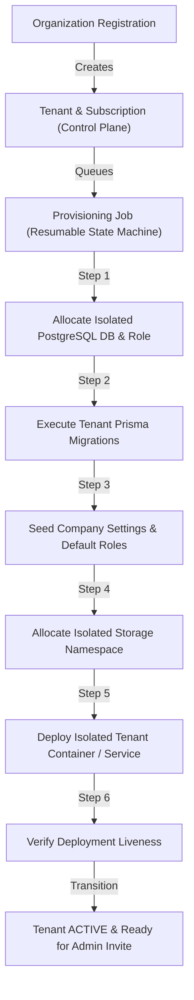
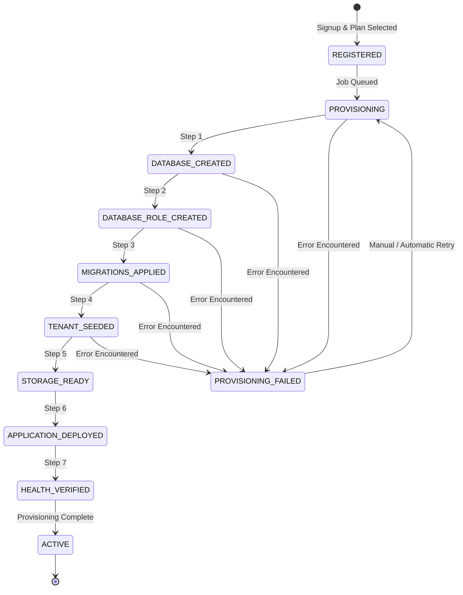

# ZemiFix SaaS Phase S2.1 Technical Design: Automated Tenant Provisioning Engine

**Date:** November 18, 2026  
**Project Directory:** `E:\HP\Downloads\remix-zemifix-cmms`  
**Reference Specification:** *ZemiFix SaaS Target Architecture Blueprint Final*  
**Scope:** Architecture and technical design for the ZemiFix Automated Tenant Provisioning Engine (Phase S2.1). Read-only design task; no implementation or infrastructure changes.

---

## 1. Executive Summary

The Automated Tenant Provisioning Engine is the core orchestration service responsible for automatically spinning up fully isolated ZemiFix enterprise workspaces upon successful customer organization subscription and registration. 

Adhering strictly to the core architectural decision (**One Legal Company per Deployment**), this engine provisions an isolated PostgreSQL database, creates a dedicated restricted database role, executes Prisma migrations using the tenant migration history only, seeds default company settings and operational roles, provisions isolated file storage namespaces, configures isolated application container deployments, and assigns dedicated subdomain workspace URLs (`{tenant}.zemifix.com`). Provisioning is designed as a resumable, idempotent state machine with robust error recovery and tamper-evident audit logging.

---

## 2. Existing Architecture Assessment

- **Single-Deployment Baseline:** The existing CMMS codebase operates as a single tenant per deployment.
- **Platform Control Plane (`zemifix_platform_dev`):** Established in Phase S1 with models for `PlatformUser`, `Tenant`, `TenantDeployment`, `SubscriptionPlan`, `Subscription`, and `PlatformAuditLog`.
- **Tenant Isolation Principle:** Preserves absolute data separation. No shared multi-tenant database tables exist within core CMMS modules.

---

## 3. Current Implementation Inventory

- **Platform Control Plane APIs (`/api/platform/*`):** Tenant registry CRUD, platform authentication, RBAC, and tamper-evident audit logging.
- **Tenant Database & Migrations:** 33 tenant migration folders located in `prisma/migrations/`.
- **Platform Schema:** Located in `prisma/platform/platform.prisma` with migrations in `prisma/platform/migrations/`.
- **Missing Components (To be designed):**
  - Asynchronous provisioning job worker queue.
  - PostgreSQL database and restricted role provisioning service.
  - Automated tenant migration runner.
  - Tenant seed execution service.
  - Storage namespace allocator.
  - DNS / subdomain routing configurator.

---

## 4. Proposed Provisioning Architecture

---

## 5. Component and Service Responsibilities

1. **Provisioning Orchestrator (`platformProvisioningService.ts`):** Manages the state machine, coordinates execution steps, and records step progression.
2. **PostgreSQL Provisioner (`postgresProvisioner.ts`):** Handles database creation, role generation, credential encryption, and privilege revocation.
3. **Migration Runner (`tenantMigrationRunner.ts`):** Programmatically executes `prisma migrate deploy` against target tenant databases using tenant migrations only (`prisma/migrations/`).
4. **Tenant Seeder (`tenantSeeder.ts`):** Populates baseline company metadata, operating modes, and system roles.
5. **Storage Allocator (`storageProvisioner.ts`):** Allocates local directories (dev) or S3 object prefixes (production).
6. **Domain & Routing Agent (`dnsProvisioner.ts`):** Manages subdomain binding and reverse proxy routing discovery.

---

## 6. Provisioning Lifecycle & State Machine

Provisioning is modeled as a resumable, durable state machine tracked via `ProvisioningJob` and `ProvisioningStep` entities:

- **Idempotency & Retry Logic:** When a job is retried, the execution engine inspects completed steps and resumes from the first incomplete step without duplicating databases, roles, or storage buckets.

---

## 7. Database and Role Isolation Design

- **Database Naming:** `zemifix_tenant_{slug}` (e.g., `zemifix_tenant_hospital_a`).
- **Restricted Role:** `tenant_role_{slug}` with a high-entropy password generated via `crypto.randomBytes(32).toString('hex')`.
- **Privilege Boundaries:**
  - Revoke default public connection privileges: `REVOKE CONNECT ON DATABASE zemifix_tenant_{slug} FROM PUBLIC;`
  - Grant connection exclusively to tenant role: `GRANT CONNECT ON DATABASE zemifix_tenant_{slug} TO tenant_role_{slug};`
  - Grant schema ownership/privileges exclusively on `public` schema.
- **Secrets Management:** Credentials encrypted via AES-256-GCM using `PLATFORM_ENCRYPTION_KEY` and stored in `TenantDeployment`.

---

## 8. Migration and Seeding Design

- **Migrations:** Uses the tenant migration folder (`prisma/migrations/`) exclusively. Never touches platform migrations.
- **Seeding:** Initializes the tenant's `Company` record with the registered organization name, operating modes (`facility`, `contractor`), base currency, timezone, and upserts baseline system roles and permissions (`Admin`, `Manager`, `Technician`, etc.).

---

## 9. Storage Architecture

- **Development:** Local directory isolation (`storage/tenants/{slug}/`).
- **Production:** S3-compatible object storage buckets with tenant-specific object key prefixes (`s3://zemifix-tenants-{region}/{slug}/`).
- **Security:** Strict IAM policy enforcement ensuring tenant containers can only read/write within their dedicated namespace.

---

## 10. Deployment & Domain Architecture

- **Subdomain Routing:** `{slug}.zemifix.com`.
- **Gateway:** Reverse proxy (Nginx / Traefik / Cloudflare) inspecting `Host` headers and routing traffic to the tenant's dedicated container deployment.

---

## 11. Secrets Management

- All database passwords, encryption keys, and integration secrets are encrypted at rest using AES-256-GCM (`PLATFORM_ENCRYPTION_KEY`).
- Plaintext secrets are strictly excluded from logging pipelines (`[REDACTED]`).

---

## 12. Failure Recovery & Idempotency

- **No Automatic Destruction:** Failed provisioning attempts never automatically drop databases or storage volumes, preserving state for diagnostic investigation and safe retry.
- **Explicit Cleanup Override:** Destructive deletion requires explicit platform admin authorization, multi-factor confirmation, and audit logging.

---

## 13. Proposed Platform Schema Additions (`prisma/platform/platform.prisma`)

To support asynchronous job orchestration:
1. **`ProvisioningJob`**: Tracks tenant ID, status (`PENDING`, `IN_PROGRESS`, `COMPLETED`, `FAILED`), current step, retry count, and error message.
2. **`ProvisioningStep`**: Granular tracking of each step (`DB_CREATION`, `ROLE_CREATION`, `MIGRATION`, `SEEDING`, `STORAGE`, `DEPLOYMENT`, `HEALTH_CHECK`), status, and timestamp.

---

## 14. API & Worker Design

- Background worker polling `ProvisioningJob` queue or triggered via internal event hooks, executing steps sequentially with exponential backoff on transient errors.

---

## 15. Security Threat Assessment

- **Cross-Tenant Access:** Mitigated by strict database-level role isolation and isolated container boundaries.
- **SQL Injection / Identifier Abuse:** Mitigated by strict regex validation of tenant slugs (`/^[a-z0-9-]+$/`) and parameterized query execution for DDL operations where supported.

---

## 16. Testing Strategy

- Unit tests for provisioning state machine transitions and retry logic.
- Integration tests verifying isolated database creation, restricted role permissions, and tenant migration execution against temporary test PostgreSQL instances.

---

## 17. Infrastructure Decisions Requiring Approval

1. **Hosting Provider:** Selection of container orchestration platform (e.g., AWS ECS, Render, or Docker Swarm). *Recommendation for S2:* Docker Compose / ECS namespaces for first commercial release.
2. **Managed PostgreSQL Cluster:** Selection of cloud managed PostgreSQL provider (e.g., AWS RDS / Supabase / Neon). *Recommendation for S2:* Managed single PostgreSQL cluster with isolated tenant database roles.
3. **Cloudflare DNS Automation:** Approval for automated API-driven DNS CNAME record creation for tenant subdomains.

---

## 18. Recommended Implementation Sequence (S2.2 Onward)

- **Phase S2.2:** Platform schema additions (`ProvisioningJob`, `ProvisioningStep`).
- **Phase S2.3:** PostgreSQL Provisioner & Restricted Role service implementation.
- **Phase S2.4:** Tenant Migration Runner & Seeder integration.
- **Phase S2.5:** Provisioning Worker State Machine & Retry Orchestration.
