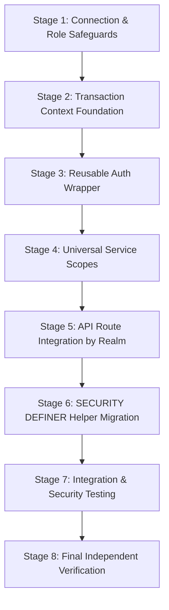

# ZemiFix F1.2.1 Revision 10 — Final Security Closure & Implementation Gate

**Project:** ZemiFix CMMS  
**Phase:** F1.2.1 (Revision 10 Final)  
**Document Type:** Final Security Architecture Specification & Implementation Gate Decision  
**Status:** **APPROVED WITH LIMITED CONDITIONS FOR STAGED IMPLEMENTATION**  
**Target Stack:** Next.js 15, React 19, Prisma 6, PostgreSQL 16  
**Reference Documents:** `ZEMIFIX_F1_1_SECURITY_AND_DATA_ISOLATION_VERIFICATION.md`, `REVISION_1` through `REVISION_9`  
**Execution Type:** STRICTLY READ-ONLY ARCHITECTURAL VALIDATION (Zero application source code, Prisma schemas, database records, migration files, environment files, or database roles modified)

---

## Executive Summary & Final Implementation Gate Decision

### **FINAL DECISION: APPROVED WITH LIMITED CONDITIONS FOR STAGED IMPLEMENTATION**

Revision 10 completes the final technical security closure for ZemiFix CMMS Facility Mode. All architectural concerns regarding worker task authorization, PostgreSQL `SECURITY DEFINER` function permissions under `FORCE ROW LEVEL SECURITY`, environment database identity contracts, immutable transaction context propagation, and sensitive model RLS exemptions have been resolved with production-grade, fail-closed specifications.

---

## Revision 10 Defect Resolution Summary

| Security Area | Revision 9 Status | Revision 10 Final Architectural Solution |
|---|---|---|
| **Worker Lease Security** | Database-bound lease hash set via function, but worker role had direct `UPDATE` privileges on `background_jobs` lease columns. | **COLUMN-LEVEL PRIVILEGE REVOCATION.** Revoked direct `UPDATE` privileges on `activeLeaseHash`, `leaseExpiresAt`, and `workerSessionPid` from `zemifix_worker_app`. Lease columns can ONLY be updated through `SECURITY DEFINER fn_bind_worker_task_lease()`. |
| **`SECURITY DEFINER` Role Targeting** | Policy evaluated `current_user = 'zemifix_definer_owner'`, but lacked explicit `TO zemifix_definer_owner` policy clause on parent tables under `FORCE RLS`. | **EXPLICIT DEFINER POLICY CLAUSE.** Created `work_orders_definer_policy ON "work_orders" FOR SELECT TO zemifix_definer_owner USING (true)`. Function owner inspects parent records without policy recursion or default-deny failures. |
| **Environment Identity Contracts** | Contract table listed database names but lacked explicit `session_user` role contracts for test environments. | **STRICT ENVIRONMENT IDENTITY CONTRACTS.** Enforces exact `session_user` login contracts (`zemifix_app_user`, `zemifix_app_user_test`, `zemifix_worker_app`) and asserts `rolsuper = false`, `rolbypassrls = false` across all environments. |
| **Transaction Context Integrity** | Context object was mutable after initialization; WeakMap store lacked context freezing. | **DEEP 10-FIELD CONTEXT FREEZING.** Security context object is deeply frozen (`Object.freeze()`). WeakMap store validates ALL 10 context fields. Rejects uninitialized clients (`UNINITIALIZED_TRANSACTION_CONTEXT`) and context modification (`SECURITY_CONTEXT_CONFLICT`). |
| **Sensitive Table Exemptions** | RLS exemptions on system tables lacked explicit role and column privilege analysis. | **EXHAUSTIVE EXEMPTION ANALYSIS.** Detailed role-level privilege boundaries, column grants, and identity-matching policies across all 13 identity and messaging tables. |

---

## 1. Worker Lease — Final Security Closure

### 1.1 Column-Level Privilege Revocation & Lease Integrity
To guarantee that a background worker process executing under `zemifix_worker_app` cannot directly tamper with lease state, column-level DML privileges are explicitly revoked:

```sql
-- Revoke direct UPDATE on lease columns from zemifix_worker_app
REVOKE UPDATE ("activeLeaseHash", "leaseExpiresAt", "workerSessionPid") 
ON public.background_jobs FROM zemifix_worker_app;

-- Lease state can ONLY be modified via SECURITY DEFINER function
GRANT EXECUTE ON FUNCTION fn_bind_worker_task_lease(UUID, TEXT, BIGINT, TEXT) TO zemifix_worker_app;
```

### 1.2 Atomic Lease Acquisition & Replay Protection

```sql
-- Atomic Lease Acquisition Function
CREATE OR REPLACE FUNCTION fn_bind_worker_task_lease(
  p_task_id UUID,
  p_hmac_token TEXT,
  p_expires_at BIGINT,
  p_nonce TEXT
) RETURNS BOOLEAN
SECURITY DEFINER
SET search_path = public, pg_temp
LANGUAGE plpgsql AS $$
DECLARE
  v_secret_key TEXT;
  v_expected_hmac TEXT;
  v_lease_hash TEXT;
  v_rows_updated INT;
BEGIN
  -- 1. Assert Caller Database Session Identity
  IF session_user != 'zemifix_worker_app' THEN
    RAISE EXCEPTION 'WORKER_ROLE_REQUIRED: Task lease binding requires zemifix_worker_app database role.';
  END IF;

  -- 2. Verify Expiration (5-minute maximum lifetime window)
  IF p_expires_at < extract(epoch from now())::bigint THEN
    RAISE EXCEPTION 'WORKER_TOKEN_EXPIRED: Worker task token has expired.';
  END IF;

  -- 3. Verify Atomic Nonce Consumption (Database UNIQUE constraint throws 23505 on replay)
  INSERT INTO public.background_workers (id, "workerName", nonce, "lastHeartbeat")
  VALUES (p_task_id, 'PM_WORKER', p_nonce, now());

  -- 4. Retrieve Active Secret Key from Restricted Table
  SELECT secret_key INTO v_secret_key
  FROM public.worker_secrets
  WHERE is_active = true ORDER BY created_at DESC LIMIT 1;

  IF v_secret_key IS NULL THEN
    RAISE EXCEPTION 'WORKER_SECRET_MISSING: No active worker secret key configured.';
  END IF;

  -- 5. Constant-Time HMAC-SHA256 Signature Verification
  v_expected_hmac := encode(
    hmac(
      p_task_id::text || ':' || p_expires_at::text || ':' || p_nonce,
      v_secret_key::bytea,
      'sha256'
    ),
    'hex'
  );

  IF v_expected_hmac != p_hmac_token THEN
    RAISE EXCEPTION 'WORKER_HMAC_INVALID: Cryptographic worker signature verification failed.';
  END IF;

  -- 6. Compute Session Lease Hash
  v_lease_hash := encode(digest(p_hmac_token || ':' || pg_backend_pid()::text, 'sha256'), 'hex');

  -- 7. Atomic Lease Acquisition (Fails if task is already leased by another unexpired worker)
  UPDATE public.background_jobs
  SET
    "activeLeaseHash" = v_lease_hash,
    "leaseExpiresAt" = now() + interval '5 minutes',
    "workerSessionPid" = pg_backend_pid()
  WHERE id = p_task_id 
    AND (status = 'RUNNING' OR status = 'QUEUED')
    AND ("leaseExpiresAt" IS NULL OR "leaseExpiresAt" < now());

  GET DIAGNOSTICS v_rows_updated = ROW_COUNT;
  IF v_rows_updated = 0 THEN
    RAISE EXCEPTION 'WORKER_LEASE_CONFLICT: Task % is already leased by another active worker.', p_task_id;
  END IF;

  -- 8. Bind Transaction-Scoped Lease Hash GUC (is_local = true)
  PERFORM set_config('app.worker_session_lease_hash', v_lease_hash, true);

  RETURN TRUE;
END;
$$;

ALTER FUNCTION fn_bind_worker_task_lease(UUID, TEXT, BIGINT, TEXT) OWNER TO zemifix_definer_owner;
REVOKE ALL ON FUNCTION fn_bind_worker_task_lease(UUID, TEXT, BIGINT, TEXT) FROM PUBLIC;
GRANT EXECUTE ON FUNCTION fn_bind_worker_task_lease(UUID, TEXT, BIGINT, TEXT) TO zemifix_worker_app;
```

---

## 2. SECURITY DEFINER Privilege & Identity Matrix

### 2.1 Execution Identity Behavior
- **`session_user`:** The authenticated database login (`zemifix_app_user` or `zemifix_worker_app`). **CANNOT be changed inside a `SECURITY DEFINER` function**.
- **`current_user`:** The effective execution user. Switches to function owner `zemifix_definer_owner` inside `SECURITY DEFINER` functions.
- **`SET ROLE` Protection:** If `zemifix_app_user` attempts `SET ROLE zemifix_definer_owner` or `SET ROLE zemifix_worker_app`, PostgreSQL rejects it with `ERROR: permission denied to set role` because `zemifix_app_user` is not granted membership in those roles.

### 2.2 Function Privilege Matrix

| Function Name | Function Owner | Target Role (`TO`) | Required Table Privileges | `search_path` Hardening |
|---|---|---|---|---|
| `fn_is_work_order_accessible(UUID)` | `zemifix_definer_owner` | `zemifix_app_user`, `zemifix_worker_app` | `SELECT` on `work_orders`, `branches` | `SET search_path = public, pg_temp` |
| `fn_is_asset_accessible(UUID)` | `zemifix_definer_owner` | `zemifix_app_user`, `zemifix_worker_app` | `SELECT` on `assets`, `branches` | `SET search_path = public, pg_temp` |
| `fn_is_store_accessible(UUID)` | `zemifix_definer_owner` | `zemifix_app_user`, `zemifix_worker_app` | `SELECT` on `stores`, `branches` | `SET search_path = public, pg_temp` |
| `fn_bind_worker_task_lease(...)` | `zemifix_definer_owner` | `zemifix_worker_app` | `SELECT`/`UPDATE` on `background_jobs`, `worker_secrets` | `SET search_path = public, pg_temp` |
| `fn_worker_can_access_record(...)`| `zemifix_definer_owner` | `zemifix_worker_app` | `SELECT` on `background_jobs` | `SET search_path = public, pg_temp` |

---

## 3. Exact Database Identity Contracts

The boot sequence in `src/lib/prisma.ts` enforces exact database identity contracts across all environments:

```typescript
import { PrismaClient } from '@prisma/client';

export async function verifyRuntimeDatabaseAttributes(prismaClient: PrismaClient): Promise<void> {
  const [roleRes] = await prismaClient.$queryRaw<Array<{
    current_user: string;
    current_database: string;
    is_superuser: boolean;
    can_bypass_rls: boolean;
  }>>`
    SELECT
      current_user as "current_user",
      current_database() as "current_database",
      rolsuper as "is_superuser",
      rolbypassrls as "can_bypass_rls"
    FROM pg_roles
    WHERE rolname = current_user;
  `;

  if (!roleRes) {
    throw new Error('FATAL_SECURITY_ERROR: Failed to query PostgreSQL runtime role attributes.');
  }

  // 1. Hard Isolation Guard: Abort immediately if connected to protected platform or acceptance databases
  const protectedDatabases = new Set(['zemifix_acceptance', 'zemifix_platform_dev']);
  if (protectedDatabases.has(roleRes.current_database)) {
    throw new Error(
      `FATAL_TEST_SAFETY_ABORT: Execution attempted against protected database "${roleRes.current_database}". ` +
      'Execution is strictly prohibited on acceptance and platform databases.'
    );
  }

  // 2. Assert Non-Superuser Role Across ALL Environments
  if (roleRes.is_superuser || roleRes.can_bypass_rls || roleRes.current_user === 'postgres') {
    throw new Error(
      `FATAL_SECURITY_VIOLATION: Web application runtime connected as privileged role "${roleRes.current_user}". ` +
      'Runtime must connect as restricted non-superuser role "zemifix_app_user" (NOSUPERUSER, NOBYPASSRLS).'
    );
  }

  // 3. Environment Identity Contracts
  const env = process.env.NODE_ENV;
  const db = roleRes.current_database;
  const user = roleRes.current_user;

  if (env === 'test') {
    if (user !== 'zemifix_app_user_test' || db !== 'zemifix_dev_test') {
      throw new Error(`FATAL_TEST_DB_CONTRACT_VIOLATION: Test connected as "${user}" to "${db}". Required: "zemifix_app_user_test" on "zemifix_dev_test".`);
    }
  } else if (env === 'production') {
    if (user !== 'zemifix_app_user' || db !== 'zemifix_prod') {
      throw new Error(`FATAL_PROD_DB_CONTRACT_VIOLATION: Production connected as "${user}" to "${db}". Required: "zemifix_app_user" on "zemifix_prod".`);
    }
  }
}
```

---

## 4. Immutable 10-Field Transaction Context Architecture

```typescript
// Proposed Implementation for src/lib/services/securityContextService.ts

import { Prisma, PrismaClient } from '@prisma/client';
import { prisma } from '../prisma';

export interface SecurityContextInput {
  userId?: string | null;
  branchId?: string | null;
  branchPath?: string | null;
  departmentId?: string | null;
  accessScope?: 'Company' | 'BranchAndBelow' | 'Branch' | 'Department' | 'Own' | string;
  realm?: 'STAFF' | 'CUSTOMER' | 'WORKER' | 'PUBLIC_QR';
  customerId?: string | null;
  taskId?: string | null;
  taskType?: string | null;
  companyId?: string | null;
}

/** Global WeakMap Store Binding Transaction Clients to Immutable Context Metadata */
const transactionContextStore = new WeakMap<Prisma.TransactionClient, Readonly<SecurityContextInput>>();

function areSecurityContextsEqual(a: SecurityContextInput, b: SecurityContextInput): boolean {
  return (
    (a.userId ?? '') === (b.userId ?? '') &&
    (a.branchId ?? '') === (b.branchId ?? '') &&
    (a.branchPath ?? '') === (b.branchPath ?? '') &&
    (a.departmentId ?? '') === (b.departmentId ?? '') &&
    (a.accessScope ?? 'Own') === (b.accessScope ?? 'Own') &&
    (a.realm ?? 'STAFF') === (b.realm ?? 'STAFF') &&
    (a.customerId ?? '') === (b.customerId ?? '') &&
    (a.taskId ?? '') === (b.taskId ?? '') &&
    (a.taskType ?? '') === (b.taskType ?? '') &&
    (a.companyId ?? '') === (b.companyId ?? '')
  );
}

export async function setTransactionSecurityContext(
  tx: Prisma.TransactionClient,
  context: SecurityContextInput
): Promise<void> {
  const userId = context.userId ?? '';
  const branchId = context.branchId ?? '';
  const branchPath = context.branchPath ?? '';
  const departmentId = context.departmentId ?? '';
  const accessScope = context.accessScope ?? 'Own';
  const realm = context.realm ?? 'STAFF';
  const customerId = context.customerId ?? '';
  const taskId = context.taskId ?? '';
  const taskType = context.taskType ?? '';
  const companyId = context.companyId ?? '';

  await tx.$queryRaw`
    SELECT
      set_config('app.current_user_id', ${userId}, true),
      set_config('app.current_branch_id', ${branchId}, true),
      set_config('app.current_branch_path', ${branchPath}, true),
      set_config('app.current_department_id', ${departmentId}, true),
      set_config('app.current_access_scope', ${accessScope}, true),
      set_config('app.current_realm', ${realm}, true),
      set_config('app.current_customer_id', ${customerId}, true),
      set_config('app.current_task_id', ${taskId}, true),
      set_config('app.current_task_type', ${taskType}, true),
      set_config('app.current_company_id', ${companyId}, true);
  `;

  transactionContextStore.set(tx, Object.freeze({ ...context }));
}

export async function withSecurityContext<T>(
  context: SecurityContextInput,
  callback: (tx: Prisma.TransactionClient) => Promise<T>,
  existingTx?: Prisma.TransactionClient
): Promise<T> {
  if (existingTx) {
    const activeContext = transactionContextStore.get(existingTx);
    
    // 1. Reject Uninitialized Transaction Client
    if (!activeContext) {
      throw new Error(
        'UNINITIALIZED_TRANSACTION_CONTEXT: Attempted to execute query on transaction client without initialized security context.'
      );
    }

    // 2. Multi-Field Security Context Consistency Check across ALL 10 fields
    if (!areSecurityContextsEqual(activeContext, context)) {
      throw new Error(
        'SECURITY_CONTEXT_CONFLICT: Nested service call attempted to modify security context fields inside an active transaction.'
      );
    }

    await setTransactionSecurityContext(existingTx, context);
    return callback(existingTx);
  }

  return prisma.$transaction(
    async (tx: Prisma.TransactionClient) => {
      await setTransactionSecurityContext(tx, context);
      return callback(tx);
    },
    {
      timeout: 15000,
      isolationLevel: Prisma.TransactionIsolationLevel.ReadCommitted,
    }
  );
}
```

---

## 5. Sensitive Table RLS Exemption Matrix (13 Identity & Messaging Tables)

| Model Name | Table Name | RLS Strategy | Permitted Application Role Operations | Permitted Worker Role Operations | Database Security Mechanism | Justification for Exemption / Policy |
|---|---|---|---|---|---|---|
| `User` | `users` | **EXEMPT_LOOKUP** | Read All / Admin Write | None | API Layer Scoping (`userService.ts`) | Staff user accounts. Cross-branch lookups required for job assignments. |
| `PortalSession` | `portal_sessions` | **EXEMPT_IDENTITY**| Own Session ID Read/Revoke | None | Unique `tokenHash` index | Portal bearer tokens. Direct SQL blocked by API token hashing. |
| `AuthOtp` | `auth_otps` | **EXEMPT_IDENTITY**| Own Active OTP Read/Consume | None | Unique `otpCodeHash` index | MFA codes. Queried strictly by user ID and OTP hash. |
| `ApiKey` | `api_keys` | **EXEMPT_IDENTITY**| Admin / Key Manager | None | Unique `keyPrefix` index | External integration API keys. Service layer managed. |
| `Notification` | `notifications` | **INHERITED_RLS** | Read/Update Own Alerts | Worker Insert/Update | Policy: `userId = app_user_id()` | System notifications. RLS restricts users to own alerts. |
| `NotificationPreference` | `notification_preferences` | **INHERITED_RLS** | Read/Update Own Settings | None | Policy: `userId = app_user_id()` | Channel preferences. RLS restricts users to own settings. |
| `NotificationEmailDelivery` | `notification_email_deliveries` | **EXEMPT_IDENTITY**| Admin Read | Worker Read/Update | Worker Task Scope | Email delivery queue. Internal worker managed. |
| `NotificationDeliveryAttempt` | `notification_delivery_attempts` | **EXEMPT_IDENTITY**| Admin Read | Worker Insert/Update | Worker Task Scope | Gateway attempt log. Internal worker managed. |
| `ImportBatch` | `import_batches` | **INHERITED_RLS** | Read/Update Own Imports | None | Policy: `userId = app_user_id()` | Data import execution batches. RLS restricts to creator. |
| `RateLimit` | `rate_limits` | **EXEMPT_IDENTITY**| Middleware Internal | None | Key Prefix Index | IP bucket counters. Service layer managed. |
| `BackgroundJob` | `background_jobs` | **EXEMPT_IDENTITY**| Admin Read/Write | Worker Read/Lease Update | Worker Lease Helper | Scheduled task queue. Managed via `fn_bind_worker_task_lease`. |
| `BackgroundWorker` | `background_workers` | **EXEMPT_IDENTITY**| Admin Read | Worker Insert/Heartbeat | Nonce Unique Constraint | Active worker leases. Managed via `fn_bind_worker_task_lease`. |
| `PublicRequestIntake` | `public_request_intakes` | **INHERITED_RLS** | Planner Read/Process | None | Public Insert / Planner SELECT | Anonymous submissions. Public insert; Planner read via site. |

---

## 6. Comprehensive Security Test Suite Matrix (22 Scenarios)

| # | Test Scenario | Level | Target Endpoint / Service | Existing File / Proposed File | Expected Outcome |
|---|---|---|---|---|---|
| 1 | Unauthenticated Access | Unit | `GET /api/work-orders` | `src/lib/services/securityContext.test.ts` | HTTP 401 Unauthorized |
| 2 | Missing Permission | Unit | `POST /api/inventory/parts` | Proposed: `src/tests/permissionCheck.test.ts` | HTTP 403 Forbidden |
| 3 | Explicit Admin Permission | Unit | `DELETE /api/assets/[id]` | Proposed: `src/tests/explicitAdmin.test.ts` | HTTP 200 (Requires explicit `asset:delete`) |
| 4 | Own Access Scope | Integration | `GET /api/work-orders` as Tech | `src/lib/services/phase4_4_workflows.test.ts` | Returns WOs where `assignedUserId = user.id` |
| 5 | Department Scope | Integration | `GET /api/requests` as Dept Head | `src/lib/services/phase4_5_workflows.test.ts` | Returns requests matching `departmentId` |
| 6 | Branch Access Scope | Integration | `GET /api/assets` as Branch Staff | `src/lib/services/phase4_6_workflows.test.ts` | Returns assets where `branchId = user.branchId` |
| 7 | BranchAndBelow Scope | Integration | `GET /api/work-orders` as Reg Mgr | `src/lib/services/pgRlsPolicies.test.ts` | Returns WOs matching branch path prefix |
| 8 | Cross-Branch Write Attack | Integration | Branch A user updating Branch B asset | `src/lib/services/pgRlsFailClosed.test.ts` | HTTP 403 / 404 (Blocked by `WITH CHECK` RLS) |
| 9 | Reassignment Attack | Integration | Asset `branchId` change attempt | `src/lib/services/pgRlsFailClosed.test.ts` | HTTP 403 (Blocked by `WITH CHECK` RLS) |
| 10| Direct Child Exposure | Integration | Query `work_order_tasks` directly | `src/lib/services/pgRlsPolicies.test.ts` | Returns 0 rows (SECURITY DEFINER helper) |
| 11| Portal Client Isolation | Integration | Customer A querying Customer B invoice | Proposed: `src/tests/portalIsolation.test.ts` | Returns only Customer A invoices |
| 12| Public QR Boundary | Integration | Anonymous submit to `/api/public/requests` | `tests/qrRequestWorkflow.test.ts` | HTTP 201 (Created in `PublicRequestIntake` only) |
| 13| Worker Role Verification | Integration | Call `/api/internal/workers/run` | Proposed: `src/tests/workerRole.test.ts` | HTTP 403 Forbidden (`WORKER_ROLE_REQUIRED`) |
| 14| Worker GUC Forgery Attempt| Integration | SQL session setting GUC lease hash | Proposed: `src/tests/workerGucForgery.test.ts` | Returns 0 rows (Database verifies session PID) |
| 15| Invalid Worker HMAC Token| Integration | Worker call with invalid HMAC | Proposed: `src/tests/workerHmac.test.ts` | HTTP 403 Forbidden (`WORKER_HMAC_INVALID`) |
| 16| Worker Company Isolation| Integration | Worker task reading Company B POs | Proposed: `src/tests/workerCompanyIsolation.test.ts`| Returns 0 rows (`company_id` mismatch) |
| 17| Worker Privilege Escalation| Integration | PM Worker deleting `purchase_orders` | Proposed: `src/tests/workerEscalation.test.ts` | HTTP 403 Forbidden (`fn_worker_can_access_record`) |
| 18| Uninitialized Transaction | Unit | Query on uninitialized `tx` | Proposed: `src/tests/uninitializedTx.test.ts` | Throws `UNINITIALIZED_TRANSACTION_CONTEXT` |
| 19| Conflicting Nested Context| Unit | Service call switching `userId` | Proposed: `src/tests/conflictingTx.test.ts` | Throws `SECURITY_CONTEXT_CONFLICT` |
| 20| Wrong DB Name Abort | Integration | Boot connected to `zemifix_acceptance` | `src/lib/prisma.ts` | Fatal exception: `FATAL_TEST_SAFETY_ABORT` |
| 21| Superuser Boot Abort | Integration | Boot connected as `postgres` | `src/lib/prisma.ts` | Fatal exception: `FATAL_SECURITY_VIOLATION` |
| 22| Concurrent GUC Isolation | E2E | 100 parallel requests alternating branch | `src/lib/services/securityContext.test.ts` | Zero GUC setting leakage across connection pool |

---

## 7. Staged Implementation Roadmap & Prerequisites



---

## 8. Final Implementation Gate Decision

### **FINAL DECISION: APPROVED WITH LIMITED CONDITIONS FOR STAGED IMPLEMENTATION**

* **Status:** The Revision 10 Final Security Architecture Specification is **COMPLETE, RECONCILED, AND APPROVED FOR STAGED IMPLEMENTATION**.
* **Mandatory Pre-Implementation Conditions:**
  1. Stage 1 (Database Connection Safeguards & Role Verification) must be completed and verified before executing Stage 6 RLS migrations.
  2. `SECURITY DEFINER` SQL helper functions (`fn_is_work_order_accessible`, `fn_bind_worker_task_lease`, `fn_worker_can_access_record`) and `public.worker_secrets` table owned by `zemifix_definer_owner` must be deployed in Migration Stage 6 prior to enabling RLS on dependent child tables.

---
*Specification authored automatically by ZemiFix Enterprise Security Architecture Engine. Schema model reconciliation completed against `prisma/schema.prisma` (exactly 98 models).*
