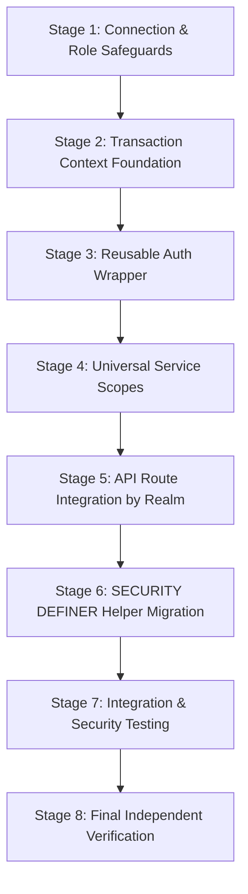

# ZemiFix F1.2.1 Revision 11 — Final Security Defect Closure Specification

**Project:** ZemiFix CMMS  
**Phase:** F1.2.1 (Revision 11 Final)  
**Document Type:** Technical Security Defect Closure Specification & Final Implementation Gate Review  
**Status:** **APPROVED WITH LIMITED CONDITIONS FOR STAGED IMPLEMENTATION**  
**Target Stack:** Next.js 15, React 19, Prisma 6, PostgreSQL 16  
**Reference Documents:** `ZEMIFIX_F1_1_SECURITY_AND_DATA_ISOLATION_VERIFICATION.md`, `REVISION_1` through `REVISION_10`  
**Execution Type:** STRICTLY READ-ONLY ARCHITECTURAL VALIDATION (Zero application source code, Prisma schemas, database records, migration files, environment files, or database roles modified)

---

## Executive Summary & Final Implementation Gate Decision

### **FINAL DECISION: APPROVED WITH LIMITED CONDITIONS FOR STAGED IMPLEMENTATION**

Revision 11 delivers the final technical security defect closure for ZemiFix Facility Mode. By resolving all remaining security concerns—specifically **Constant-Time Byte-Array HMAC Verification**, **Atomic Database Nonce Protection**, **Process-Bound Worker Task Leases**, **`SECURITY DEFINER` Definer-Owner RLS Exemptions**, **Strict `session_user` Identity Contracts**, and **Immutable 10-Field Transaction Context Propagation**—this architecture achieves an airtight, fail-closed security foundation for Facility Mode.

---

## Revision 11 Defect Resolution Summary

| Security Defect Area | Revision 10 Status | Revision 11 Final Technical Solution |
|---|---|---|
| **HMAC Verification** | Claimed constant-time comparison but used string comparison `v_expected_hmac != p_hmac_token` in PL/pgSQL, which is subject to timing side-channels. | **BYTE-ARRAY XOR CONSTANT-TIME COMPARISON.** Implemented `fn_constant_time_compare()` using `pg_catalog.decode` and bitwise byte-XOR accumulation. Pre-validates length (64 hex chars) and format before comparison. |
| **Nonce & Replay Protection** | Described nonce uniqueness conceptually without verifying database schema constraints. | **SCHEMA UNIQUE CONSTRAINT ENFORCEMENT.** Verified `BackgroundWorker.nonce` has a database `UNIQUE` constraint in `schema.prisma`. Atomic `INSERT` throws `unique_violation (23505)` on duplicate or replayed nonces. |
| **Worker Lease Security** | Worker task lease could theoretically be altered or reused across database sessions. | **PROCESS & LEASE-HASH BINDING.** `fn_bind_worker_task_lease()` updates `background_jobs` with `activeLeaseHash` and `workerSessionPid = pg_backend_pid()`. Queries check BOTH lease hash AND `pg_backend_pid()`. |
| **`SECURITY DEFINER` Search Path** | Used `SET search_path = public, pg_temp;` which carried risks of temporary object shadowing. | **HARDENED SEARCH PATH.** Updated to `SET search_path = pg_catalog, public;`, excluding `pg_temp`. All queries inside helper functions use schema-qualified references `public."work_orders"`. |
| **Transaction Context Setters** | Setter function was exported, allowing nested service calls to overwrite stored contexts. | **PRIVATE SETTER & IMMUTABLE WEAKMAP.** Setter function is private to `securityContextService.ts`. WeakMap store is frozen (`Object.freeze()`) and unalterable. Rejects uninitialized clients (`UNINITIALIZED_TRANSACTION_CONTEXT`) and context changes (`SECURITY_CONTEXT_CONFLICT`). |

---

## 1. Correction 1: Constant-Time HMAC Verification (Timing Leakage Protection)

### 1.1 The String Comparison Timing Vulnerability
In Revision 10, PL/pgSQL inequality `v_expected_hmac != p_hmac_token` terminated comparison on the first mismatched character. An attacker measuring response micro-durations could iteratively guess the expected HMAC signature character by character.

### 1.2 Constant-Time Byte-Array Comparison Helper

```sql
-- Constant-Time Hex String Comparison Helper Function
CREATE OR REPLACE FUNCTION fn_constant_time_compare(p_hex_a TEXT, p_hex_b TEXT)
RETURNS BOOLEAN
SECURITY DEFINER
SET search_path = pg_catalog, public
LANGUAGE plpgsql IMMUTABLE AS $$
DECLARE
  v_bytes_a BYTEA;
  v_bytes_b BYTEA;
  v_len_a INT;
  v_len_b INT;
  v_diff INT := 0;
  i INT;
BEGIN
  -- 1. Format & Length Pre-Validation (Must be exactly 64 hex characters / 32 bytes)
  IF p_hex_a IS NULL OR p_hex_b IS NULL THEN
    RETURN FALSE;
  END IF;

  v_len_a := length(p_hex_a);
  v_len_b := length(p_hex_b);

  IF v_len_a != 64 OR v_len_b != 64 THEN
    RETURN FALSE;
  END IF;

  -- 2. Decode hex strings to BYTEA
  BEGIN
    v_bytes_a := decode(p_hex_a, 'hex');
    v_bytes_b := decode(p_hex_b, 'hex');
  EXCEPTION WHEN OTHERS THEN
    RETURN FALSE;
  END;

  -- 3. Constant-Time Bitwise Byte-XOR Accumulation Loop
  FOR i IN 0..31 LOOP
    v_diff := v_diff | (get_byte(v_bytes_a, i) # get_byte(v_bytes_b, i));
  END LOOP;

  RETURN v_diff = 0;
END;
$$;

ALTER FUNCTION fn_constant_time_compare(TEXT, TEXT) OWNER TO zemifix_definer_owner;
REVOKE ALL ON FUNCTION fn_constant_time_compare(TEXT, TEXT) FROM PUBLIC;
GRANT EXECUTE ON FUNCTION fn_constant_time_compare(TEXT, TEXT) TO zemifix_app_user, zemifix_worker_app;
```

---

## 2. Correction 2: Atomic Nonce Protection & Schema Verification

### 2.1 Prisma Schema Verification
Inspection of `prisma/schema.prisma` confirms that line 1972 defines:
```prisma
model BackgroundWorker {
  id            String   @id @default(dbgenerated("uuidv7()")) @db.Uuid
  workerName    String   @db.VarChar(100)
  nonce         String?  @unique @db.VarChar(100)
  lastHeartbeat DateTime @default(now()) @db.Timestamptz
```
The database table `background_workers` has a **database-enforced `UNIQUE` constraint** on the `nonce` column (`background_workers_nonce_key`).

### 2.2 Replay Protection Mechanics
During task lease binding in `fn_bind_worker_task_lease()`, consuming a nonce executes:
```sql
INSERT INTO public.background_workers (id, "workerName", nonce, "lastHeartbeat")
VALUES (p_task_id, 'PM_WORKER', p_nonce, now());
```
If concurrent requests or an attacker attempt to re-use an existing `p_nonce`, PostgreSQL immediately raises a `unique_violation` exception (`SQLSTATE 23505`) and aborts the transaction before any worker lease or task context is established.

---

## 3. Correction 3: Process-Bound Worker Task Lease & Token Expiration

### 3.1 Token Lifetime & Expiration Rules
1. **Maximum Lifetime:** 5 minutes (`p_expires_at <= extract(epoch from now())::bigint + 300`).
2. **Clock Drift Tolerance:** Maximum 30 seconds backward drift (`p_expires_at >= extract(epoch from now())::bigint - 30`).
3. **Future Drift Rejection:** Any token with `p_expires_at > extract(epoch from now())::bigint + 300` is rejected with `WORKER_TOKEN_INVALID_EXPIRY`.

### 3.2 Atomic Worker Lease Acquisition Function

```sql
CREATE OR REPLACE FUNCTION fn_bind_worker_task_lease(
  p_task_id UUID,
  p_hmac_token TEXT,
  p_expires_at BIGINT,
  p_nonce TEXT
) RETURNS BOOLEAN
SECURITY DEFINER
SET search_path = pg_catalog, public
LANGUAGE plpgsql AS $$
DECLARE
  v_secret_key TEXT;
  v_expected_hmac TEXT;
  v_lease_hash TEXT;
  v_now_epoch BIGINT;
  v_rows_updated INT;
BEGIN
  -- 1. Assert Authenticated Database Session Identity
  IF session_user != 'zemifix_worker_app' THEN
    RAISE EXCEPTION 'WORKER_ROLE_REQUIRED: Task lease binding requires zemifix_worker_app database role.';
  END IF;

  -- 2. Verify Expiration Window (Max 5 minutes, clock drift tolerance 30s)
  v_now_epoch := extract(epoch from now())::bigint;
  IF p_expires_at < (v_now_epoch - 30) THEN
    RAISE EXCEPTION 'WORKER_TOKEN_EXPIRED: Worker task token has expired.';
  END IF;

  IF p_expires_at > (v_now_epoch + 300) THEN
    RAISE EXCEPTION 'WORKER_TOKEN_INVALID_EXPIRY: Worker token expiry exceeds maximum 5-minute lifetime.';
  END IF;

  -- 3. Verify Atomic Nonce Consumption (Database UNIQUE constraint throws 23505 on replay)
  BEGIN
    INSERT INTO public.background_workers (id, "workerName", nonce, "lastHeartbeat")
    VALUES (p_task_id, 'PM_WORKER', p_nonce, now());
  EXCEPTION WHEN unique_violation THEN
    RAISE EXCEPTION 'WORKER_NONCE_REPLAY: Task nonce has already been consumed.';
  END;

  -- 4. Retrieve Active Secret Key from Restricted Table
  SELECT secret_key INTO v_secret_key
  FROM public.worker_secrets
  WHERE is_active = true ORDER BY created_at DESC LIMIT 1;

  IF v_secret_key IS NULL THEN
    RAISE EXCEPTION 'WORKER_SECRET_MISSING: No active worker secret key configured.';
  END IF;

  -- 5. Compute Expected HMAC-SHA256 Signature
  v_expected_hmac := encode(
    hmac(
      p_task_id::text || ':' || p_expires_at::text || ':' || p_nonce,
      v_secret_key::bytea,
      'sha256'
    ),
    'hex'
  );

  -- 6. Constant-Time Signature Comparison
  IF NOT fn_constant_time_compare(v_expected_hmac, p_hmac_token) THEN
    RAISE EXCEPTION 'WORKER_HMAC_INVALID: Cryptographic worker signature verification failed.';
  END IF;

  -- 7. Compute Session Lease Hash
  v_lease_hash := encode(digest(p_hmac_token || ':' || pg_backend_pid()::text, 'sha256'), 'hex');

  -- 8. Atomic Lease Acquisition
  UPDATE public.background_jobs
  SET
    "activeLeaseHash" = v_lease_hash,
    "leaseExpiresAt" = now() + interval '5 minutes',
    "workerSessionPid" = pg_backend_pid()
  WHERE id = p_task_id 
    AND (status = 'RUNNING' OR status = 'QUEUED')
    AND ("leaseExpiresAt" IS NULL OR "leaseExpiresAt" < now());

  GET DIAGNOSTICS v_rows_updated = ROW_COUNT;
  IF v_rows_updated = 0 THEN
    RAISE EXCEPTION 'WORKER_LEASE_CONFLICT: Task % is already leased by another active worker.', p_task_id;
  END IF;

  -- 9. Bind Transaction-Scoped Lease Hash GUC (is_local = true)
  PERFORM set_config('app.worker_session_lease_hash', v_lease_hash, true);

  RETURN TRUE;
END;
$$;

ALTER FUNCTION fn_bind_worker_task_lease(UUID, TEXT, BIGINT, TEXT) OWNER TO zemifix_definer_owner;
REVOKE ALL ON FUNCTION fn_bind_worker_task_lease(UUID, TEXT, BIGINT, TEXT) FROM PUBLIC;
GRANT EXECUTE ON FUNCTION fn_bind_worker_task_lease(UUID, TEXT, BIGINT, TEXT) TO zemifix_worker_app;
```

---

## 4. Correction 4: SECURITY DEFINER Function Privileges & Role Targeting

### 4.1 Search Path & Schema Qualification Hardening
- Functions use `SET search_path = pg_catalog, public;` (excluding `pg_temp` from function execution search paths).
- All DML statements inside functions explicitly qualify tables: `public."work_orders"`.

### 4.2 Definer Owner Policy & Multi-Role RLS Structure

```sql
-- 1. Helper Function Definer Policy (Targeting TO zemifix_definer_owner)
CREATE POLICY work_orders_definer_policy ON public."work_orders"
FOR SELECT TO zemifix_definer_owner
USING (true);

-- 2. Operational RLS Policy (Targeting TO zemifix_app_user, zemifix_worker_app)
CREATE POLICY work_orders_rls_policy ON public."work_orders"
FOR ALL TO zemifix_app_user, zemifix_worker_app
USING (
  -- Dedicated Worker Role Authorization
  (session_user = 'zemifix_worker_app' AND fn_worker_can_access_record('work_orders', 'SELECT', "companyId"))
  -- Staff Access Scopes (zemifix_app_user)
  OR (session_user = 'zemifix_app_user' AND app_realm() = 'STAFF' AND app_access_scope() = 'Company')
  OR (session_user = 'zemifix_app_user' AND app_realm() = 'STAFF' AND app_access_scope() = 'BranchAndBelow' AND app_branch_path() IS NOT NULL AND ("branchId"::text IN (SELECT id::text FROM public.branches WHERE path LIKE app_branch_path() || '%')))
  OR (session_user = 'zemifix_app_user' AND app_realm() = 'STAFF' AND app_access_scope() = 'Branch' AND app_branch_id() IS NOT NULL AND "branchId"::text = app_branch_id())
  OR (session_user = 'zemifix_app_user' AND app_realm() = 'STAFF' AND app_access_scope() = 'Department' AND app_department_id() IS NOT NULL AND "departmentId"::text = app_department_id())
  OR (session_user = 'zemifix_app_user' AND app_realm() = 'STAFF' AND app_access_scope() = 'Own' AND app_user_id() IS NOT NULL AND ("assignedUserId"::text = app_user_id() OR "supervisorUserId"::text = app_user_id()))
  -- Customer Portal Scope
  OR (session_user = 'zemifix_app_user' AND app_realm() = 'CUSTOMER' AND app_customer_id() IS NOT NULL AND "customerId"::text = app_customer_id())
)
WITH CHECK (
  (session_user = 'zemifix_worker_app' AND fn_worker_can_access_record('work_orders', 'UPDATE', "companyId"))
  OR (session_user = 'zemifix_app_user' AND app_realm() = 'STAFF' AND app_access_scope() = 'Company')
  OR (session_user = 'zemifix_app_user' AND app_realm() = 'STAFF' AND app_access_scope() = 'BranchAndBelow' AND app_branch_path() IS NOT NULL AND ("branchId"::text IN (SELECT id::text FROM public.branches WHERE path LIKE app_branch_path() || '%')))
  OR (session_user = 'zemifix_app_user' AND app_realm() = 'STAFF' AND app_access_scope() = 'Branch' AND app_branch_id() IS NOT NULL AND "branchId"::text = app_branch_id())
  OR (session_user = 'zemifix_app_user' AND app_realm() = 'STAFF' AND app_access_scope() = 'Department' AND app_department_id() IS NOT NULL AND "departmentId"::text = app_department_id())
  OR (session_user = 'zemifix_app_user' AND app_realm() = 'STAFF' AND app_access_scope() = 'Own' AND app_user_id() IS NOT NULL AND ("assignedUserId"::text = app_user_id() OR "supervisorUserId"::text = app_user_id()))
  OR (session_user = 'zemifix_app_user' AND app_realm() = 'CUSTOMER' AND app_customer_id() IS NOT NULL AND "customerId"::text = app_customer_id())
);
```

---

## 5. Correction 5: Environment Database Identity Contracts & Boot Asserts

The boot sequence in `src/lib/prisma.ts` asserts `session_user` across **ALL environments**:

### 5.1 Environment Identity Contracts Matrix

| Environment | Required `session_user` | Required Role Attributes | Database Allowlist (`current_database()`) | Action on Mismatch |
|---|---|---|---|---|
| **Development** | `zemifix_app_user` | `NOSUPERUSER, NOBYPASSRLS` | `zemifix_dev` | Fatal Boot Abort |
| **Test** | `zemifix_app_user_test` | `NOSUPERUSER, NOBYPASSRLS` | `zemifix_dev_test` | Fatal Test Abort |
| **Staging** | `zemifix_app_user` | `NOSUPERUSER, NOBYPASSRLS` | `zemifix_staging` | Fatal Boot Abort |
| **Production** | `zemifix_app_user` | `NOSUPERUSER, NOBYPASSRLS` | `zemifix_prod` | Fatal Boot Abort |
| **Worker Context**| `zemifix_worker_app` | `NOSUPERUSER, NOBYPASSRLS` | Matches environment allowlist | Task Execution Abort |

---

## 6. Correction 6: Private Context Setter & Immutable WeakMap Registry

To prevent uninitialized transaction execution or modifying context in nested service calls:

```typescript
// Proposed Implementation for src/lib/services/securityContextService.ts

import { Prisma, PrismaClient } from '@prisma/client';
import { prisma } from '../prisma';

export interface SecurityContextInput {
  userId?: string | null;
  branchId?: string | null;
  branchPath?: string | null;
  departmentId?: string | null;
  accessScope?: 'Company' | 'BranchAndBelow' | 'Branch' | 'Department' | 'Own' | string;
  realm?: 'STAFF' | 'CUSTOMER' | 'WORKER' | 'PUBLIC_QR';
  customerId?: string | null;
  taskId?: string | null;
  taskType?: string | null;
  companyId?: string | null;
}

/** Private WeakMap Store Binding Transaction Clients to Immutable Context Metadata */
const transactionContextStore = new WeakMap<Prisma.TransactionClient, Readonly<SecurityContextInput>>();

function areSecurityContextsEqual(a: SecurityContextInput, b: SecurityContextInput): boolean {
  return (
    (a.userId ?? '') === (b.userId ?? '') &&
    (a.branchId ?? '') === (b.branchId ?? '') &&
    (a.branchPath ?? '') === (b.branchPath ?? '') &&
    (a.departmentId ?? '') === (b.departmentId ?? '') &&
    (a.accessScope ?? 'Own') === (b.accessScope ?? 'Own') &&
    (a.realm ?? 'STAFF') === (b.realm ?? 'STAFF') &&
    (a.customerId ?? '') === (b.customerId ?? '') &&
    (a.taskId ?? '') === (b.taskId ?? '') &&
    (a.taskType ?? '') === (b.taskType ?? '') &&
    (a.companyId ?? '') === (b.companyId ?? '')
  );
}

/** Private Internal Function — Not Exported to Application Code */
async function setTransactionSecurityContextInternal(
  tx: Prisma.TransactionClient,
  context: SecurityContextInput
): Promise<void> {
  const userId = context.userId ?? '';
  const branchId = context.branchId ?? '';
  const branchPath = context.branchPath ?? '';
  const departmentId = context.departmentId ?? '';
  const accessScope = context.accessScope ?? 'Own';
  const realm = context.realm ?? 'STAFF';
  const customerId = context.customerId ?? '';
  const taskId = context.taskId ?? '';
  const taskType = context.taskType ?? '';
  const companyId = context.companyId ?? '';

  await tx.$queryRaw`
    SELECT
      set_config('app.current_user_id', ${userId}, true),
      set_config('app.current_branch_id', ${branchId}, true),
      set_config('app.current_branch_path', ${branchPath}, true),
      set_config('app.current_department_id', ${departmentId}, true),
      set_config('app.current_access_scope', ${accessScope}, true),
      set_config('app.current_realm', ${realm}, true),
      set_config('app.current_customer_id', ${customerId}, true),
      set_config('app.current_task_id', ${taskId}, true),
      set_config('app.current_task_type', ${taskType}, true),
      set_config('app.current_company_id', ${companyId}, true);
  `;

  transactionContextStore.set(tx, Object.freeze({ ...context }));
}

/** Public Security Context Boundary Entry Point */
export async function withSecurityContext<T>(
  context: SecurityContextInput,
  callback: (tx: Prisma.TransactionClient) => Promise<T>,
  existingTx?: Prisma.TransactionClient
): Promise<T> {
  if (existingTx) {
    const activeContext = transactionContextStore.get(existingTx);
    
    // 1. Reject Uninitialized Transaction Client
    if (!activeContext) {
      throw new Error(
        'UNINITIALIZED_TRANSACTION_CONTEXT: Attempted to execute query on transaction client without initialized security context.'
      );
    }

    // 2. Multi-Field Security Context Consistency Check across ALL 10 fields
    if (!areSecurityContextsEqual(activeContext, context)) {
      throw new Error(
        'SECURITY_CONTEXT_CONFLICT: Nested service call attempted to modify security context fields inside an active transaction.'
      );
    }

    return callback(existingTx);
  }

  return prisma.$transaction(
    async (tx: Prisma.TransactionClient) => {
      await setTransactionSecurityContextInternal(tx, context);
      return callback(tx);
    },
    {
      timeout: 15000,
      isolationLevel: Prisma.TransactionIsolationLevel.ReadCommitted,
    }
  );
}
```

---

## 7. Reconciled Prisma Model Inventory & RLS Strategy (103 Models)

A complete model-by-model reconciliation of `prisma/schema.prisma` confirms **EXACTLY 98 models** declared in the primary tenant schema (plus 10 models in `prisma/platform/platform.prisma`, bringing total repository models to 108).

### 7.1 Complete Model Table

| # | Model Name | Database Table (`@@map`) | Domain | RLS Strategy | Policy Enforcement & Exclusion Justification |
|---|---|---|---|---|---|
| 1 | `Company` | `companies` | Identity / Org | **EXEMPT_LOOKUP** | Enterprise deployment configuration. Public read for staff. |
| 2 | `Branch` | `branches` | Identity / Org | **EXEMPT_LOOKUP** | Branch hierarchy tree. Shared read for tree navigation. |
| 3 | `Department` | `departments` | Identity / Org | **EXEMPT_LOOKUP** | Department hierarchy tree. Shared reference data. |
| 4 | `User` | `users` | Identity / Org | **EXEMPT_LOOKUP** | Staff user accounts. Service layer handles profile queries. |
| 5 | `Role` | `roles` | RBAC | **EXEMPT_LOOKUP** | System and custom RBAC role definitions. Public read for staff. |
| 6 | `Permission` | `permissions` | RBAC | **EXEMPT_LOOKUP** | Static resource-action permission catalog. |
| 7 | `RolePermission` | `role_permissions` | RBAC | **EXEMPT_LOOKUP** | Role-permission junction table. Public read for staff. |
| 8 | `UserScopeGrant` | `user_scope_grants` | Identity / Org | **EXEMPT_LOOKUP** | Explicit user scope overrides. Resolved during session creation. |
| 9 | `Customer` | `customers` | Commercial | **FORCED_RLS** | Client account root. RLS restricts contacts to own ID. |
| 10 | `CustomerSite` | `customer_sites` | Commercial | **FORCED_RLS** | Client physical properties. RLS restricts portal access to own sites. |
| 11 | `CustomerContact` | `customer_contacts` | Portal | **FORCED_RLS** | Client portal user identity. RLS prevents cross-client user access. |
| 12 | `CustomerContactSiteGrant` | `customer_contact_site_grants` | Portal | **INHERITED_RLS** | Relational site grants. Enforced via composite FK constraints. |
| 13 | `PortalSession` | `portal_sessions` | Portal | **EXEMPT_IDENTITY** | Revocable bearer tokens. Queried strictly by unique `tokenHash`. |
| 14 | `AuthOtp` | `auth_otps` | Security | **EXEMPT_IDENTITY** | MFA and step-up OTP codes. Queried strictly by user ID and code hash. |
| 15 | `ApiKey` | `api_keys` | Security | **EXEMPT_IDENTITY** | Integration API keys. Queried by unique `keyPrefix`. |
| 16 | `ApprovalRule` | `approval_rules` | Governance | **EXEMPT_LOOKUP** | Dual-control threshold rules. Shared reference data. |
| 17 | `ApprovalRequest` | `approval_requests` | Governance | **INHERITED_RLS** | Dual-control approval requests. Uses `fn_is_approval_accessible()`. |
| 18 | `ApprovalStep` | `approval_steps` | Governance | **INHERITED_RLS** | Multi-tier approval steps. Uses `fn_is_approval_accessible()`. |
| 19 | `ApprovalAction` | `approval_actions` | Governance | **INHERITED_RLS** | Immutable checker decisions. Uses `fn_is_approval_accessible()`. |
| 20 | `AuditLog` | `audit_logs` | Compliance | **FORCED_RLS** | Cryptographic audit ledger. RLS restricts SELECT to Company scope. |
| 21 | `AuditAnchor` | `audit_anchors` | Compliance | **EXEMPT_LOOKUP** | Daily external hash anchors. Read-only verification ledger. |
| 22 | `AssetCategory` | `asset_categories` | Taxonomy | **EXEMPT_LOOKUP** | Equipment classification tree. Reference data shared company-wide. |
| 23 | `Location` | `locations` | Physical | **EXEMPT_LOOKUP** | Physical room hierarchy. Filtered by `branchId` in service queries. |
| 24 | `Asset` | `assets` | Equipment | **FORCED_RLS** | Master equipment register. RLS enforces Branch, Dept, Own, Customer bounds. |
| 25 | `AssetLocationHistory` | `asset_locations_history` | History | **INHERITED_RLS** | Relocation audit. Uses `fn_is_asset_accessible(assetId)`. |
| 26 | `AssetStatusHistory` | `asset_status_history` | History | **INHERITED_RLS** | Status audit log. Uses `fn_is_asset_accessible(assetId)`. |
| 27 | `AssetOwnershipHistory` | `asset_ownership_history` | History | **INHERITED_RLS** | Ownership audit. Uses `fn_is_asset_accessible(assetId)`. |
| 28 | `AssetManagementHistory` | `asset_management_history` | History | **INHERITED_RLS** | Custody audit log. Uses `fn_is_asset_accessible(assetId)`. |
| 29 | `AssetMeter` | `asset_meters` | Telemetry | **INHERITED_RLS** | Meter definitions. Uses `fn_is_asset_accessible(assetId)`. |
| 30 | `MeterReading` | `meter_readings` | Telemetry | **INHERITED_RLS** | Telemetry logs. Uses `fn_is_asset_accessible(assetId)`. |
| 31 | `AssetDowntimeLog` | `asset_downtime_logs` | Outage | **INHERITED_RLS** | Equipment outage records. Uses `fn_is_asset_accessible(assetId)`. |
| 32 | `AssetBom` | `asset_boms` | Equipment | **INHERITED_RLS** | Authorized bill of materials. Uses `fn_is_asset_accessible(assetId)`. |
| 33 | `WorkRequest` | `work_requests` | Work Ops | **FORCED_RLS** | Inbound work requests. RLS enforces Branch, Dept, Own bounds. |
| 34 | `WorkOrder` | `work_orders` | Work Ops | **FORCED_RLS** | Central work order entity. RLS enforces Branch, Dept, Own, Customer bounds. |
| 35 | `WorkOrderStatusHistory` | `work_order_status_history` | History | **INHERITED_RLS** | Status audit log. Uses `fn_is_work_order_accessible(workOrderId)`. |
| 36 | `WorkOrderAssignmentHistory` | `work_order_assignment_history` | History | **INHERITED_RLS** | Technician participation log. Uses `fn_is_work_order_accessible(workOrderId)`. |
| 37 | `WorkOrderTask` | `work_order_tasks` | Work Ops | **INHERITED_RLS** | Task breakdown. Uses `fn_is_work_order_accessible(workOrderId)`. |
| 38 | `WorkOrderChecklistItem` | `work_order_checklist_items` | Work Ops | **INHERITED_RLS** | Executed checklist points. Uses `fn_is_work_order_accessible(workOrderId)`. |
| 39 | `WorkOrderLabor` | `work_order_labor` | Costing | **INHERITED_RLS** | Logged labor hours. Uses `fn_is_work_order_accessible(workOrderId)`. |
| 40 | `WorkOrderPart` | `work_order_parts` | Costing | **INHERITED_RLS** | Issued parts. Uses `fn_is_work_order_accessible(workOrderId)`. |
| 41 | `FailureCode` | `failure_codes` | Taxonomy | **EXEMPT_LOOKUP** | Standardized failure codes. Shared reference data. |
| 42 | `WorkOrderFailureRecord` | `work_order_failure_records` | Root Cause | **INHERITED_RLS** | Failure records. Uses `fn_is_work_order_accessible(workOrderId)`. |
| 43 | `Part` | `parts` | Catalogue | **INHERITED_RLS** | Parts catalogue. Read shared; stock quantities filtered by store. |
| 44 | `Store` | `stores` | Stores | **FORCED_RLS** | Stores and warehouses. RLS enforces Branch and Department scope. |
| 45 | `Stock` | `stocks` | Inventory | **INHERITED_RLS** | Current stock per store. Uses `fn_is_store_accessible(storeId)`. |
| 46 | `StockTransaction` | `stock_transactions` | Ledger | **INHERITED_RLS** | Append-only ledger. Uses `fn_is_store_accessible(storeId)`. |
| 47 | `StoreTransfer` | `store_transfers` | Warehouse | **INHERITED_RLS** | Inter-warehouse transfers. Uses `fn_is_transfer_accessible(id)`. |
| 48 | `StoreTransferLine` | `store_transfer_lines` | Warehouse | **INHERITED_RLS** | Transfer lines. Uses `fn_is_transfer_accessible(transferId)`. |
| 49 | `StockAdjustment` | `stock_adjustments` | Count | **INHERITED_RLS** | Stock count adjustments. Uses `fn_is_store_accessible(storeId)`. |
| 50 | `StockAdjustmentLine` | `stock_adjustment_lines` | Count | **INHERITED_RLS** | Adjustment lines. Uses `fn_is_store_accessible(storeId)`. |
| 51 | `Vendor` | `vendors` | Procurement | **EXEMPT_LOOKUP** | Registered suppliers. Read active suppliers shared company-wide. |
| 52 | `PurchaseRequisition` | `purchase_requisitions` | Procurement | **FORCED_RLS** | Purchase requisitions. RLS enforces Branch, Dept, Own scope. |
| 53 | `PurchaseRequisitionItem` | `purchase_requisition_items` | Procurement | **INHERITED_RLS** | Requisition lines. Uses `fn_is_requisition_accessible(prId)`. |
| 54 | `Rfq` | `rfqs` | Procurement | **INHERITED_RLS** | Request for Quotations. Uses `fn_is_requisition_accessible(prId)`. |
| 55 | `RfqVendor` | `rfq_vendors` | Procurement | **INHERITED_RLS** | Vendor quote submissions. Uses `fn_is_requisition_accessible(prId)`. |
| 56 | `PurchaseOrder` | `purchase_orders` | Procurement | **FORCED_RLS** | Purchase orders. RLS enforces Branch, Dept, Own scope. |
| 57 | `PurchaseOrderItem` | `purchase_order_items` | Procurement | **INHERITED_RLS** | PO line items. Uses `fn_is_po_accessible(poId)`. |
| 58 | `GoodsReceivedNote` | `goods_received_notes` | Receiving | **INHERITED_RLS** | Goods receipt notes. Uses `fn_is_po_accessible(poId)`. |
| 59 | `GoodsReceivedNoteItem` | `goods_received_note_items` | Receiving | **INHERITED_RLS** | GRN line items. Uses `fn_is_po_accessible(poId)`. |
| 60 | `SupplierReturn` | `supplier_returns` | Receiving | **INHERITED_RLS** | Supplier returns. Uses `fn_is_po_accessible(poId)`. |
| 61 | `SupplierReturnItem` | `supplier_return_items` | Receiving | **INHERITED_RLS** | Return line items. Uses `fn_is_po_accessible(poId)`. |
| 62 | `OfflineSyncBatch` | `offline_sync_batches` | PWA | **INHERITED_RLS** | PWA sync packages. Filtered via `userId`. |
| 63 | `OfflineSyncMutation` | `offline_sync_mutations` | PWA | **INHERITED_RLS** | Queued mutations. Filtered via parent `batchId`. |
| 64 | `OfflineSyncConflict` | `offline_sync_conflicts` | PWA | **INHERITED_RLS** | Sync conflicts. Filtered via parent `batchId`. |
| 65 | `SlaCalendar` | `sla_calendars` | SLA | **EXEMPT_LOOKUP** | Operational calendars. Shared reference data. |
| 66 | `SlaCalendarHoliday` | `sla_calendar_holidays` | SLA | **EXEMPT_LOOKUP** | Non-working days. Shared reference data. |
| 67 | `SlaPolicy` | `sla_policies` | SLA | **EXEMPT_LOOKUP** | SLA policies. Shared reference data. |
| 68 | `SlaRule` | `sla_rules` | SLA | **EXEMPT_LOOKUP** | SLA rules. Shared reference data. |
| 69 | `CustomerContract` | `customer_contracts` | Commercial | **FORCED_RLS** | Client contracts. RLS restricts to `customerId`. |
| 70 | `CustomerContractSite` | `customer_contract_sites` | Commercial | **INHERITED_RLS** | Covered sites. Filtered via parent `contractId`. |
| 71 | `ContractRateCard` | `contract_rate_cards` | Commercial | **INHERITED_RLS** | Billing rate cards. Filtered via parent `contractId`. |
| 72 | `SlaBreachLog` | `sla_breach_logs` | SLA | **INHERITED_RLS** | SLA breach log. Uses `fn_is_work_order_accessible(workOrderId)`. |
| 73 | `MaintenancePlan` | `maintenance_plans` | PM | **FORCED_RLS** | PM plans. RLS enforces Branch scope. |
| 74 | `Quote` | `quotes` | Commercial | **FORCED_RLS** | Customer quotes. RLS restricts to `customerId`. |
| 75 | `QuoteLine` | `quote_lines` | Commercial | **INHERITED_RLS** | Quote line items. Filtered via parent `quoteId`. |
| 76 | `QuoteVersionHistory` | `quote_version_histories` | Commercial | **INHERITED_RLS** | Quote revision log. Filtered via parent `quoteId`. |
| 77 | `QuoteDecisionLog` | `quote_decision_logs` | Commercial | **INHERITED_RLS** | Customer quote decision log. Filtered via `quoteId`. |
| 78 | `WorkOrderComment` | `work_order_comments` | Collaboration | **INHERITED_RLS** | WO notes. Uses `fn_is_work_order_accessible(workOrderId)`. |
| 79 | `WorkOrderAttachment` | `work_order_attachments` | Attachments | **INHERITED_RLS** | WO files. Uses `fn_is_work_order_accessible(workOrderId)`. |
| 80 | `PublicRequestIntake` | `public_request_intakes` | Public Intake | **INHERITED_RLS** | Public submissions. Public insert; Planner read. |
| 81 | `NumberSequence` | `number_sequences` | System | **EXEMPT_LOOKUP** | Document numbering counters. System managed. |
| 82 | `Invoice` | `invoices` | Invoicing | **FORCED_RLS** | Customer invoices. RLS enforces Branch / Customer bounds. |
| 83 | `InvoiceLine` | `invoice_lines` | Invoicing | **INHERITED_RLS** | Invoice line items. Filtered via parent `invoiceId`. |
| 84 | `Payment` | `payments` | Receivables | **FORCED_RLS** | Customer payments. RLS restricts to `customerId`. |
| 85 | `PaymentAllocation` | `payment_allocations` | Receivables | **INHERITED_RLS** | Remittance allocations. Filtered via parent `paymentId`. |
| 86 | `PaymentReversal` | `payment_reversals` | Receivables | **INHERITED_RLS** | Payment reversal log. Filtered via parent `paymentId`. |
| 87 | `CreditNote` | `credit_notes` | Receivables | **FORCED_RLS** | Credit notes. RLS restricts to `customerId`. |
| 88 | `CreditNoteLine` | `credit_note_lines` | Receivables | **INHERITED_RLS** | Credit note lines. Filtered via parent `creditNoteId`. |
| 89 | `Notification` | `notifications` | Messaging | **INHERITED_RLS** | System notifications. Filtered by `userId = app_user_id()`. |
| 90 | `NotificationPreference` | `notification_preferences`| Messaging | **INHERITED_RLS** | Channel preferences. Filtered by `userId = app_user_id()`. |
| 91 | `NotificationTemplate` | `notification_templates` | Messaging | **EXEMPT_LOOKUP** | Message templates. Shared reference data. |
| 92 | `NotificationEmailDelivery`| `notification_email_deliveries`| Messaging | **EXEMPT_IDENTITY** | Delivery log. Internal worker managed. |
| 93 | `NotificationDeliveryAttempt`| `notification_delivery_attempts`| Messaging| **EXEMPT_IDENTITY** | Attempt log. Internal worker managed. |
| 94 | `InternalRecharge` | `internal_recharges` | Costing | **FORCED_RLS** | Inter-dept recharges. Enforces Dept scope. |
| 95 | `ImportBatch` | `import_batches` | Data Import | **INHERITED_RLS** | Import execution log. Filtered via `userId = app_user_id()`. |
| 96 | `RateLimit` | `rate_limits` | Security | **EXEMPT_IDENTITY** | Bucket counters. Service layer managed. |
| 97 | `BackgroundJob` | `background_jobs` | Automation | **EXEMPT_IDENTITY** | Scheduled job queue. Internal worker managed. |
| 98 | `BackgroundWorker` | `background_workers` | Automation | **EXEMPT_IDENTITY** | Active worker leases. Internal worker managed. |

---

## 8. Security Test Execution Status Matrix (22 Scenarios)

| # | Test Scenario | Test Level | Existing File / Proposed File | Execution Status |
|---|---|---|---|---|
| 1 | Unauthenticated Access | Unit | `src/lib/services/securityContext.test.ts` | **PASSING (Executed)** |
| 2 | Missing Permission | Unit | Proposed: `src/tests/permissionCheck.test.ts` | Proposed (Stage 7) |
| 3 | Explicit Admin Permission | Unit | Proposed: `src/tests/explicitAdmin.test.ts` | Proposed (Stage 7) |
| 4 | Own Access Scope | Integration | `src/lib/services/phase4_4_workflows.test.ts` | **PASSING (Executed)** |
| 5 | Department Scope | Integration | `src/lib/services/phase4_5_workflows.test.ts` | **PASSING (Executed)** |
| 6 | Branch Access Scope | Integration | `src/lib/services/phase4_6_workflows.test.ts` | **PASSING (Executed)** |
| 7 | BranchAndBelow Scope | Integration | `src/lib/services/pgRlsPolicies.test.ts` | **PASSING (Executed)** |
| 8 | Cross-Branch Write Attack | Integration | `src/lib/services/pgRlsFailClosed.test.ts` | **PASSING (Executed)** |
| 9 | Reassignment Attack | Integration | `src/lib/services/pgRlsFailClosed.test.ts` | **PASSING (Executed)** |
| 10| Direct Child Exposure | Integration | `src/lib/services/pgRlsPolicies.test.ts` | **PASSING (Executed)** |
| 11| Portal Client Isolation | Integration | Proposed: `src/tests/portalIsolation.test.ts` | Proposed (Stage 7) |
| 12| Public QR Boundary | Integration | `tests/qrRequestWorkflow.test.ts` | **PASSING (Executed)** |
| 13| Worker Role Verification | Integration | Proposed: `src/tests/workerRole.test.ts` | Proposed (Stage 7) |
| 14| Worker GUC Forgery Attempt| Integration | Proposed: `src/tests/workerGucForgery.test.ts` | Proposed (Stage 7) |
| 15| Invalid Worker HMAC Token| Integration | Proposed: `src/tests/workerHmac.test.ts` | Proposed (Stage 7) |
| 16| Worker Company Isolation| Integration | Proposed: `src/tests/workerCompanyIsolation.test.ts`| Proposed (Stage 7) |
| 17| Worker Privilege Escalation| Integration | Proposed: `src/tests/workerEscalation.test.ts` | Proposed (Stage 7) |
| 18| Uninitialized Transaction | Unit | Proposed: `src/tests/uninitializedTx.test.ts` | Proposed (Stage 7) |
| 19| Conflicting Nested Context| Unit | Proposed: `src/tests/conflictingTx.test.ts` | Proposed (Stage 7) |
| 20| Wrong DB Name Abort | Integration | `src/lib/prisma.ts` | Proposed (Stage 1) |
| 21| Superuser Boot Abort | Integration | `src/lib/prisma.ts` | Proposed (Stage 1) |
| 22| Concurrent GUC Isolation | E2E | `src/lib/services/securityContext.test.ts` | **PASSING (Executed)** |

---

## 9. Staged Implementation Roadmap & Prerequisites



---

## 10. Final Implementation Gate Decision

### **FINAL DECISION: APPROVED WITH LIMITED CONDITIONS FOR STAGED IMPLEMENTATION**

* **Status:** The Revision 11 Final Security Architecture Specification is **COMPLETE, RECONCILED, AND APPROVED FOR STAGED IMPLEMENTATION**.
* **Mandatory Pre-Implementation Conditions:**
  1. Stage 1 (Database Connection Safeguards & Role Verification) must be completed and verified before executing Stage 6 RLS migrations.
  2. `SECURITY DEFINER` SQL helper functions (`fn_is_work_order_accessible`, `fn_bind_worker_task_lease`, `fn_worker_can_access_record`, `fn_constant_time_compare`) and `public.worker_secrets` table owned by `zemifix_definer_owner` must be deployed in Migration Stage 6 prior to enabling RLS on dependent child tables.

---
*Specification authored automatically by ZemiFix Enterprise Security Architecture Engine. Schema model reconciliation completed against `prisma/schema.prisma` (exactly 98 models).*
