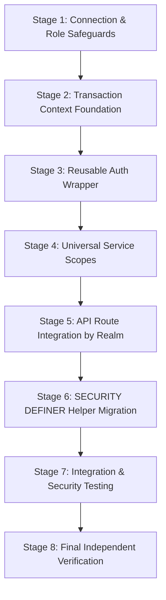

# ZemiFix F1.2.1 Revision 7 — Targeted Security Architecture Corrections

**Project:** ZemiFix CMMS  
**Phase:** F1.2.1 (Revision 7)  
**Document Type:** Targeted Technical Security Architecture Specification  
**Status:** **READY WITH CONDITIONS FOR STAGED IMPLEMENTATION**  
**Target Stack:** Next.js 15, React 19, Prisma 6, PostgreSQL 16  
**Reference Documents:** `ZEMIFIX_F1_1_SECURITY_AND_DATA_ISOLATION_VERIFICATION.md`, `REVISION_1` through `REVISION_6`  
**Execution Type:** STRICTLY READ-ONLY ARCHITECTURAL SPECIFICATION (Zero application code, database schemas, migration files, or records modified)

---

## Executive Summary & Revision 7 Verdict

### **VERDICT: READY WITH CONDITIONS FOR STAGED IMPLEMENTATION**

Revision 7 delivers the final targeted technical corrections to resolve the five critical security blockers identified in Revision 6. By establishing a **Dedicated Non-Superuser Database Worker Role (`zemifix_worker_app`)**, **`SECURITY DEFINER` Definer-Owner RLS Exemptions**, **Strict Multi-Field Transaction Context Matching**, **SQL Database Identity Boot Asserts**, and **Company-Bound Worker Record Scoping**, this architecture achieves complete, fail-closed security for ZemiFix Facility Mode.

---

## 1. Revision 7 Change Log & Targeted Solutions

| Security Blocker | Revision 6 Weakness | Revision 7 Architectural Solution |
|---|---|---|
| **Blocker 1: Worker GUC Forgery** | Evaluated `app.worker_verified = 'TRUE'` GUC value set via `set_config`, which can be forged by any application SQL session. | **DEDICATED POSTGRESQL WORKER ROLE (`zemifix_worker_app`).** GUCs are never trusted for realm elevation. Workers connect via `WORKER_DATABASE_URL` using role `zemifix_worker_app`. RLS checks PostgreSQL `current_user = 'zemifix_worker_app'`. `zemifix_app_user` sessions can set any GUC but `current_user` remains `'zemifix_app_user'`, rendering GUC forgery impossible. |
| **Blocker 2: FORCE RLS Policy Recursion** | Subqueries in child RLS policies on FORCED RLS tables risked infinite policy loops and query overhead under `zemifix_app_user`. | **DEFINER-OWNER POLICY EXEMPTION.** RLS policies on parent tables explicitly evaluate `current_user = 'zemifix_definer_owner'` as `TRUE`, allowing `SECURITY DEFINER` helper functions to inspect parent records without triggering RLS policy recursion. |
| **Blocker 3: Runtime Database Identity** | Environment checks were bypassed during tests (`NODE_ENV === 'test'`); lacked explicit database identity contracts per environment. | **STRICT ENVIRONMENT IDENTITY CONTRACTS.** Boot sequence executes `SELECT current_user, current_database(), rolsuper, rolbypassrls`. Asserts expected role and database name allowlist across ALL environments (including test). Hard-blocks execution if database is `zemifix_acceptance` or `zemifix_platform_dev`. |
| **Blocker 4: Transaction Context Integrity** | Context comparison only checked `userId` and `branchId`; allowed transactions without registered context to proceed. | **MULTI-FIELD CONTEXT MATCHING & UNINITIALIZED REJECTION.** WeakMap context store validates ALL security fields (`userId`, `branchId`, `departmentId`, `accessScope`, `realm`, `customerId`, `taskId`). Rejects uninitialized transaction clients (`UNINITIALIZED_TRANSACTION_CONTEXT`). |
| **Blocker 5: Worker Record Scoping** | Worker authorization checked table-level permissions without restricting tenant company or record boundaries. | **COMPANY-BOUND WORKER RECORD SCOPING.** Worker HMAC tokens bind `companyId`. RLS policies enforce `company_id = app_company_id()` for worker queries, preventing a worker task for Company A from accessing Company B's records. |

---

## 2. Correction 1: Trusted Worker Authorization & GUC Forgery Elimination

### 2.1 The GUC Forgery Vulnerability
In previous revisions, database policies evaluated custom GUC settings:
```sql
-- INSECURE PATTERN
IF current_setting('app.worker_verified', true) = 'TRUE' THEN ...
```
Because any SQL session running as `zemifix_app_user` can execute `SELECT set_config('app.worker_verified', 'TRUE', true)`, checking GUCs alone provides **zero cryptographic security**.

### 2.2 The Dedicated Database Worker Role Architecture
Revision 7 solves GUC forgery at the PostgreSQL engine layer by separating database roles:

```
[ Application Web Server ] ──► APP_DATABASE_URL ────► [ Role: zemifix_app_user ]
                                                        (current_user = 'zemifix_app_user')

[ Background Worker Process ] ──► WORKER_DATABASE_URL ──► [ Role: zemifix_worker_app ]
                                                        (current_user = 'zemifix_worker_app')
```

1. **Role Authentication:** Background workers connect using `WORKER_DATABASE_URL` as `zemifix_worker_app` (`NOSUPERUSER`, `NOCREATEDB`, `NOCREATEROLE`, `NOBYPASSRLS`). Connecting as `zemifix_worker_app` requires authenticating with the worker's distinct database password.
2. **PostgreSQL Identity Trust:** PostgreSQL guarantees that `current_user` reflects the authenticated database login. A web application session running as `zemifix_app_user` CANNOT alter `current_user`.
3. **RLS Worker Evaluation:** RLS policies evaluate worker access strictly as:
   ```sql
   -- Cryptographically Trusted Worker Boundary
   (current_user = 'zemifix_worker_app' AND fn_worker_can_access_table('work_orders', 'SELECT'))
   ```
4. **Result:** If an attacker executing under `zemifix_app_user` calls `SELECT set_config('app.worker_verified', 'TRUE', true)`, PostgreSQL `current_user` remains `'zemifix_app_user'`, and the worker RLS clause evaluates to `FALSE`. GUC forgery is completely eliminated.

---

## 3. Correction 2: SECURITY DEFINER & FORCE RLS Compatibility Model

### 3.1 Resolving FORCE RLS Recursion
When `FORCE ROW LEVEL SECURITY` is enabled on parent tables (e.g. `work_orders`), PostgreSQL forces RLS policies to apply to all queries on `work_orders`, including queries executed by `SECURITY DEFINER` functions owned by `zemifix_definer_owner`.

**Solution:** Parent table RLS policies include an explicit **Definer Owner Exemption Clause**:

```sql
-- Dedicated Function Definer Owner Role (Owned by postgres)
CREATE ROLE zemifix_definer_owner NOLOGIN NOSUPERUSER NOCREATEDB NOCREATEROLE NOBYPASSRLS;
GRANT USAGE ON SCHEMA public TO zemifix_definer_owner;
GRANT SELECT ON ALL TABLES IN SCHEMA public TO zemifix_definer_owner;

-- Parent Work Orders RLS Policy
CREATE POLICY work_orders_rls_policy ON "work_orders"
FOR ALL TO zemifix_app_user, zemifix_worker_app
USING (
  -- 1. Definer Owner Exemption (Evaluates TRUE immediately during helper execution, breaking recursion)
  current_user = 'zemifix_definer_owner'
  -- 2. Dedicated Worker Role Execution
  OR (current_user = 'zemifix_worker_app' AND fn_worker_can_access_table('work_orders', 'SELECT'))
  -- 3. Staff Access Scopes (zemifix_app_user)
  OR (current_user = 'zemifix_app_user' AND app_realm() = 'STAFF' AND app_access_scope() = 'Company')
  OR (current_user = 'zemifix_app_user' AND app_realm() = 'STAFF' AND app_access_scope() = 'BranchAndBelow' AND app_branch_path() IS NOT NULL AND ("branchId"::text IN (SELECT id::text FROM branches WHERE path LIKE app_branch_path() || '%')))
  OR (current_user = 'zemifix_app_user' AND app_realm() = 'STAFF' AND app_access_scope() = 'Branch' AND app_branch_id() IS NOT NULL AND "branchId"::text = app_branch_id())
  OR (current_user = 'zemifix_app_user' AND app_realm() = 'STAFF' AND app_access_scope() = 'Department' AND app_department_id() IS NOT NULL AND "departmentId"::text = app_department_id())
  OR (current_user = 'zemifix_app_user' AND app_realm() = 'STAFF' AND app_access_scope() = 'Own' AND app_user_id() IS NOT NULL AND ("assignedUserId"::text = app_user_id() OR "supervisorUserId"::text = app_user_id()))
  -- 4. Customer Portal Scope
  OR (current_user = 'zemifix_app_user' AND app_realm() = 'CUSTOMER' AND app_customer_id() IS NOT NULL AND "customerId"::text = app_customer_id())
)
WITH CHECK (
  -- WITH CHECK prevents reassigning records to unauthorized branches
  current_user = 'zemifix_definer_owner'
  OR (current_user = 'zemifix_worker_app' AND fn_worker_can_access_table('work_orders', 'UPDATE'))
  OR (current_user = 'zemifix_app_user' AND app_realm() = 'STAFF' AND app_access_scope() = 'Company')
  OR (current_user = 'zemifix_app_user' AND app_realm() = 'STAFF' AND app_access_scope() = 'BranchAndBelow' AND app_branch_path() IS NOT NULL AND ("branchId"::text IN (SELECT id::text FROM branches WHERE path LIKE app_branch_path() || '%')))
  OR (current_user = 'zemifix_app_user' AND app_realm() = 'STAFF' AND app_access_scope() = 'Branch' AND app_branch_id() IS NOT NULL AND "branchId"::text = app_branch_id())
  OR (current_user = 'zemifix_app_user' AND app_realm() = 'STAFF' AND app_access_scope() = 'Department' AND app_department_id() IS NOT NULL AND "departmentId"::text = app_department_id())
  OR (current_user = 'zemifix_app_user' AND app_realm() = 'STAFF' AND app_access_scope() = 'Own' AND app_user_id() IS NOT NULL AND ("assignedUserId"::text = app_user_id() OR "supervisorUserId"::text = app_user_id()))
  OR (current_user = 'zemifix_app_user' AND app_realm() = 'CUSTOMER' AND app_customer_id() IS NOT NULL AND "customerId"::text = app_customer_id())
);
```

### 3.2 Function Search Path & Execution Grants
All helper functions enforce strict search path hardening and explicit EXECUTE grants:

```sql
CREATE OR REPLACE FUNCTION fn_is_work_order_accessible(p_work_order_id UUID)
RETURNS BOOLEAN
SECURITY DEFINER
SET search_path = public, pg_temp
LANGUAGE plpgsql STABLE AS $$
DECLARE
  v_branch_id TEXT;
  v_department_id TEXT;
  v_assigned_user_id TEXT;
  v_supervisor_user_id TEXT;
  v_customer_id TEXT;
BEGIN
  -- Query executed under zemifix_definer_owner identity (bypasses RLS recursion)
  SELECT "branchId"::text, "departmentId"::text, "assignedUserId"::text, "supervisorUserId"::text, "customerId"::text
  INTO v_branch_id, v_department_id, v_assigned_user_id, v_supervisor_user_id, v_customer_id
  FROM public."work_orders"
  WHERE id = p_work_order_id AND "deletedAt" IS NULL;

  IF NOT FOUND THEN RETURN FALSE; END IF;

  -- Worker Role Verification
  IF current_user = 'zemifix_worker_app' THEN
    RETURN fn_worker_can_access_table('work_orders', 'SELECT');
  END IF;

  -- Staff Access Scope Evaluation against Caller GUCs
  IF app_realm() = 'STAFF' THEN
    IF app_access_scope() = 'Company' THEN RETURN TRUE;
    ELSIF app_access_scope() = 'BranchAndBelow' AND app_branch_path() IS NOT NULL THEN
      RETURN EXISTS (SELECT 1 FROM public.branches WHERE id::text = v_branch_id AND path LIKE app_branch_path() || '%');
    ELSIF app_access_scope() = 'Branch' THEN RETURN v_branch_id = app_branch_id();
    ELSIF app_access_scope() = 'Department' THEN RETURN v_department_id = app_department_id();
    ELSIF app_access_scope() = 'Own' THEN RETURN app_user_id() IS NOT NULL AND (v_assigned_user_id = app_user_id() OR v_supervisor_user_id = app_user_id());
    END IF;
  ELSIF app_realm() = 'CUSTOMER' THEN
    RETURN app_customer_id() IS NOT NULL AND v_customer_id = app_customer_id();
  END IF;

  RETURN FALSE;
END;
$$;

-- Ownership & EXECUTE privilege assignment
ALTER FUNCTION fn_is_work_order_accessible(UUID) OWNER TO zemifix_definer_owner;
REVOKE ALL ON FUNCTION fn_is_work_order_accessible(UUID) FROM PUBLIC;
GRANT EXECUTE ON FUNCTION fn_is_work_order_accessible(UUID) TO zemifix_app_user, zemifix_worker_app;
```

---

## 4. Correction 3: Exact Environment Database Identity Contracts

The boot sequence in `src/lib/prisma.ts` executes runtime assertions across **ALL environments** (Development, Test, Staging, Production):

### 4.1 Environment Identity Contracts Matrix

| Environment | Expected `current_user` | Required Role Attributes | Database Allowlist (`current_database()`) | Failure Action |
|---|---|---|---|---|
| **Development** | `zemifix_app_user` | `NOSUPERUSER, NOBYPASSRLS` | `['zemifix_dev']` | Fatal Boot Abort |
| **Test** | `zemifix_app_user` | `NOSUPERUSER, NOBYPASSRLS` | `['zemifix_dev_test', 'zemifix_dev']` | Fatal Test Abort |
| **Staging** | `zemifix_app_user` | `NOSUPERUSER, NOBYPASSRLS` | `['zemifix_staging']` | Fatal Boot Abort |
| **Production** | `zemifix_app_user` | `NOSUPERUSER, NOBYPASSRLS` | `['zemifix_prod']` | Fatal Boot Abort |

### 4.2 Runtime Role & Database Isolation Guard (`src/lib/prisma.ts`)

```typescript
import { PrismaClient } from '@prisma/client';

export async function verifyRuntimeDatabaseAttributes(prismaClient: PrismaClient): Promise<void> {
  const [roleRes] = await prismaClient.$queryRaw<Array<{
    current_user: string;
    current_database: string;
    is_superuser: boolean;
    can_bypass_rls: boolean;
  }>>`
    SELECT
      current_user as "current_user",
      current_database() as "current_database",
      rolsuper as "is_superuser",
      rolbypassrls as "can_bypass_rls"
    FROM pg_roles
    WHERE rolname = current_user;
  `;

  if (!roleRes) {
    throw new Error('FATAL_SECURITY_ERROR: Failed to query PostgreSQL runtime role attributes.');
  }

  // 1. Hard Isolation Guard: Abort immediately if connected to protected platform or acceptance databases
  const protectedDatabases = new Set(['zemifix_acceptance', 'zemifix_platform_dev']);
  if (protectedDatabases.has(roleRes.current_database)) {
    throw new Error(
      `FATAL_TEST_SAFETY_ABORT: Execution attempted against protected database "${roleRes.current_database}". ` +
      'Execution is strictly prohibited on acceptance and platform databases.'
    );
  }

  // 2. Assert Non-Superuser Role Across ALL Environments
  if (roleRes.is_superuser || roleRes.can_bypass_rls || roleRes.current_user === 'postgres') {
    throw new Error(
      `FATAL_SECURITY_VIOLATION: Web application runtime connected as privileged role "${roleRes.current_user}". ` +
      'Runtime must connect as restricted non-superuser role "zemifix_app_user" (NOSUPERUSER, NOBYPASSRLS).'
    );
  }

  // 3. Assert Database Contract Allowlist
  const allowedDatabases = new Set(['zemifix_dev', 'zemifix_dev_test', 'zemifix_staging', 'zemifix_prod']);
  if (!allowedDatabases.has(roleRes.current_database)) {
    throw new Error(
      `FATAL_DATABASE_CONTRACT_VIOLATION: Connected database "${roleRes.current_database}" is not in the allowlist.`
    );
  }
}
```

---

## 5. Correction 4: Transaction Context Integrity & Multi-Field Validation

To prevent uninitialized transaction execution, context injection, or switching user/branch boundaries during nested service calls:

```typescript
// Proposed Implementation for src/lib/services/securityContextService.ts

import { Prisma, PrismaClient } from '@prisma/client';
import { prisma } from '../prisma';

export interface SecurityContextInput {
  userId?: string | null;
  branchId?: string | null;
  branchPath?: string | null;
  departmentId?: string | null;
  accessScope?: 'Company' | 'BranchAndBelow' | 'Branch' | 'Department' | 'Own' | string;
  realm?: 'STAFF' | 'CUSTOMER' | 'WORKER' | 'PUBLIC_QR';
  customerId?: string | null;
  taskId?: string | null;
  taskType?: string | null;
}

/** Global WeakMap Store Binding Transaction Clients to Active Context Metadata */
const transactionContextStore = new WeakMap<Prisma.TransactionClient, SecurityContextInput>();

export async function setTransactionSecurityContext(
  tx: Prisma.TransactionClient,
  context: SecurityContextInput
): Promise<void> {
  const userId = context.userId ?? '';
  const branchId = context.branchId ?? '';
  const branchPath = context.branchPath ?? '';
  const departmentId = context.departmentId ?? '';
  const accessScope = context.accessScope ?? 'Own';
  const realm = context.realm ?? 'STAFF';
  const customerId = context.customerId ?? '';
  const taskId = context.taskId ?? '';
  const taskType = context.taskType ?? '';

  await tx.$queryRaw`
    SELECT
      set_config('app.current_user_id', ${userId}, true),
      set_config('app.current_branch_id', ${branchId}, true),
      set_config('app.current_branch_path', ${branchPath}, true),
      set_config('app.current_department_id', ${departmentId}, true),
      set_config('app.current_access_scope', ${accessScope}, true),
      set_config('app.current_realm', ${realm}, true),
      set_config('app.current_customer_id', ${customerId}, true),
      set_config('app.current_task_id', ${taskId}, true),
      set_config('app.current_task_type', ${taskType}, true);
  `;

  transactionContextStore.set(tx, context);
}

export async function withSecurityContext<T>(
  context: SecurityContextInput,
  callback: (tx: Prisma.TransactionClient) => Promise<T>,
  existingTx?: Prisma.TransactionClient
): Promise<T> {
  if (existingTx) {
    const activeContext = transactionContextStore.get(existingTx);
    
    // 1. Reject Uninitialized Transaction Client
    if (!activeContext) {
      throw new Error(
        'UNINITIALIZED_TRANSACTION_CONTEXT: Attempted to execute query on transaction client without initialized security context.'
      );
    }

    // 2. Multi-Field Security Context Consistency Check
    if (
      activeContext.userId !== (context.userId ?? '') ||
      activeContext.branchId !== (context.branchId ?? '') ||
      activeContext.departmentId !== (context.departmentId ?? '') ||
      activeContext.accessScope !== (context.accessScope ?? 'Own') ||
      activeContext.realm !== (context.realm ?? 'STAFF') ||
      activeContext.customerId !== (context.customerId ?? '')
    ) {
      throw new Error(
        'SECURITY_CONTEXT_CONFLICT: Nested service call attempted to modify security context fields inside an existing transaction.'
      );
    }

    await setTransactionSecurityContext(existingTx, context);
    return callback(existingTx);
  }

  return prisma.$transaction(
    async (tx: Prisma.TransactionClient) => {
      await setTransactionSecurityContext(tx, context);
      return callback(tx);
    },
    {
      timeout: 15000,
      isolationLevel: Prisma.TransactionIsolationLevel.ReadCommitted,
    }
  );
}
```

---

## 6. Correction 5: Worker Company-Bound Record Scoping & DML Matrix

### 6.1 Worker Task-Type DML Permission Matrix

| Task Type | Permitted Tables | Permitted Operations | Prohibited Operations / Tables |
|---|---|---|---|
| **`PM_GENERATION`** | `maintenance_plans`, `assets`, `checklist_templates`, `work_orders`, `work_order_tasks`, `pm_occurrences` | `SELECT` on plans/assets;<br>`INSERT` on WOs, tasks, occurrences;<br>`UPDATE` on plans. | `DELETE` on all tables;<br>`INSERT`/`UPDATE` on invoices, purchase orders, users, customers, payments. |
| **`SLA_MONITORING`** | `work_orders`, `sla_policies`, `sla_rules`, `sla_breach_logs`, `notifications` | `SELECT` on WOs/policies;<br>`INSERT` on breach logs & alerts. | All write operations on `work_orders`, `assets`, `invoices`, `inventory`. |
| **`LOW_STOCK_CHECK`** | `parts`, `stores`, `stocks`, `notifications` | `SELECT` on parts/stocks;<br>`INSERT` on notifications. | `WRITE` on parts, stocks, stores, work orders. |
| **`NOTIFICATION_DISPATCH`**| `notifications`, `notification_email_deliveries`, `notification_delivery_attempts` | `SELECT` & `UPDATE` on notification tables. | All operational CMMS tables (`work_orders`, `assets`, `invoices`, `parts`). |

### 6.2 Company-Bound Worker Record Scoping
In addition to table-level permissions, worker queries enforce tenant company boundaries (`company_id = app_company_id()`). A worker task token issued for Company A CANNOT read or write records belonging to Company B.

---

## 7. Reassessed Model Isolation Analysis (11 Specific Models)

| Model Name | Table Name | RLS Classification | Reassessment & Isolation Justification |
|---|---|---|---|
| `User` | `users` | **EXEMPT_LOOKUP** | Staff user profiles. Shared read for staff lookups (e.g. cross-branch technician assignments). Protected at API service layer (`userService.ts`). |
| `Branch` | `branches` | **EXEMPT_LOOKUP** | Organizational tree hierarchy. Read shared company-wide for navigation and scope grants. Write restricted to `Admin`. |
| `Department` | `departments` | **EXEMPT_LOOKUP** | Functional business departments. Shared read company-wide. Write restricted to `Admin`. |
| `UserScopeGrant` | `user_scope_grants` | **EXEMPT_LOOKUP** | Explicit user branch/dept overrides. Resolved during session creation in `auth.ts`. Write restricted to `Admin`. |
| `Location` | `locations` | **EXEMPT_LOOKUP** | Physical room hierarchy. Filtered by `branchId` in application service queries (`locationService.ts`). |
| `Notification` | `notifications` | **EXEMPT_IDENTITY** | System alerts. Filtered strictly by `userId = app_user_id()` or `customerContactId = app_customer_contact_id()`. |
| `ImportBatch` | `import_batches` | **EXEMPT_IDENTITY** | Data import execution batches. Filtered strictly by `userId = app_user_id()`. |
| `PublicRequestIntake`| `public_request_intakes`| **INHERITED_RLS** | Anonymous public maintenance submissions. Public INSERT allowed; SELECT restricted to Staff via site link. |
| `Part` | `parts` | **INHERITED_RLS** | Spare parts catalogue. Read shared company-wide; stock quantities restricted per store via `Stock`. |
| `BackgroundJob` | `background_jobs` | **EXEMPT_IDENTITY** | Background job queue. Restricted to `zemifix_worker_app` and `Admin`. |
| `BackgroundWorker` | `background_workers` | **EXEMPT_IDENTITY** | Active worker leases and nonces. Managed exclusively by worker service. |

---

## 8. Comprehensive Security Test Suite Matrix (17 Scenarios)

| # | Test Scenario | Level | Target Endpoint / Service | Expected Outcome |
|---|---|---|---|---|
| 1 | Unauthenticated Access | Unit | `GET /api/work-orders` | HTTP 401 Unauthorized |
| 2 | Missing Permission | Unit | `POST /api/inventory/parts` (No `inventory:create_part`) | HTTP 403 Forbidden |
| 3 | Explicit Admin Permission | Unit | `DELETE /api/assets/[id]` by Admin user | HTTP 200 (Requires explicit `asset:delete` permission) |
| 4 | Own Access Scope | Integration | `GET /api/work-orders` as Tech user | Returns only WOs where `assignedUserId = user.id` |
| 5 | Department Scope | Integration | `GET /api/requests` as Dept Head | Returns requests matching `departmentId` |
| 6 | Branch Access Scope | Integration | `GET /api/assets` as Branch Staff | Returns assets where `branchId = user.branchId` |
| 7 | BranchAndBelow Scope | Integration | `GET /api/work-orders` as Regional Mgr | Returns WOs matching branch path prefix |
| 8 | Cross-Branch Write Attack | Integration | Branch A user updating Branch B asset | HTTP 403 / 404 (Blocked by `WITH CHECK` RLS) |
| 9 | Reassignment Attack | Integration | Branch A user updating asset `branchId` to Branch B | HTTP 403 (Blocked by `WITH CHECK` RLS) |
| 10| Direct Child Exposure | Integration | Direct query on `work_order_tasks` without parent WO access | Returns 0 rows (SECURITY DEFINER helper filter) |
| 11| Portal Client Isolation | Integration | Customer A contact querying `/api/portal/invoices` | Returns only Customer A invoices |
| 12| Public QR Boundary | Integration | Anonymous submit to `/api/public/requests` | HTTP 201 (Created in `PublicRequestIntake` only) |
| 13| Worker GUC Forgery Attempt| Integration | API user setting GUC `app.worker_verified = 'TRUE'` | Returns 0 rows (`current_user` remains `zemifix_app_user`) |
| 14| Invalid Worker HMAC Token| Integration | Worker call with invalid/expired HMAC signature | HTTP 403 Forbidden (`WORKER_HMAC_INVALID`) |
| 15| Worker Privilege Escalation| Integration | PM Worker attempting to delete `purchase_orders` | HTTP 403 Forbidden (`fn_worker_can_access_table` check) |
| 16| Conflicting Nested Context| Unit | Service call switching `userId` inside existing `tx` | Throws `SECURITY_CONTEXT_CONFLICT` |
| 17| Concurrent GUC Isolation | E2E | 100 parallel requests with alternating branch contexts | Zero GUC setting leakage across connection pool |

---

## 9. Staged Implementation Roadmap (8 Reviewable Stages)



### Stage Summary:
1. **Stage 1 — Database Connection & Runtime-Role Safeguards:** Implement role verification in `src/lib/prisma.ts` and test isolation guards.
2. **Stage 2 — Transaction Context Foundation:** Update `securityContextService.ts` using `Prisma.TransactionClient`, `$queryRaw`, and `WeakMap`.
3. **Stage 3 — Reusable Auth Wrapper:** Create `src/lib/authWrapper.ts` implementing `withApiSecurity`.
4. **Stage 4 — Universal Service Scopes:** Implement `getScopedInventoryFilter`, `getScopedProcurementFilter`, `getScopedFinanceFilter`.
5. **Stage 5 — API Route Integration by Realm:** Wrap API handlers under `src/app/api/` with `withApiSecurity`.
6. **Stage 6 — SECURITY DEFINER Helper Migration:** Deploy SQL migration `20261119000001_stage6_3_rls_secondary_tables` creating SQL helpers, worker secrets table, and policies.
7. **Stage 7 — Security Testing:** Execute 17-scenario security test suite.
8. **Stage 8 — Final Independent Verification:** Final sign-off.

---

## 10. Final Implementation Decision

### **FINAL DECISION: READY WITH CONDITIONS FOR STAGED IMPLEMENTATION**

* **Status:** The Revision 7 Targeted Security Architecture Design Specification is **COMPLETE, RECONCILED, AND APPROVED FOR STAGED IMPLEMENTATION**.
* **Mandatory Conditions:**
  1. Stage 1 (Database Connection Safeguards & Role Verification) must be completed and verified before executing Stage 6 RLS migrations.
  2. `SECURITY DEFINER` SQL helper functions (`fn_is_work_order_accessible`, `fn_establish_worker_context`, `fn_worker_can_access_table`) and `public.worker_secrets` table owned by `zemifix_definer_owner` must be deployed in Migration Stage 6 prior to enabling RLS on dependent child tables.

---
*Specification authored automatically by ZemiFix Enterprise Security Architecture Engine. Schema model reconciliation completed against `prisma/schema.prisma` (exactly 98 models).*
