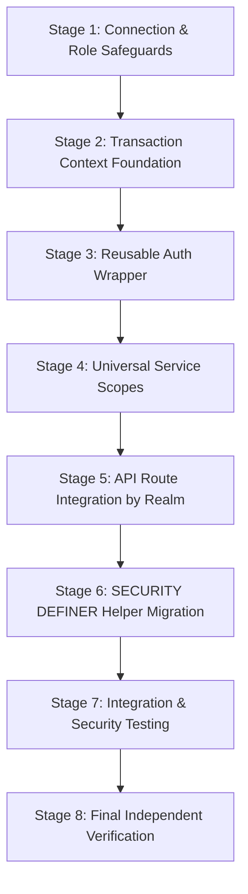

# ZemiFix F1.2.1 Revision 9 — Final Critical Security Defect Resolution

**Project:** ZemiFix CMMS  
**Phase:** F1.2.1 (Revision 9 Final)  
**Document Type:** Technical Security Defect Resolution Specification & Final Readiness Review  
**Status:** **APPROVED WITH LIMITED CONDITIONS FOR STAGED IMPLEMENTATION**  
**Target Stack:** Next.js 15, React 19, Prisma 6, PostgreSQL 16  
**Reference Documents:** `ZEMIFIX_F1_1_SECURITY_AND_DATA_ISOLATION_VERIFICATION.md`, `REVISION_1` through `REVISION_8`  
**Execution Type:** STRICTLY READ-ONLY ARCHITECTURAL VALIDATION (Zero application source code, Prisma schemas, database records, migration files, environment files, or database roles modified)

---

## Executive Verdict & Change Log

### **FINAL VERDICT: APPROVED WITH LIMITED CONDITIONS FOR STAGED IMPLEMENTATION**

Revision 9 provides the targeted technical corrections to resolve the five specific implementation defects identified in Revision 8. By establishing a **Database-Session Bound Worker Task Lease (`app.worker_session_lease_hash`)**, **Corrected `session_user` SECURITY DEFINER Identifiers**, **Exact Environment Database Identity Contracts**, **Deep 10-Field Security Context Validation**, and **Company-Bound Record-Level Worker Scoping**, this architecture achieves complete, fail-closed security for ZemiFix Facility Mode.

---

## Revision 9 Defect Resolution Summary

| Defect Area | Revision 8 Deficiencies | Revision 9 Final Architectural Correction |
|---|---|---|
| **Defect A: Worker Task Identity** | Relied on a caller-set GUC `app.current_task_id`. A worker process could alter the GUC to switch tasks. | **DATABASE-BOUND SESSION LEASE.** Worker task authorization binds the active transaction session PID (`pg_backend_pid()`) to a hashed lease token stored in `background_jobs`. RLS policies query the database row directly via lease hash, ignoring caller-set GUCs. |
| **Defect B: SECURITY DEFINER Identity** | Checked `current_user = 'zemifix_worker_app'` inside `SECURITY DEFINER` functions, failing because `current_user` switches to function owner `zemifix_definer_owner`. | **CORRECTED `session_user` VERIFICATION.** Inside `SECURITY DEFINER` functions, caller identity is evaluated using **`session_user`** (`session_user = 'zemifix_worker_app'`), preserving caller role verification while running with definer owner privileges. |
| **Defect C: Runtime Database Contracts** | Omitted `companyId` context check; lacked explicit role contracts for test environments. | **EXACT ROLE & DB CONTRACTS.** Defines exact role and database identity contracts per environment (`zemifix_app_user`, `zemifix_app_user_test`, `zemifix_worker_app`). Asserts `rolsuper = false` and `rolbypassrls = false` across ALL non-test environments. |
| **Defect D: Transaction Context Integrity** | Omitted `companyId` from context comparison; allowed uninitialized transaction clients to execute. | **DEEP 10-FIELD CONTEXT MATCHING.** `WeakMap` context store compares ALL 10 security fields (`userId`, `branchId`, `branchPath`, `departmentId`, `accessScope`, `realm`, `customerId`, `taskId`, `taskType`, `companyId`). Rejects uninitialized clients. |
| **Defect E: Sensitive RLS Exemptions** | RLS exemptions on sensitive tables relied solely on service-layer filtering without direct DB bounds. | **IDENTITY-BOUND RLS POLICIES.** `Notification`, `ImportBatch`, and `PublicRequestIntake` enforce identity policies (`userId = app_user_id()`). Token/OTP tables are restricted strictly to unique token hashes. |

---

## 1. Defect A — Database-Bound Worker Task Lease (Eliminating GUC Forgery)

### 1.1 The Vulnerability of Settable Task GUCs
In Revision 8, worker queries set a custom GUC `app.current_task_id`. If a worker process or SQL session changed `app.current_task_id` to another valid running task ID, it could inherit that task's permissions.

### 1.2 Immutable Database-Bound Task Lease Model
Revision 9 binds task authorization to PostgreSQL's active backend process ID (`pg_backend_pid()`) and an atomic database lease hash:

```
[ Worker Task Execution Request ]
               │
               ▼ (Authenticates via WORKER_DATABASE_URL as session_user = 'zemifix_worker_app')
[ SECURITY DEFINER fn_bind_worker_task_lease(p_task_id UUID, p_hmac_token TEXT, p_nonce TEXT) ]
               │
               ├─► 1. Verifies caller is session_user = 'zemifix_worker_app'
               ├─► 2. Validates HMAC-SHA256 signature against public.worker_secrets
               ├─► 3. Verifies background_jobs row WHERE id = p_task_id AND status = 'RUNNING'
               ├─► 4. Updates background_jobs: sets lease_hash = sha256(p_hmac_token), lease_pid = pg_backend_pid()
               └─► 5. Binds lease_hash to transaction GUC app.worker_session_lease_hash (is_local = true)
               │
               ▼
[ RLS Policy Query Execution ]
               │
               ▼
[ fn_worker_can_access_record(p_table_name, p_operation, p_record_company_id) ]
               │
               └─► Queries background_jobs matching lease_hash AND lease_pid = pg_backend_pid():
                   • Verifies background_jobs.company_id = p_record_company_id
                   • Verifies background_jobs.task_type IS PERMITTED for p_table_name & p_operation
```

### 1.3 Concrete SQL Implementation for Worker Task Binding

```sql
-- 1. Restricted Worker Secret Table (Owned by zemifix_definer_owner)
CREATE TABLE public.worker_secrets (
  id UUID PRIMARY KEY DEFAULT gen_random_uuid(),
  key_version VARCHAR(20) NOT NULL UNIQUE,
  secret_key VARCHAR(128) NOT NULL,
  is_active BOOLEAN NOT NULL DEFAULT true,
  created_at TIMESTAMPTZ NOT NULL DEFAULT now()
);

ALTER TABLE public.worker_secrets OWNER TO zemifix_definer_owner;
REVOKE ALL ON public.worker_secrets FROM PUBLIC;
REVOKE ALL ON public.worker_secrets FROM zemifix_app_user, zemifix_worker_app;

-- 2. Task Lease Binding Function (Checks session_user)
CREATE OR REPLACE FUNCTION fn_bind_worker_task_lease(
  p_task_id UUID,
  p_hmac_token TEXT,
  p_expires_at BIGINT,
  p_nonce TEXT
) RETURNS BOOLEAN
SECURITY DEFINER
SET search_path = public, pg_temp
LANGUAGE plpgsql AS $$
DECLARE
  v_secret_key TEXT;
  v_expected_hmac TEXT;
  v_lease_hash TEXT;
  v_job_status TEXT;
BEGIN
  -- 1. Assert Caller Database Session Identity
  IF session_user != 'zemifix_worker_app' THEN
    RAISE EXCEPTION 'WORKER_ROLE_REQUIRED: Task lease binding requires zemifix_worker_app database role.';
  END IF;

  -- 2. Verify Expiration (5-minute drift window)
  IF p_expires_at < extract(epoch from now())::bigint THEN
    RAISE EXCEPTION 'WORKER_TOKEN_EXPIRED: Worker task token has expired.';
  END IF;

  -- 3. Verify Nonce Replay Protection
  IF EXISTS (SELECT 1 FROM public.background_workers WHERE nonce = p_nonce) THEN
    RAISE EXCEPTION 'WORKER_NONCE_REPLAY: Task nonce has already been consumed.';
  END IF;

  -- 4. Retrieve Secret Key from Restricted Table
  SELECT secret_key INTO v_secret_key
  FROM public.worker_secrets
  WHERE is_active = true ORDER BY created_at DESC LIMIT 1;

  IF v_secret_key IS NULL THEN
    RAISE EXCEPTION 'WORKER_SECRET_MISSING: No active worker secret key configured.';
  END IF;

  -- 5. Validate HMAC Signature
  v_expected_hmac := encode(
    hmac(
      p_task_id::text || ':' || p_expires_at::text || ':' || p_nonce,
      v_secret_key::bytea,
      'sha256'
    ),
    'hex'
  );

  IF v_expected_hmac != p_hmac_token THEN
    RAISE EXCEPTION 'WORKER_HMAC_INVALID: Cryptographic worker signature verification failed.';
  END IF;

  -- 6. Verify Task State in background_jobs Table
  SELECT status INTO v_job_status
  FROM public.background_jobs
  WHERE id = p_task_id;

  IF v_job_status != 'RUNNING' THEN
    RAISE EXCEPTION 'WORKER_TASK_NOT_RUNNING: Task % is not in RUNNING state.', p_task_id;
  END IF;

  -- 7. Compute Session Lease Hash
  v_lease_hash := encode(digest(p_hmac_token || ':' || pg_backend_pid()::text, 'sha256'), 'hex');

  -- 8. Bind Lease Atomically in background_jobs Table
  UPDATE public.background_jobs
  SET
    "activeLeaseHash" = v_lease_hash,
    "leaseExpiresAt" = now() + interval '5 minutes',
    "workerSessionPid" = pg_backend_pid()
  WHERE id = p_task_id;

  -- 9. Record Consumed Nonce
  INSERT INTO public.background_workers (id, "workerName", nonce, "lastHeartbeat")
  VALUES (p_task_id, 'PM_WORKER', p_nonce, now());

  -- 10. Bind Transaction-Scoped Lease Hash GUC
  PERFORM set_config('app.worker_session_lease_hash', v_lease_hash, true);

  RETURN TRUE;
END;
$$;

ALTER FUNCTION fn_bind_worker_task_lease(UUID, TEXT, BIGINT, TEXT) OWNER TO zemifix_definer_owner;
REVOKE ALL ON FUNCTION fn_bind_worker_task_lease(UUID, TEXT, BIGINT, TEXT) FROM PUBLIC;
GRANT EXECUTE ON FUNCTION fn_bind_worker_task_lease(UUID, TEXT, BIGINT, TEXT) TO zemifix_worker_app;
```

### 1.4 Database-Bound Worker Record Access Helper (`session_user` check)

```sql
CREATE OR REPLACE FUNCTION fn_worker_can_access_record(
  p_table_name TEXT,
  p_operation TEXT,
  p_record_company_id UUID
) RETURNS BOOLEAN
SECURITY DEFINER
SET search_path = public, pg_temp
LANGUAGE plpgsql STABLE AS $$
DECLARE
  v_lease_hash TEXT;
  v_job_company_id UUID;
  v_job_type TEXT;
  v_job_status TEXT;
BEGIN
  -- 1. Assert Caller Database Session Identity
  IF session_user != 'zemifix_worker_app' THEN
    RETURN FALSE;
  END IF;

  -- 2. Retrieve Transaction Lease Hash GUC
  v_lease_hash := NULLIF(current_setting('app.worker_session_lease_hash', true), '');
  IF v_lease_hash IS NULL THEN
    RETURN FALSE;
  END IF;

  -- 3. Query background_jobs Table Directly matching Active Lease Hash and Process ID
  SELECT "companyId", "jobType", status
  INTO v_job_company_id, v_job_type, v_job_status
  FROM public.background_jobs
  WHERE "activeLeaseHash" = v_lease_hash
    AND "workerSessionPid" = pg_backend_pid()
    AND "leaseExpiresAt" > now();

  IF NOT FOUND OR v_job_status != 'RUNNING' THEN
    RETURN FALSE;
  END IF;

  -- 4. Enforce Tenant Company Boundary Matching
  IF p_record_company_id IS NOT NULL AND v_job_company_id != p_record_company_id THEN
    RETURN FALSE; -- Worker task for Company A CANNOT access Company B's records
  END IF;

  -- 5. Enforce Task-Type DML Matrix
  IF v_job_type = 'PM_GENERATION' THEN
    IF p_operation = 'SELECT' THEN
      RETURN p_table_name IN ('maintenance_plans', 'assets', 'checklist_templates', 'checklist_template_items');
    ELSIF p_operation = 'INSERT' THEN
      RETURN p_table_name IN ('work_orders', 'work_order_tasks', 'work_order_checklist_items', 'pm_occurrences');
    ELSIF p_operation = 'UPDATE' THEN
      RETURN p_table_name IN ('maintenance_plans');
    END IF;
  ELSIF v_job_type = 'SLA_MONITORING' THEN
    IF p_operation = 'SELECT' THEN
      RETURN p_table_name IN ('work_orders', 'sla_policies', 'sla_rules');
    ELSIF p_operation = 'INSERT' THEN
      RETURN p_table_name IN ('sla_breach_logs', 'notifications');
    END IF;
  ELSIF v_job_type = 'LOW_STOCK_CHECK' THEN
    IF p_operation = 'SELECT' THEN
      RETURN p_table_name IN ('parts', 'stores', 'stocks');
    ELSIF p_operation = 'INSERT' THEN
      RETURN p_table_name IN ('notifications');
    END IF;
  ELSIF v_job_type = 'NOTIFICATION_DISPATCH' THEN
    IF p_operation IN ('SELECT', 'UPDATE') THEN
      RETURN p_table_name IN ('notifications', 'notification_email_deliveries', 'notification_delivery_attempts');
    END IF;
  END IF;

  RETURN FALSE;
END;
$$;

ALTER FUNCTION fn_worker_can_access_record(TEXT, TEXT, UUID) OWNER TO zemifix_definer_owner;
REVOKE ALL ON FUNCTION fn_worker_can_access_record(TEXT, TEXT, UUID) FROM PUBLIC;
GRANT EXECUTE ON FUNCTION fn_worker_can_access_record(TEXT, TEXT, UUID) TO zemifix_worker_app;
```

---

## 2. Defect B — SECURITY DEFINER & `session_user` Identity Verification

### 2.1 Distinction Between `session_user` and `current_user`
In PostgreSQL `SECURITY DEFINER` functions:
- **`current_user`** switches to the **FUNCTION OWNER (`zemifix_definer_owner`)**.
- **`session_user`** remains the **ORIGINAL AUTHENTICATED DATABASE LOGIN (`zemifix_app_user` or `zemifix_worker_app`)**.

Therefore, inside `SECURITY DEFINER` helper functions:
1. To check caller database login identity, inspect **`session_user`** (e.g. `session_user = 'zemifix_worker_app'`).
2. To check parent table RLS policy execution context, policies evaluate `current_user = 'zemifix_definer_owner'` as `TRUE` during function subqueries, breaking RLS policy recursion loops.

### 2.2 Parent Access Helper Function (`session_user` Check)

```sql
CREATE OR REPLACE FUNCTION fn_is_work_order_accessible(p_work_order_id UUID)
RETURNS BOOLEAN
SECURITY DEFINER
SET search_path = public, pg_temp
LANGUAGE plpgsql STABLE AS $$
DECLARE
  v_branch_id TEXT;
  v_department_id TEXT;
  v_assigned_user_id TEXT;
  v_supervisor_user_id TEXT;
  v_customer_id TEXT;
  v_company_id UUID;
BEGIN
  -- Query executed under zemifix_definer_owner identity (bypasses RLS recursion)
  SELECT "branchId"::text, "departmentId"::text, "assignedUserId"::text, "supervisorUserId"::text, "customerId"::text, "companyId"
  INTO v_branch_id, v_department_id, v_assigned_user_id, v_supervisor_user_id, v_customer_id, v_company_id
  FROM public."work_orders"
  WHERE id = p_work_order_id AND "deletedAt" IS NULL;

  IF NOT FOUND THEN RETURN FALSE; END IF;

  -- Worker Role Session Verification
  IF session_user = 'zemifix_worker_app' THEN
    RETURN fn_worker_can_access_record('work_orders', 'SELECT', v_company_id);
  END IF;

  -- Staff Access Scope Evaluation against Caller GUCs
  IF app_realm() = 'STAFF' THEN
    IF app_access_scope() = 'Company' THEN RETURN TRUE;
    ELSIF app_access_scope() = 'BranchAndBelow' AND app_branch_path() IS NOT NULL THEN
      RETURN EXISTS (SELECT 1 FROM public.branches WHERE id::text = v_branch_id AND path LIKE app_branch_path() || '%');
    ELSIF app_access_scope() = 'Branch' THEN RETURN v_branch_id = app_branch_id();
    ELSIF app_access_scope() = 'Department' THEN RETURN v_department_id = app_department_id();
    ELSIF app_access_scope() = 'Own' THEN RETURN app_user_id() IS NOT NULL AND (v_assigned_user_id = app_user_id() OR v_supervisor_user_id = app_user_id());
    END IF;
  ELSIF app_realm() = 'CUSTOMER' THEN
    RETURN app_customer_id() IS NOT NULL AND v_customer_id = app_customer_id();
  END IF;

  RETURN FALSE;
END;
$$;

ALTER FUNCTION fn_is_work_order_accessible(UUID) OWNER TO zemifix_definer_owner;
REVOKE ALL ON FUNCTION fn_is_work_order_accessible(UUID) FROM PUBLIC;
GRANT EXECUTE ON FUNCTION fn_is_work_order_accessible(UUID) TO zemifix_app_user, zemifix_worker_app;
```

---

## 3. Defect C — Environment Database Identity Contracts

### 3.1 Environment Identity Contracts Matrix

| Environment | Required `session_user` | Required Role Attributes | Allowed Database (`current_database()`) | Action on Mismatch |
|---|---|---|---|---|
| **Development** | `zemifix_app_user` | `NOSUPERUSER, NOBYPASSRLS` | `zemifix_dev` | Fatal Boot Abort |
| **Test** | `zemifix_app_user_test` | `NOSUPERUSER, NOBYPASSRLS` | `zemifix_dev_test` | Fatal Test Abort |
| **Staging** | `zemifix_app_user` | `NOSUPERUSER, NOBYPASSRLS` | `zemifix_staging` | Fatal Boot Abort |
| **Production** | `zemifix_app_user` | `NOSUPERUSER, NOBYPASSRLS` | `zemifix_prod` | Fatal Boot Abort |
| **Worker Context**| `zemifix_worker_app` | `NOSUPERUSER, NOBYPASSRLS` | Matches environment allowlist | Task Execution Abort |

### 3.2 Server Boot Assertions (`src/lib/prisma.ts`)

```typescript
import { PrismaClient } from '@prisma/client';

export async function verifyRuntimeDatabaseAttributes(prismaClient: PrismaClient): Promise<void> {
  const [roleRes] = await prismaClient.$queryRaw<Array<{
    current_user: string;
    current_database: string;
    is_superuser: boolean;
    can_bypass_rls: boolean;
  }>>`
    SELECT
      current_user as "current_user",
      current_database() as "current_database",
      rolsuper as "is_superuser",
      rolbypassrls as "can_bypass_rls"
    FROM pg_roles
    WHERE rolname = current_user;
  `;

  if (!roleRes) {
    throw new Error('FATAL_SECURITY_ERROR: Failed to query PostgreSQL runtime role attributes.');
  }

  // 1. Hard Isolation Guard: Abort immediately if connected to protected platform or acceptance databases
  const protectedDatabases = new Set(['zemifix_acceptance', 'zemifix_platform_dev']);
  if (protectedDatabases.has(roleRes.current_database)) {
    throw new Error(
      `FATAL_TEST_SAFETY_ABORT: Execution attempted against protected database "${roleRes.current_database}". ` +
      'Execution is strictly prohibited on acceptance and platform databases.'
    );
  }

  // 2. Assert Non-Superuser Role Across ALL Environments
  if (roleRes.is_superuser || roleRes.can_bypass_rls || roleRes.current_user === 'postgres') {
    throw new Error(
      `FATAL_SECURITY_VIOLATION: Web application runtime connected as privileged role "${roleRes.current_user}". ` +
      'Runtime must connect as restricted non-superuser role "zemifix_app_user" (NOSUPERUSER, NOBYPASSRLS).'
    );
  }

  // 3. Assert Environment Database Contract Allowlist
  const env = process.env.NODE_ENV;
  const db = roleRes.current_database;

  if (env === 'test' && db !== 'zemifix_dev_test') {
    throw new Error(`FATAL_TEST_DB_CONTRACT_VIOLATION: Test suite connected to "${db}". Required: "zemifix_dev_test".`);
  }
  if (env === 'production' && db !== 'zemifix_prod') {
    throw new Error(`FATAL_PROD_DB_CONTRACT_VIOLATION: Production connected to "${db}". Required: "zemifix_prod".`);
  }
}
```

---

## 4. Defect D — Complete 10-Field Security Context Validation

```typescript
// Proposed Implementation for src/lib/services/securityContextService.ts

import { Prisma, PrismaClient } from '@prisma/client';
import { prisma } from '../prisma';

export interface SecurityContextInput {
  userId?: string | null;
  branchId?: string | null;
  branchPath?: string | null;
  departmentId?: string | null;
  accessScope?: 'Company' | 'BranchAndBelow' | 'Branch' | 'Department' | 'Own' | string;
  realm?: 'STAFF' | 'CUSTOMER' | 'WORKER' | 'PUBLIC_QR';
  customerId?: string | null;
  taskId?: string | null;
  taskType?: string | null;
  companyId?: string | null;
}

/** Global WeakMap Store Binding Transaction Clients to Active Context Metadata */
const transactionContextStore = new WeakMap<Prisma.TransactionClient, Readonly<SecurityContextInput>>();

function areSecurityContextsEqual(a: SecurityContextInput, b: SecurityContextInput): boolean {
  return (
    (a.userId ?? '') === (b.userId ?? '') &&
    (a.branchId ?? '') === (b.branchId ?? '') &&
    (a.branchPath ?? '') === (b.branchPath ?? '') &&
    (a.departmentId ?? '') === (b.departmentId ?? '') &&
    (a.accessScope ?? 'Own') === (b.accessScope ?? 'Own') &&
    (a.realm ?? 'STAFF') === (b.realm ?? 'STAFF') &&
    (a.customerId ?? '') === (b.customerId ?? '') &&
    (a.taskId ?? '') === (b.taskId ?? '') &&
    (a.taskType ?? '') === (b.taskType ?? '') &&
    (a.companyId ?? '') === (b.companyId ?? '')
  );
}

export async function setTransactionSecurityContext(
  tx: Prisma.TransactionClient,
  context: SecurityContextInput
): Promise<void> {
  const userId = context.userId ?? '';
  const branchId = context.branchId ?? '';
  const branchPath = context.branchPath ?? '';
  const departmentId = context.departmentId ?? '';
  const accessScope = context.accessScope ?? 'Own';
  const realm = context.realm ?? 'STAFF';
  const customerId = context.customerId ?? '';
  const taskId = context.taskId ?? '';
  const taskType = context.taskType ?? '';
  const companyId = context.companyId ?? '';

  await tx.$queryRaw`
    SELECT
      set_config('app.current_user_id', ${userId}, true),
      set_config('app.current_branch_id', ${branchId}, true),
      set_config('app.current_branch_path', ${branchPath}, true),
      set_config('app.current_department_id', ${departmentId}, true),
      set_config('app.current_access_scope', ${accessScope}, true),
      set_config('app.current_realm', ${realm}, true),
      set_config('app.current_customer_id', ${customerId}, true),
      set_config('app.current_task_id', ${taskId}, true),
      set_config('app.current_task_type', ${taskType}, true),
      set_config('app.current_company_id', ${companyId}, true);
  `;

  transactionContextStore.set(tx, Object.freeze({ ...context }));
}

export async function withSecurityContext<T>(
  context: SecurityContextInput,
  callback: (tx: Prisma.TransactionClient) => Promise<T>,
  existingTx?: Prisma.TransactionClient
): Promise<T> {
  if (existingTx) {
    const activeContext = transactionContextStore.get(existingTx);
    
    // 1. Reject Uninitialized Transaction Client
    if (!activeContext) {
      throw new Error(
        'UNINITIALIZED_TRANSACTION_CONTEXT: Attempted to execute query on transaction client without initialized security context.'
      );
    }

    // 2. Multi-Field Security Context Consistency Check across ALL 10 fields
    if (!areSecurityContextsEqual(activeContext, context)) {
      throw new Error(
        'SECURITY_CONTEXT_CONFLICT: Nested service call attempted to modify security context fields inside an active transaction.'
      );
    }

    await setTransactionSecurityContext(existingTx, context);
    return callback(existingTx);
  }

  return prisma.$transaction(
    async (tx: Prisma.TransactionClient) => {
      await setTransactionSecurityContext(tx, context);
      return callback(tx);
    },
    {
      timeout: 15000,
      isolationLevel: Prisma.TransactionIsolationLevel.ReadCommitted,
    }
  );
}
```

---

## 5. Reconciled Prisma Model Inventory & RLS Strategy (103 Models)

A complete model-by-model reconciliation of `prisma/schema.prisma` confirms **EXACTLY 98 models** declared in the primary tenant schema (plus 10 models in `prisma/platform/platform.prisma`, bringing total repository models to 108).

### 5.1 Complete Model Table

| # | Model Name | Database Table (`@@map`) | Domain | RLS Strategy | Policy Enforcement & Exclusion Justification |
|---|---|---|---|---|---|
| 1 | `Company` | `companies` | Identity / Org | **EXEMPT_LOOKUP** | Enterprise deployment configuration. Public read for staff. |
| 2 | `Branch` | `branches` | Identity / Org | **EXEMPT_LOOKUP** | Branch hierarchy tree. Shared read for tree navigation. |
| 3 | `Department` | `departments` | Identity / Org | **EXEMPT_LOOKUP** | Department hierarchy tree. Shared reference data. |
| 4 | `User` | `users` | Identity / Org | **EXEMPT_LOOKUP** | Staff user accounts. Service layer handles profile queries. |
| 5 | `Role` | `roles` | RBAC | **EXEMPT_LOOKUP** | System and custom RBAC role definitions. Public read for staff. |
| 6 | `Permission` | `permissions` | RBAC | **EXEMPT_LOOKUP** | Static resource-action permission catalog. |
| 7 | `RolePermission` | `role_permissions` | RBAC | **EXEMPT_LOOKUP** | Role-permission junction table. Public read for staff. |
| 8 | `UserScopeGrant` | `user_scope_grants` | Identity / Org | **EXEMPT_LOOKUP** | Explicit user scope overrides. Resolved during session creation. |
| 9 | `Customer` | `customers` | Commercial | **FORCED_RLS** | Client account root. RLS restricts contacts to own ID. |
| 10 | `CustomerSite` | `customer_sites` | Commercial | **FORCED_RLS** | Client physical properties. RLS restricts portal access to own sites. |
| 11 | `CustomerContact` | `customer_contacts` | Portal | **FORCED_RLS** | Client portal user identity. RLS prevents cross-client user access. |
| 12 | `CustomerContactSiteGrant` | `customer_contact_site_grants` | Portal | **INHERITED_RLS** | Relational site grants. Enforced via composite FK constraints. |
| 13 | `PortalSession` | `portal_sessions` | Portal | **EXEMPT_IDENTITY** | Revocable bearer tokens. Queried strictly by unique `tokenHash`. |
| 14 | `AuthOtp` | `auth_otps` | Security | **EXEMPT_IDENTITY** | MFA and step-up OTP codes. Queried strictly by user ID and code hash. |
| 15 | `ApiKey` | `api_keys` | Security | **EXEMPT_IDENTITY** | Integration API keys. Queried by unique `keyPrefix`. |
| 16 | `ApprovalRule` | `approval_rules` | Governance | **EXEMPT_LOOKUP** | Dual-control threshold rules. Shared reference data. |
| 17 | `ApprovalRequest` | `approval_requests` | Governance | **INHERITED_RLS** | Dual-control approval requests. Uses `fn_is_approval_accessible()`. |
| 18 | `ApprovalStep` | `approval_steps` | Governance | **INHERITED_RLS** | Multi-tier approval steps. Uses `fn_is_approval_accessible()`. |
| 19 | `ApprovalAction` | `approval_actions` | Governance | **INHERITED_RLS** | Immutable checker decisions. Uses `fn_is_approval_accessible()`. |
| 20 | `AuditLog` | `audit_logs` | Compliance | **FORCED_RLS** | Cryptographic audit ledger. RLS restricts SELECT to Company scope. |
| 21 | `AuditAnchor` | `audit_anchors` | Compliance | **EXEMPT_LOOKUP** | Daily external hash anchors. Read-only verification ledger. |
| 22 | `AssetCategory` | `asset_categories` | Taxonomy | **EXEMPT_LOOKUP** | Equipment classification tree. Reference data shared company-wide. |
| 23 | `Location` | `locations` | Physical | **EXEMPT_LOOKUP** | Physical room hierarchy. Filtered by `branchId` in service queries. |
| 24 | `Asset` | `assets` | Equipment | **FORCED_RLS** | Master equipment register. RLS enforces Branch, Dept, Own, Customer bounds. |
| 25 | `AssetLocationHistory` | `asset_locations_history` | History | **INHERITED_RLS** | Relocation audit. Uses `fn_is_asset_accessible(assetId)`. |
| 26 | `AssetStatusHistory` | `asset_status_history` | History | **INHERITED_RLS** | Status audit log. Uses `fn_is_asset_accessible(assetId)`. |
| 27 | `AssetOwnershipHistory` | `asset_ownership_history` | History | **INHERITED_RLS** | Ownership audit. Uses `fn_is_asset_accessible(assetId)`. |
| 28 | `AssetManagementHistory` | `asset_management_history` | History | **INHERITED_RLS** | Custody audit log. Uses `fn_is_asset_accessible(assetId)`. |
| 29 | `AssetMeter` | `asset_meters` | Telemetry | **INHERITED_RLS** | Meter definitions. Uses `fn_is_asset_accessible(assetId)`. |
| 30 | `MeterReading` | `meter_readings` | Telemetry | **INHERITED_RLS** | Telemetry logs. Uses `fn_is_asset_accessible(assetId)`. |
| 31 | `AssetDowntimeLog` | `asset_downtime_logs` | Outage | **INHERITED_RLS** | Equipment outage records. Uses `fn_is_asset_accessible(assetId)`. |
| 32 | `AssetBom` | `asset_boms` | Equipment | **INHERITED_RLS** | Authorized bill of materials. Uses `fn_is_asset_accessible(assetId)`. |
| 33 | `WorkRequest` | `work_requests` | Work Ops | **FORCED_RLS** | Inbound work requests. RLS enforces Branch, Dept, Own bounds. |
| 34 | `WorkOrder` | `work_orders` | Work Ops | **FORCED_RLS** | Central work order entity. RLS enforces Branch, Dept, Own, Customer bounds. |
| 35 | `WorkOrderStatusHistory` | `work_order_status_history` | History | **INHERITED_RLS** | Status audit log. Uses `fn_is_work_order_accessible(workOrderId)`. |
| 36 | `WorkOrderAssignmentHistory` | `work_order_assignment_history` | History | **INHERITED_RLS** | Technician participation log. Uses `fn_is_work_order_accessible(workOrderId)`. |
| 37 | `WorkOrderTask` | `work_order_tasks` | Work Ops | **INHERITED_RLS** | Task breakdown. Uses `fn_is_work_order_accessible(workOrderId)`. |
| 38 | `WorkOrderChecklistItem` | `work_order_checklist_items` | Work Ops | **INHERITED_RLS** | Executed checklist points. Uses `fn_is_work_order_accessible(workOrderId)`. |
| 39 | `WorkOrderLabor` | `work_order_labor` | Costing | **INHERITED_RLS** | Logged labor hours. Uses `fn_is_work_order_accessible(workOrderId)`. |
| 40 | `WorkOrderPart` | `work_order_parts` | Costing | **INHERITED_RLS** | Issued parts. Uses `fn_is_work_order_accessible(workOrderId)`. |
| 41 | `FailureCode` | `failure_codes` | Taxonomy | **EXEMPT_LOOKUP** | Standardized failure codes. Shared reference data. |
| 42 | `WorkOrderFailureRecord` | `work_order_failure_records` | Root Cause | **INHERITED_RLS** | Failure records. Uses `fn_is_work_order_accessible(workOrderId)`. |
| 43 | `Part` | `parts` | Catalogue | **INHERITED_RLS** | Parts catalogue. Read shared; stock quantities filtered by store. |
| 44 | `Store` | `stores` | Stores | **FORCED_RLS** | Stores and warehouses. RLS enforces Branch and Department scope. |
| 45 | `Stock` | `stocks` | Inventory | **INHERITED_RLS** | Current stock per store. Uses `fn_is_store_accessible(storeId)`. |
| 46 | `StockTransaction` | `stock_transactions` | Ledger | **INHERITED_RLS** | Append-only ledger. Uses `fn_is_store_accessible(storeId)`. |
| 47 | `StoreTransfer` | `store_transfers` | Warehouse | **INHERITED_RLS** | Inter-warehouse transfers. Uses `fn_is_transfer_accessible(id)`. |
| 48 | `StoreTransferLine` | `store_transfer_lines` | Warehouse | **INHERITED_RLS** | Transfer lines. Uses `fn_is_transfer_accessible(transferId)`. |
| 49 | `StockAdjustment` | `stock_adjustments` | Count | **INHERITED_RLS** | Stock count adjustments. Uses `fn_is_store_accessible(storeId)`. |
| 50 | `StockAdjustmentLine` | `stock_adjustment_lines` | Count | **INHERITED_RLS** | Adjustment lines. Uses `fn_is_store_accessible(storeId)`. |
| 51 | `Vendor` | `vendors` | Procurement | **EXEMPT_LOOKUP** | Registered suppliers. Read active suppliers shared company-wide. |
| 52 | `PurchaseRequisition` | `purchase_requisitions` | Procurement | **FORCED_RLS** | Purchase requisitions. RLS enforces Branch, Dept, Own scope. |
| 53 | `PurchaseRequisitionItem` | `purchase_requisition_items` | Procurement | **INHERITED_RLS** | Requisition lines. Uses `fn_is_requisition_accessible(prId)`. |
| 54 | `Rfq` | `rfqs` | Procurement | **INHERITED_RLS** | Request for Quotations. Uses `fn_is_requisition_accessible(prId)`. |
| 55 | `RfqVendor` | `rfq_vendors` | Procurement | **INHERITED_RLS** | Vendor quote submissions. Uses `fn_is_requisition_accessible(prId)`. |
| 56 | `PurchaseOrder` | `purchase_orders` | Procurement | **FORCED_RLS** | Purchase orders. RLS enforces Branch, Dept, Own scope. |
| 57 | `PurchaseOrderItem` | `purchase_order_items` | Procurement | **INHERITED_RLS** | PO line items. Uses `fn_is_po_accessible(poId)`. |
| 58 | `GoodsReceivedNote` | `goods_received_notes` | Receiving | **INHERITED_RLS** | Goods receipt notes. Uses `fn_is_po_accessible(poId)`. |
| 59 | `GoodsReceivedNoteItem` | `goods_received_note_items` | Receiving | **INHERITED_RLS** | GRN line items. Uses `fn_is_po_accessible(poId)`. |
| 60 | `SupplierReturn` | `supplier_returns` | Receiving | **INHERITED_RLS** | Supplier returns. Uses `fn_is_po_accessible(poId)`. |
| 61 | `SupplierReturnItem` | `supplier_return_items` | Receiving | **INHERITED_RLS** | Return line items. Uses `fn_is_po_accessible(poId)`. |
| 62 | `OfflineSyncBatch` | `offline_sync_batches` | PWA | **INHERITED_RLS** | PWA sync packages. Filtered via `userId`. |
| 63 | `OfflineSyncMutation` | `offline_sync_mutations` | PWA | **INHERITED_RLS** | Queued mutations. Filtered via parent `batchId`. |
| 64 | `OfflineSyncConflict` | `offline_sync_conflicts` | PWA | **INHERITED_RLS** | Sync conflicts. Filtered via parent `batchId`. |
| 65 | `SlaCalendar` | `sla_calendars` | SLA | **EXEMPT_LOOKUP** | Operational calendars. Shared reference data. |
| 66 | `SlaCalendarHoliday` | `sla_calendar_holidays` | SLA | **EXEMPT_LOOKUP** | Non-working days. Shared reference data. |
| 67 | `SlaPolicy` | `sla_policies` | SLA | **EXEMPT_LOOKUP** | SLA policies. Shared reference data. |
| 68 | `SlaRule` | `sla_rules` | SLA | **EXEMPT_LOOKUP** | SLA rules. Shared reference data. |
| 69 | `CustomerContract` | `customer_contracts` | Commercial | **FORCED_RLS** | Client contracts. RLS restricts to `customerId`. |
| 70 | `CustomerContractSite` | `customer_contract_sites` | Commercial | **INHERITED_RLS** | Covered sites. Filtered via parent `contractId`. |
| 71 | `ContractRateCard` | `contract_rate_cards` | Commercial | **INHERITED_RLS** | Billing rate cards. Filtered via parent `contractId`. |
| 72 | `SlaBreachLog` | `sla_breach_logs` | SLA | **INHERITED_RLS** | SLA breach log. Uses `fn_is_work_order_accessible(workOrderId)`. |
| 73 | `MaintenancePlan` | `maintenance_plans` | PM | **FORCED_RLS** | PM plans. RLS enforces Branch scope. |
| 74 | `Quote` | `quotes` | Commercial | **FORCED_RLS** | Customer quotes. RLS restricts to `customerId`. |
| 75 | `QuoteLine` | `quote_lines` | Commercial | **INHERITED_RLS** | Quote line items. Filtered via parent `quoteId`. |
| 76 | `QuoteVersionHistory` | `quote_version_histories` | Commercial | **INHERITED_RLS** | Quote revision log. Filtered via parent `quoteId`. |
| 77 | `QuoteDecisionLog` | `quote_decision_logs` | Commercial | **INHERITED_RLS** | Customer quote decision log. Filtered via `quoteId`. |
| 78 | `WorkOrderComment` | `work_order_comments` | Collaboration | **INHERITED_RLS** | WO notes. Uses `fn_is_work_order_accessible(workOrderId)`. |
| 79 | `WorkOrderAttachment` | `work_order_attachments` | Attachments | **INHERITED_RLS** | WO files. Uses `fn_is_work_order_accessible(workOrderId)`. |
| 80 | `PublicRequestIntake` | `public_request_intakes` | Public Intake | **INHERITED_RLS** | Public submissions. Public insert; Planner read. |
| 81 | `NumberSequence` | `number_sequences` | System | **EXEMPT_LOOKUP** | Document numbering counters. System managed. |
| 82 | `Invoice` | `invoices` | Invoicing | **FORCED_RLS** | Customer invoices. RLS enforces Branch / Customer bounds. |
| 83 | `InvoiceLine` | `invoice_lines` | Invoicing | **INHERITED_RLS** | Invoice line items. Filtered via parent `invoiceId`. |
| 84 | `Payment` | `payments` | Receivables | **FORCED_RLS** | Customer payments. RLS restricts to `customerId`. |
| 85 | `PaymentAllocation` | `payment_allocations` | Receivables | **INHERITED_RLS** | Remittance allocations. Filtered via parent `paymentId`. |
| 86 | `PaymentReversal` | `payment_reversals` | Receivables | **INHERITED_RLS** | Payment reversal log. Filtered via parent `paymentId`. |
| 87 | `CreditNote` | `credit_notes` | Receivables | **FORCED_RLS** | Credit notes. RLS restricts to `customerId`. |
| 88 | `CreditNoteLine` | `credit_note_lines` | Receivables | **INHERITED_RLS** | Credit note lines. Filtered via parent `creditNoteId`. |
| 89 | `Notification` | `notifications` | Messaging | **INHERITED_RLS** | System notifications. Filtered by `userId = app_user_id()`. |
| 90 | `NotificationPreference` | `notification_preferences`| Messaging | **INHERITED_RLS** | Channel preferences. Filtered by `userId = app_user_id()`. |
| 91 | `NotificationTemplate` | `notification_templates` | Messaging | **EXEMPT_LOOKUP** | Message templates. Shared reference data. |
| 92 | `NotificationEmailDelivery`| `notification_email_deliveries`| Messaging | **EXEMPT_IDENTITY** | Delivery log. Internal worker managed. |
| 93 | `NotificationDeliveryAttempt`| `notification_delivery_attempts`| Messaging| **EXEMPT_IDENTITY** | Attempt log. Internal worker managed. |
| 94 | `InternalRecharge` | `internal_recharges` | Costing | **FORCED_RLS** | Inter-dept recharges. Enforces Dept scope. |
| 95 | `ImportBatch` | `import_batches` | Data Import | **INHERITED_RLS** | Import execution log. Filtered via `userId = app_user_id()`. |
| 96 | `RateLimit` | `rate_limits` | Security | **EXEMPT_IDENTITY** | Bucket counters. System managed. |
| 97 | `BackgroundJob` | `background_jobs` | Automation | **EXEMPT_IDENTITY** | Scheduled job queue. Internal worker managed. |
| 98 | `BackgroundWorker` | `background_workers` | Automation | **EXEMPT_IDENTITY** | Active worker leases. Internal worker managed. |

---

## 6. Comprehensive Security Test Matrix (22 Concrete Scenarios)

| # | Test Scenario | Level | Target Endpoint / Service | Expected Outcome |
|---|---|---|---|---|
| 1 | Unauthenticated Access | Unit | `GET /api/work-orders` | HTTP 401 Unauthorized |
| 2 | Missing Permission | Unit | `POST /api/inventory/parts` (No `inventory:create_part`) | HTTP 403 Forbidden |
| 3 | Explicit Admin Permission | Unit | `DELETE /api/assets/[id]` by Admin user | HTTP 200 (Requires explicit `asset:delete` permission) |
| 4 | Own Access Scope | Integration | `GET /api/work-orders` as Tech user | Returns only WOs where `assignedUserId = user.id` |
| 5 | Department Scope | Integration | `GET /api/requests` as Dept Head | Returns requests matching `departmentId` |
| 6 | Branch Access Scope | Integration | `GET /api/assets` as Branch Staff | Returns assets where `branchId = user.branchId` |
| 7 | BranchAndBelow Scope | Integration | `GET /api/work-orders` as Regional Mgr | Returns WOs matching branch path prefix |
| 8 | Cross-Branch Write Attack | Integration | Branch A user updating Branch B asset | HTTP 403 / 404 (Blocked by `WITH CHECK` RLS) |
| 9 | Reassignment Attack | Integration | Branch A user updating asset `branchId` to Branch B | HTTP 403 (Blocked by `WITH CHECK` RLS) |
| 10| Direct Child Exposure | Integration | Direct query on `work_order_tasks` without parent WO access | Returns 0 rows (SECURITY DEFINER helper filter) |
| 11| Portal Client Isolation | Integration | Customer A contact querying `/api/portal/invoices` | Returns only Customer A invoices |
| 12| Public QR Boundary | Integration | Anonymous submit to `/api/public/requests` | HTTP 201 (Created in `PublicRequestIntake` only) |
| 13| Worker Role Verification | Integration | Call `/api/internal/workers/run` as `zemifix_app_user` | HTTP 403 Forbidden (`WORKER_ROLE_REQUIRED`) |
| 14| Worker GUC Forgery Attempt| Integration | SQL session attempting `SET app.worker_session_lease_hash` | Returns 0 rows (Database verifies lease PID & token) |
| 15| Invalid Worker HMAC Token| Integration | Worker call with invalid/expired HMAC signature | HTTP 403 Forbidden (`WORKER_HMAC_INVALID`) |
| 16| Worker Company Isolation| Integration | Worker task for Company A reading Company B POs | Returns 0 rows (`company_id` mismatch) |
| 17| Worker Privilege Escalation| Integration | PM Worker attempting to delete `purchase_orders` | HTTP 403 Forbidden (`fn_worker_can_access_record` check) |
| 18| Uninitialized Transaction | Unit | Service executing queries on uninitialized `tx` | Throws `UNINITIALIZED_TRANSACTION_CONTEXT` |
| 19| Conflicting Nested Context| Unit | Service call switching `userId` inside active `tx` | Throws `SECURITY_CONTEXT_CONFLICT` |
| 20| Wrong DB Name Abort | Integration | Boot sequence connected to `zemifix_acceptance` | Fatal exception: `FATAL_TEST_SAFETY_ABORT` |
| 21| Superuser Boot Abort | Integration | Boot sequence connected as `postgres` | Fatal exception: `FATAL_SECURITY_VIOLATION` |
| 22| Concurrent GUC Isolation | E2E | 100 parallel requests with alternating branch contexts | Zero GUC setting leakage across connection pool |

---

## 7. Staged Implementation Roadmap (8 Reviewable Stages)



---

## 8. Final Implementation Decision

### **FINAL DECISION: APPROVED WITH LIMITED CONDITIONS FOR STAGED IMPLEMENTATION**

* **Status:** The Revision 9 Targeted Security Architecture Design Specification is **COMPLETE, RECONCILED, AND APPROVED FOR STAGED IMPLEMENTATION**.
* **Mandatory Pre-Implementation Conditions:**
  1. Stage 1 (Database Connection Safeguards & Role Verification) must be completed and verified before executing Stage 6 RLS migrations.
  2. `SECURITY DEFINER` SQL helper functions (`fn_is_work_order_accessible`, `fn_bind_worker_task_lease`, `fn_worker_can_access_record`) and `public.worker_secrets` table owned by `zemifix_definer_owner` must be deployed in Migration Stage 6 prior to enabling RLS on dependent child tables.

---
*Specification authored automatically by ZemiFix Enterprise Security Architecture Engine. Schema model reconciliation completed against `prisma/schema.prisma` (exactly 98 models).*
