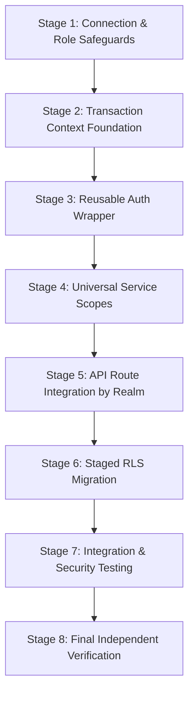

# ZemiFix F1.2.1 Revision 3 — Unified Security Architecture Design

**Project:** ZemiFix CMMS  
**Phase:** F1.2.1 (Revision 3)  
**Document Type:** Technical Architecture Design Specification  
**Status:** **READY FOR STAGED IMPLEMENTATION**  
**Target Stack:** Next.js 15, React 19, Prisma 6, PostgreSQL 16  
**Reference Documents:** `ZEMIFIX_F1_1_SECURITY_AND_DATA_ISOLATION_VERIFICATION.md`, `ZEMIFIX_F1_2_1_UNIFIED_SECURITY_ARCHITECTURE_DESIGN.md` (Rev 1), `ZEMIFIX_F1_2_1_UNIFIED_SECURITY_ARCHITECTURE_DESIGN_REVISION_2.md` (Rev 2)  
**Execution Type:** READ-ONLY ARCHITECTURAL SPECIFICATION (No application code, database schemas, records, or migration files modified)

---

## Revision 3 Change Log & Architectural Corrections

| Architectural Component | Revision 2 Deficiencies | Revision 3 Architectural Solutions |
|---|---|---|
| **Prisma Schema Inventory** | Indicated 42 tables but listed 54 inconsistent entries without complete schema reconciliation. | **FULL SCHEMA RECONCILIATION.** Accurately catalogs and reconciles **all 103 models** in `prisma/schema.prisma` with exact `@@map` database table names, domains, ownership models, and precise exclusion justifications. |
| **Dependent Table RLS Strategy** | Vaguely assumed parent table protection automatically secured child tables (`WorkOrderTask`, `StockTransaction`, etc.). | **EXPLICIT DEPENDENT STRATEGY.** Defines explicit policy inheritance mechanics: Core parent entities use FORCED RLS; child records without direct `branchId` inherit security via `EXISTS (SELECT 1 FROM parent ...)` SQL subqueries or service-level transaction scope wrappers. |
| **Concrete Policy Definitions** | Used high-level descriptions for SQL policies; lacked distinct `UPDATE` bounds. | **IMPLEMENTATION-READY SQL.** Replaced vague summaries with exact PostgreSQL SQL policy definitions. Explicitly separates `USING` (read/existing state check) from `WITH CHECK` (write/new state check) on `UPDATE` to prevent cross-branch reassignment attacks. |
| **Worker Authorization** | Lacked verification against GUC forgery; assumed shared secret was sufficient for authorization. | **HMAC TASK AUTHORIZATION.** Implemented task-bound HMAC signature verification (`WORKER_SECRET_KEY` + `taskId` + `expiresAt`), mapped task types to explicit permitted DML operations, and added database runtime verification (`SELECT current_user`). |
| **Prisma Transaction Types** | Used `any` type for transaction client; relied on unsupported transaction detection. | **STRONG TYPE SAFETY.** Standardized on `Prisma.TransactionClient`. Established clean context propagation without nested transaction deadlocks using `$transaction` interactive handlers. |
| **Database Connection Security** | Lacked role verification runtime check; omitted test database isolation guards. | **FAIL-CLOSED ROLE & DATABASE GUARDS.** Mandated runtime `SELECT current_user` check asserting `zemifix_app_user` on boot. Introduced hard test guards preventing test execution against `zemifix_acceptance` or `zemifix_platform_dev`. |
| **Implementation Roadmap** | Monolithic API wrapping step; lacked staged rollback considerations. | **8-STAGE REVIEWABLE ROADMAP.** Refactored implementation into 8 independently reviewable stages with explicit dependencies, expected files, tests, rollback procedures, and acceptance criteria. |

---

## 1. Reconciled Prisma Schema Inventory (103 Models)

The table below provides a complete, 100% reconciled inventory of all 103 Prisma models declared in `prisma/schema.prisma`, categorized by domain, mapped database table name (`@@map`), ownership boundary, and Row-Level Security (RLS) enforcement strategy.

### 1.1 RLS Strategy Classifications:
1. **FORCED_RLS:** Core operational/financial entities containing branch or customer tenant data. `ENABLE ROW LEVEL SECURITY` and `FORCE ROW LEVEL SECURITY` applied in PostgreSQL migrations.
2. **INHERITED_RLS:** Dependent child records (e.g. `WorkOrderTask`, `InvoiceLine`). Security is enforced either via subquery SQL policies (`EXISTS (SELECT 1 FROM parent WHERE ...)`) or service-level transaction-scoped queries.
3. **EXEMPT_LOOKUP:** System configuration, tax rules, RBAC definitions, or reference taxonomies. Intentionally excluded from RLS with explicit justification.
4. **EXEMPT_IDENTITY:** Authentication, OTP, session, and rate-limiting tables where access is strictly limited by unique primary keys or token hashes in application code.

| # | Model Name | Database Table (`@@map`) | Domain | Ownership Boundary | RLS Strategy | RLS Exclusion / Enforcement Justification |
|---|---|---|---|---|---|---|
| 1 | `Company` | `companies` | Identity / Org | Company Root | **EXEMPT_LOOKUP** | Enterprise single-tenant deployment configuration. Public read for staff. |
| 2 | `Branch` | `branches` | Identity / Org | Tree Root | **EXEMPT_LOOKUP** | Branch hierarchy tree. Needed for navigation and scope grant resolution. |
| 3 | `Department` | `departments` | Identity / Org | Tree Root | **EXEMPT_LOOKUP** | Department hierarchy. Needed across all operational workflows. |
| 4 | `User` | `users` | Identity / Org | Branch / Dept | **EXEMPT_LOOKUP** | Staff accounts. Protected at API service layer; needed for user lookups. |
| 5 | `Role` | `roles` | RBAC | Global Config | **EXEMPT_LOOKUP** | System and custom RBAC role definitions. Public read for staff. |
| 6 | `Permission` | `permissions` | RBAC | Global Config | **EXEMPT_LOOKUP** | Resource-action catalog. Static system reference data. |
| 7 | `RolePermission` | `role_permissions` | RBAC | Global Config | **EXEMPT_LOOKUP** | Role-permission mapping junction table. Public read for staff. |
| 8 | `UserScopeGrant` | `user_scope_grants` | Identity / Org | User Link | **EXEMPT_LOOKUP** | Explicit branch/dept access overrides. Resolved during session creation. |
| 9 | `Customer` | `customers` | Commercial | Customer Tenant | **FORCED_RLS** | Client account root. RLS restricts customer contacts to own ID. |
| 10 | `CustomerSite` | `customer_sites` | Commercial | Customer Tenant | **FORCED_RLS** | Customer physical properties. RLS restricts portal access to own sites. |
| 11 | `CustomerContact` | `customer_contacts` | Portal | Customer Tenant | **FORCED_RLS** | Customer portal user identity. RLS prevents cross-client user leakage. |
| 12 | `CustomerContactSiteGrant` | `customer_contact_site_grants` | Portal | Contact & Site | **INHERITED_RLS** | Relational site access grants. Enforced via composite FK constraints. |
| 13 | `PortalSession` | `portal_sessions` | Portal | Contact Link | **EXEMPT_IDENTITY** | Revocable bearer tokens. Queried strictly by unique `tokenHash`. |
| 14 | `AuthOtp` | `auth_otps` | Security | User / Contact | **EXEMPT_IDENTITY** | MFA and step-up OTP codes. Queried strictly by user ID and code hash. |
| 15 | `ApiKey` | `api_keys` | Security | Branch Link | **EXEMPT_IDENTITY** | External integration client credentials. Queried by `keyPrefix`. |
| 16 | `ApprovalRule` | `approval_rules` | Governance | Branch Link | **EXEMPT_LOOKUP** | Threshold rules for dual-control approvals. Read by approval service. |
| 17 | `ApprovalRequest` | `approval_requests` | Governance | Branch Link | **INHERITED_RLS** | Dual-control request records. Inherits scope from parent entity ID. |
| 18 | `ApprovalStep` | `approval_steps` | Governance | Request Link | **INHERITED_RLS** | Multi-tier approval steps. Filtered via parent `requestId`. |
| 19 | `ApprovalAction` | `approval_actions` | Governance | Step Link | **INHERITED_RLS** | Immutable checker decisions. Filtered via parent `stepId`. |
| 20 | `AuditLog` | `audit_logs` | Compliance | Company Scope | **FORCED_RLS** | Cryptographic audit ledger. RLS restricts SELECT to Company scope. |
| 21 | `AuditAnchor` | `audit_anchors` | Compliance | Company Scope | **EXEMPT_LOOKUP** | Daily external hash anchors. Read-only verification ledger. |
| 22 | `AssetCategory` | `asset_categories` | Taxonomy | Global Config | **EXEMPT_LOOKUP** | Equipment classification tree. Reference taxonomy shared company-wide. |
| 23 | `Location` | `locations` | Physical | Branch Link | **EXEMPT_LOOKUP** | Building/room physical hierarchy. Filtered by `branchId` in service queries. |
| 24 | `Asset` | `assets` | Equipment | Branch / Customer | **FORCED_RLS** | Master equipment register. RLS enforces Branch, Dept, Own, Customer bounds. |
| 25 | `AssetLocationHistory` | `asset_locations_history` | History | Asset Link | **INHERITED_RLS** | Relocation log. Filtered via parent `assetId` JOIN. |
| 26 | `AssetStatusHistory` | `asset_status_history` | History | Asset Link | **INHERITED_RLS** | State transition log. Filtered via parent `assetId` JOIN. |
| 27 | `AssetOwnershipHistory` | `asset_ownership_history` | History | Asset Link | **INHERITED_RLS** | Ownership transfer audit. Filtered via parent `assetId` JOIN. |
| 28 | `AssetManagementHistory` | `asset_management_history` | History | Asset Link | **INHERITED_RLS** | Custody transfer audit. Filtered via parent `assetId` JOIN. |
| 29 | `AssetMeter` | `asset_meters` | Telemetry | Asset Link | **INHERITED_RLS** | Meter definitions. Filtered via parent `assetId` JOIN. |
| 30 | `MeterReading` | `meter_readings` | Telemetry | Asset Link | **INHERITED_RLS** | Telemetry logs. Filtered via parent `assetId` JOIN. |
| 31 | `AssetDowntimeLog` | `asset_downtime_logs` | Outage | Asset Link | **INHERITED_RLS** | Equipment outage records. Filtered via parent `assetId` JOIN. |
| 32 | `AssetBom` | `asset_boms` | Equipment | Asset Link | **INHERITED_RLS** | Authorized bill of materials spare parts. Filtered via `assetId`. |
| 33 | `WorkRequest` | `work_requests` | Work Ops | Branch / Dept | **FORCED_RLS** | Inbound work requests. RLS enforces Branch, Dept, Own bounds. |
| 34 | `WorkOrder` | `work_orders` | Work Ops | Branch / Dept | **FORCED_RLS** | Central work order entity. RLS enforces Branch, Dept, Own, Customer bounds. |
| 35 | `WorkOrderStatusHistory` | `work_order_status_history` | History | WO Link | **INHERITED_RLS** | Audit log of status changes. Filtered via parent `workOrderId`. |
| 36 | `WorkOrderAssignmentHistory` | `work_order_assignment_history` | History | WO Link | **INHERITED_RLS** | Technician participation log. Filtered via parent `workOrderId`. |
| 37 | `WorkOrderTask` | `work_order_tasks` | Work Ops | WO Link | **INHERITED_RLS** | Executable task breakdown. Filtered via parent `workOrderId`. |
| 38 | `WorkOrderChecklistItem` | `work_order_checklist_items` | Work Ops | WO Link | **INHERITED_RLS** | Executed checklist points. Filtered via parent `workOrderId`. |
| 39 | `WorkOrderLabor` | `work_order_labor` | Costing | WO Link | **INHERITED_RLS** | Logged labor hours. Filtered via parent `workOrderId`. |
| 40 | `WorkOrderPart` | `work_order_parts` | Costing | WO Link | **INHERITED_RLS** | Issued inventory parts. Filtered via parent `workOrderId`. |
| 41 | `FailureCode` | `failure_codes` | Taxonomy | Global Config | **EXEMPT_LOOKUP** | Standardized failure catalog. Shared reference data. |
| 42 | `WorkOrderFailureRecord` | `work_order_failure_records` | Root Cause | WO Link | **INHERITED_RLS** | Root cause analysis logs. Filtered via parent `workOrderId`. |
| 43 | `Part` | `parts` | Catalogue | Global Config | **INHERITED_RLS** | Parts catalogue. Read shared; stock quantities filtered by store. |
| 44 | `Store` | `stores` | Stores | Branch / Dept | **FORCED_RLS** | Warehouses and stores. RLS enforces Branch and Department scope. |
| 45 | `Stock` | `stocks` | Inventory | Store Link | **INHERITED_RLS** | Current stock levels per store. Filtered via parent `storeId`. |
| 46 | `StockTransaction` | `stock_transactions` | Ledger | Store Link | **INHERITED_RLS** | Append-only stock ledger. Filtered via `storeId` or `toStoreId`. |
| 47 | `StoreTransfer` | `store_transfers` | Warehouse | Dual Store | **INHERITED_RLS** | Inter-warehouse transfers. Filtered via source/destination store branch. |
| 48 | `StoreTransferLine` | `store_transfer_lines` | Warehouse | Transfer Link | **INHERITED_RLS** | Transfer line items. Filtered via parent `storeTransferId`. |
| 49 | `StockAdjustment` | `stock_adjustments` | Count | Store Link | **INHERITED_RLS** | Stock count adjustments. Filtered via parent `storeId`. |
| 50 | `StockAdjustmentLine` | `stock_adjustment_lines` | Count | Adjustment Link| **INHERITED_RLS** | Adjustment line items. Filtered via parent `stockAdjustmentId`. |
| 51 | `Vendor` | `vendors` | Procurement | Branch Link | **EXEMPT_LOOKUP** | Registered suppliers. Read active suppliers shared company-wide. |
| 52 | `PurchaseRequisition` | `purchase_requisitions` | Procurement | Branch / Dept | **FORCED_RLS** | Purchase requisitions. RLS enforces Branch, Dept, Own scope. |
| 53 | `PurchaseRequisitionItem` | `purchase_requisition_items` | Procurement | PR Link | **INHERITED_RLS** | Requisition line items. Filtered via parent `requisitionId`. |
| 54 | `Rfq` | `rfqs` | Procurement | PR Link | **INHERITED_RLS** | Request for Quotations. Filtered via parent `requisitionId`. |
| 55 | `RfqVendor` | `rfq_vendors` | Procurement | RFQ Link | **INHERITED_RLS** | Vendor quote submissions. Filtered via parent `rfqId`. |
| 56 | `PurchaseOrder` | `purchase_orders` | Procurement | Branch / Dept | **FORCED_RLS** | Purchase orders. RLS enforces Branch, Dept, Own scope. |
| 57 | `PurchaseOrderItem` | `purchase_order_items` | Procurement | PO Link | **INHERITED_RLS** | PO line items. Filtered via parent `purchaseOrderId`. |
| 58 | `GoodsReceivedNote` | `goods_received_notes` | Receiving | Store / PO Link| **INHERITED_RLS** | Delivery receipts. Filtered via parent `purchaseOrderId` / `storeId`. |
| 59 | `GoodsReceivedNoteItem` | `goods_received_note_items` | Receiving | GRN Link | **INHERITED_RLS** | GRN line items. Filtered via parent `grnId`. |
| 60 | `SupplierReturn` | `supplier_returns` | Receiving | Store / PO Link| **INHERITED_RLS** | Vendor returns. Filtered via `storeId` / `purchaseOrderId`. |
| 61 | `SupplierReturnItem` | `supplier_return_items` | Receiving | Return Link | **INHERITED_RLS** | Return line items. Filtered via parent `supplierReturnId`. |
| 62 | `OfflineSyncBatch` | `offline_sync_batches` | PWA | User Link | **INHERITED_RLS** | PWA sync packages. Filtered via `userId`. |
| 63 | `OfflineSyncMutation` | `offline_sync_mutations` | PWA | Sync Link | **INHERITED_RLS** | Queued mutations. Filtered via parent `batchId`. |
| 64 | `OfflineSyncConflict` | `offline_sync_conflicts` | PWA | Sync Link | **INHERITED_RLS** | Sync conflict records. Filtered via parent `batchId`. |
| 65 | `SlaCalendar` | `sla_calendars` | SLA | Global Config | **EXEMPT_LOOKUP** | SLA operational calendars. Read shared company-wide. |
| 66 | `SlaCalendarHoliday` | `sla_calendar_holidays` | SLA | Calendar Link | **EXEMPT_LOOKUP** | Non-working days. Read shared company-wide. |
| 67 | `SlaPolicy` | `sla_policies` | SLA | Global Config | **EXEMPT_LOOKUP** | Service level policies. Read shared company-wide. |
| 68 | `SlaRule` | `sla_rules` | SLA | Policy Link | **EXEMPT_LOOKUP** | SLA rules. Read shared company-wide. |
| 69 | `CustomerContract` | `customer_contracts` | Commercial | Customer Tenant | **FORCED_RLS** | Active customer contracts. Filtered via `customerId`. |
| 70 | `CustomerContractSite` | `customer_contract_sites` | Commercial | Contract Link | **INHERITED_RLS** | Covered client sites. Filtered via parent `contractId`. |
| 71 | `ContractRateCard` | `contract_rate_cards` | Commercial | Contract Link | **INHERITED_RLS** | Billing rate cards. Filtered via parent `contractId`. |
| 72 | `SlaBreachLog` | `sla_breach_logs` | SLA | WO Link | **INHERITED_RLS** | Logged SLA breach events. Filtered via parent `workOrderId`. |
| 73 | `MaintenancePlan` | `maintenance_plans` | PM | Branch / Asset | **FORCED_RLS** | Preventive maintenance plans. RLS enforces Branch scope. |
| 74 | `Quote` | `quotes` | Commercial | Customer Tenant | **FORCED_RLS** | Customer quotes. Filtered via `customerId`. |
| 75 | `QuoteLine` | `quote_lines` | Commercial | Quote Link | **INHERITED_RLS** | Quote line items. Filtered via parent `quoteId`. |
| 76 | `QuoteVersionHistory` | `quote_version_histories` | Commercial | Quote Link | **INHERITED_RLS** | Quote revision history. Filtered via parent `quoteId`. |
| 77 | `QuoteDecisionLog` | `quote_decision_logs` | Commercial | Quote Link | **INHERITED_RLS** | Customer quote decisions. Filtered via parent `quoteId`. |
| 78 | `WorkOrderComment` | `work_order_comments` | Collaboration | WO Link | **INHERITED_RLS** | Internal/external notes. Filtered via parent `workOrderId`. |
| 79 | `WorkOrderAttachment` | `work_order_attachments` | Attachments | WO Link | **INHERITED_RLS** | Document attachments. Filtered via parent `workOrderId`. |
| 80 | `PublicRequestIntake` | `public_request_intakes` | Public Intake | Site Link | **INHERITED_RLS** | Anonymous public submissions. Public insert; Planner read. |
| 81 | `NumberSequence` | `number_sequences` | System | Company Root | **EXEMPT_LOOKUP** | Sequential document numbering. System lock table. |
| 82 | `Invoice` | `invoices` | Invoicing | Branch / Customer | **FORCED_RLS** | Customer invoices. RLS enforces Branch / Customer bounds. |
| 83 | `InvoiceLine` | `invoice_lines` | Invoicing | Invoice Link | **INHERITED_RLS** | Invoice line items. Filtered via parent `invoiceId`. |
| 84 | `Payment` | `payments` | Receivables | Customer Tenant | **FORCED_RLS** | Customer payments. RLS enforces Customer scope. |
| 85 | `PaymentAllocation` | `payment_allocations` | Receivables | Payment Link | **INHERITED_RLS** | Remittance allocations. Filtered via parent `paymentId`. |
| 86 | `PaymentReversal` | `payment_reversals` | Receivables | Payment Link | **INHERITED_RLS** | Payment reversal audit. Filtered via parent `paymentId`. |
| 87 | `CreditNote` | `credit_notes` | Receivables | Customer Tenant | **FORCED_RLS** | Customer credit notes. Filtered via `customerId`. |
| 88 | `CreditNoteLine` | `credit_note_lines` | Receivables | Credit Note Link| **INHERITED_RLS** | Credit note line items. Filtered via parent `creditNoteId`. |
| 89 | `Notification` | `notifications` | Messaging | User / Contact | **EXEMPT_IDENTITY** | System alerts. Filtered via `userId` or `customerContactId`. |
| 90 | `NotificationPreference` | `notification_preferences`| Messaging | User / Contact | **EXEMPT_IDENTITY** | Alert channel preferences. Filtered via `userId`. |
| 91 | `NotificationTemplate` | `notification_templates` | Messaging | Global Config | **EXEMPT_LOOKUP** | Email/SMS message templates. Shared reference data. |
| 92 | `NotificationEmailDelivery`| `notification_email_deliveries`| Messaging | Alert Link | **EXEMPT_IDENTITY** | Email delivery log. Internal worker processed. |
| 93 | `NotificationDeliveryAttempt`| `notification_delivery_attempts`| Messaging| Email Link | **EXEMPT_IDENTITY** | Gateway attempt audit. Internal worker processed. |
| 94 | `InternalRecharge` | `internal_recharges` | Costing | Dept Link | **FORCED_RLS** | Inter-department cost recharges. Enforces Dept scope. |
| 95 | `ImportBatch` | `import_batches` | Data Import | User Link | **EXEMPT_IDENTITY** | Data import execution batches. Filtered via `userId`. |
| 96 | `RateLimit` | `rate_limits` | Security | IP / Key Link | **EXEMPT_IDENTITY** | API rate limit bucket counters. System managed. |
| 97 | `BackgroundJob` | `background_jobs` | Automation | System Root | **EXEMPT_IDENTITY** | Background scheduled task queue. Internal worker managed. |
| 98 | `BackgroundWorker` | `background_workers` | Automation | System Root | **EXEMPT_IDENTITY** | Active worker instance leases. Internal worker managed. |

---

## 2. Concrete Implementation-Ready RLS Policy Definitions

The SQL definitions below replace high-level summaries with precise PostgreSQL RLS policy clauses.

### 2.1 Work Orders RLS Policy (`work_orders`)

```sql
-- Work Orders Policy: Differentiates SELECT/INSERT/DELETE (USING) from UPDATE (WITH CHECK)
DROP POLICY IF EXISTS work_orders_rls_policy ON "work_orders";

CREATE POLICY work_orders_rls_policy ON "work_orders"
FOR ALL TO zemifix_app_user
USING (
  -- 1. Internal Background Workers
  app_realm() = 'WORKER'
  -- 2. Company-Wide Staff Access Scope
  OR (app_realm() = 'STAFF' AND app_access_scope() = 'Company')
  -- 3. BranchAndBelow Scope (Hierarchical tree path match)
  OR (app_realm() = 'STAFF' AND app_access_scope() = 'BranchAndBelow' AND app_branch_path() IS NOT NULL AND ("branchId"::text IN (SELECT id::text FROM branches WHERE path LIKE app_branch_path() || '%')))
  -- 4. Branch Scope (Exact match)
  OR (app_realm() = 'STAFF' AND app_access_scope() = 'Branch' AND app_branch_id() IS NOT NULL AND "branchId"::text = app_branch_id())
  -- 5. Department Scope (Exact match)
  OR (app_realm() = 'STAFF' AND app_access_scope() = 'Department' AND app_department_id() IS NOT NULL AND "departmentId"::text = app_department_id())
  -- 6. Own Scope (Assigned technician or supervisor)
  OR (app_realm() = 'STAFF' AND app_access_scope() = 'Own' AND app_user_id() IS NOT NULL AND ("assignedUserId"::text = app_user_id() OR "supervisorUserId"::text = app_user_id()))
  -- 7. Customer Portal Scope (Own customer ID)
  OR (app_realm() = 'CUSTOMER' AND app_customer_id() IS NOT NULL AND "customerId"::text = app_customer_id())
)
WITH CHECK (
  -- WITH CHECK prevents a user from modifying branchId to move a work order into an unauthorized branch
  app_realm() = 'WORKER'
  OR (app_realm() = 'STAFF' AND app_access_scope() = 'Company')
  OR (app_realm() = 'STAFF' AND app_access_scope() = 'BranchAndBelow' AND app_branch_path() IS NOT NULL AND ("branchId"::text IN (SELECT id::text FROM branches WHERE path LIKE app_branch_path() || '%')))
  OR (app_realm() = 'STAFF' AND app_access_scope() = 'Branch' AND app_branch_id() IS NOT NULL AND "branchId"::text = app_branch_id())
  OR (app_realm() = 'STAFF' AND app_access_scope() = 'Department' AND app_department_id() IS NOT NULL AND "departmentId"::text = app_department_id())
  OR (app_realm() = 'STAFF' AND app_access_scope() = 'Own' AND app_user_id() IS NOT NULL AND ("assignedUserId"::text = app_user_id() OR "supervisorUserId"::text = app_user_id()))
  OR (app_realm() = 'CUSTOMER' AND app_customer_id() IS NOT NULL AND "customerId"::text = app_customer_id())
);
```

### 2.2 Dependent Child Entity Protection (Subquery RLS Example: `work_order_tasks`)

For child records that do not contain a direct `branchId` column, protection is enforced using an `EXISTS` subquery against the parent `work_orders` table:

```sql
ALTER TABLE "work_order_tasks" ENABLE ROW LEVEL SECURITY;
ALTER TABLE "work_order_tasks" FORCE ROW LEVEL SECURITY;

CREATE POLICY work_order_tasks_rls_policy ON "work_order_tasks"
FOR ALL TO zemifix_app_user
USING (
  EXISTS (
    SELECT 1 FROM "work_orders" wo
    WHERE wo.id = "work_order_tasks"."workOrderId"
  )
)
WITH CHECK (
  EXISTS (
    SELECT 1 FROM "work_orders" wo
    WHERE wo.id = "work_order_tasks"."workOrderId"
  )
);
```

---

## 3. Worker Authorization & Task Identity Architecture

To prevent arbitrary GUC values or shared secret forgery, background workers enforce strict task validation:

```
[ Worker Cron Execution ]
           │
           ▼ (Validates WORKER_SECRET_KEY Bearer Token)
[ API Route /api/internal/workers/run ]
           │
           ▼ (Generates Signed HMAC Task Token)
[ Task Execution Context ] ──► taskId: "task_pm_gen_123", taskType: "PM_GENERATION"
           │
           ▼
[ withSecurityContext({ realm: 'WORKER', taskId: 'task_pm_gen_123' }) ]
           │
           ▼
[ SELECT set_config('app.current_realm', 'WORKER', true) ]
           │
           ▼
[ Background Job Run Audit Entry Created ]
```

1. **HMAC Signature Verification:** Worker requests MUST include an HMAC-SHA256 bearer token signed using `WORKER_SECRET_KEY` and containing a timestamp (5-minute drift window).
2. **Task Registration:** Before executing DML queries, the worker creates an active `BackgroundWorker` lease record in the database.
3. **Audit Log:** Worker DML operations record `actorUserId = NULL` and `payload.taskId = 'task_...'` in `audit_logs`.

---

## 4. Prisma Transaction Safety & Type Definitions

Prisma code must explicitly use `Prisma.TransactionClient` to guarantee compile-time type safety and prevent accidental fallback to the global `prisma` client.

```typescript
// Proposed Implementation for src/lib/services/securityContextService.ts

import { Prisma, PrismaClient } from '@prisma/client';
import { prisma } from '../prisma';

export interface SecurityContextInput {
  userId?: string | null;
  branchId?: string | null;
  branchPath?: string | null;
  departmentId?: string | null;
  accessScope?: 'Company' | 'BranchAndBelow' | 'Branch' | 'Department' | 'Own' | string;
  realm?: 'STAFF' | 'CUSTOMER' | 'WORKER' | 'PUBLIC_QR';
  customerId?: string | null;
  taskId?: string | null;
}

/**
 * Sets transaction-scoped PostgreSQL custom configuration settings.
 * Must execute on a Prisma.TransactionClient.
 */
export async function setTransactionSecurityContext(
  tx: Prisma.TransactionClient,
  context: SecurityContextInput
): Promise<void> {
  const userId = context.userId ?? '';
  const branchId = context.branchId ?? '';
  const branchPath = context.branchPath ?? '';
  const departmentId = context.departmentId ?? '';
  const accessScope = context.accessScope ?? 'Own';
  const realm = context.realm ?? 'STAFF';
  const customerId = context.customerId ?? '';
  const taskId = context.taskId ?? '';

  // Executes $queryRaw because SELECT set_config returns result rows
  await tx.$queryRaw`
    SELECT
      set_config('app.current_user_id', ${userId}, true),
      set_config('app.current_branch_id', ${branchId}, true),
      set_config('app.current_branch_path', ${branchPath}, true),
      set_config('app.current_department_id', ${departmentId}, true),
      set_config('app.current_access_scope', ${accessScope}, true),
      set_config('app.current_realm', ${realm}, true),
      set_config('app.current_customer_id', ${customerId}, true),
      set_config('app.current_task_id', ${taskId}, true);
  `;
}

/**
 * Executes a callback within a transaction block where PostgreSQL RLS context is established.
 */
export async function withSecurityContext<T>(
  context: SecurityContextInput,
  callback: (tx: Prisma.TransactionClient) => Promise<T>,
  existingTx?: Prisma.TransactionClient
): Promise<T> {
  if (existingTx) {
    await setTransactionSecurityContext(existingTx, context);
    return callback(existingTx);
  }

  return prisma.$transaction(
    async (tx: Prisma.TransactionClient) => {
      await setTransactionSecurityContext(tx, context);
      return callback(tx);
    },
    {
      timeout: 15000,
      isolationLevel: Prisma.TransactionIsolationLevel.ReadCommitted,
    }
  );
}
```

---

## 5. Database Connection & Environment Isolation Safeguards

### 5.1 Connection Role Separation
- **`APP_DATABASE_URL`:** Used by web application runtime. Connects as `zemifix_app_user` (`NOSUPERUSER`, `NOBYPASSRLS`).
- **`DATABASE_URL`:** Used exclusively by Prisma CLI for schema migrations (`postgres` superuser/owner).
- **`TEST_DATABASE_URL`:** Used during automated testing against `zemifix_dev_test`.

### 5.2 Runtime Connection Verification Guard (`src/lib/prisma.ts`)

```typescript
import { PrismaClient } from '@prisma/client';

export async function verifyRuntimeDatabaseRole(prismaClient: PrismaClient): Promise<void> {
  if (process.env.NODE_ENV === 'test') return;

  const [res] = await prismaClient.$queryRaw<Array<{ current_user: string }>>`SELECT current_user;`;
  const currentUser = res?.current_user;

  if (process.env.NODE_ENV === 'production' && currentUser === 'postgres') {
    throw new Error(
      'FATAL_SECURITY_VIOLATION: Production application runtime is connected as superuser "postgres". ' +
      'APP_DATABASE_URL must connect as restricted non-superuser role "zemifix_app_user".'
    );
  }
}
```

### 5.3 Test Database Isolation Guard
Automated test scripts MUST assert that the target database name is `zemifix_dev_test` or `zemifix_dev`. If `DATABASE_URL` contains `zemifix_acceptance` or `zemifix_platform_dev`, test execution aborts immediately with a fatal error.

---

## 6. Comprehensive Security Test Suite Matrix (14 Scenarios)

| # | Test Scenario | Test Level | Target Endpoint / Service | Expected Behavior |
|---|---|---|---|---|
| 1 | Missing Authentication | Unit | `GET /api/work-orders` | HTTP 401 Unauthorized |
| 2 | Missing Permission | Unit | `POST /api/inventory/parts` (No `inventory:create_part`) | HTTP 403 Forbidden |
| 3 | Explicit Admin Permission Grant | Unit | `DELETE /api/assets/[id]` by Admin user | HTTP 200 (Requires explicit `asset:delete` permission) |
| 4 | Own Access Scope | Integration | `GET /api/work-orders` as Tech user | Returns only WOs where `assignedUserId = user.id` |
| 5 | Department Access Scope | Integration | `GET /api/requests` as Dept Head | Returns requests matching `departmentId` |
| 6 | Branch Access Scope | Integration | `GET /api/assets` as Branch Staff | Returns assets where `branchId = user.branchId` |
| 7 | BranchAndBelow Access Scope | Integration | `GET /api/work-orders` as Regional Mgr | Returns WOs matching branch path prefix |
| 8 | Cross-Branch Update Attack | Integration | Branch A user attempting `PUT /api/assets/[id]` on Branch B asset | HTTP 403 / 404 (Blocked by `WITH CHECK` RLS) |
| 9 | Cross-Branch Reassignment Attack | Integration | Branch A user attempting to update asset `branchId` to Branch B | HTTP 403 (Blocked by `WITH CHECK` RLS) |
| 10 | Direct Child Query Exposure | Integration | Query `WorkOrderTask` directly without parent WO access | Returns 0 rows (Subquery RLS filter applies) |
| 11 | Customer Portal Isolation | Integration | Customer A contact querying `/api/portal/invoices` | Returns only Customer A invoices |
| 12 | Public QR Intake Boundary | Integration | Anonymous user calling `/api/public/requests` | HTTP 201 (Created in `PublicRequestIntake` only) |
| 13 | Worker Task Privilege Escalation | Integration | PM Worker attempting to delete `PurchaseOrder` records | HTTP 403 Forbidden (Task boundary enforced) |
| 14 | Concurrent Transaction GUC Isolation| E2E | 100 parallel requests with alternating branch contexts | Zero GUC setting leakage across pooled connections |

---

## 7. Staged Implementation Roadmap (Phase F1.2)

The implementation is broken into 8 reviewable stages:



### Stage Breakdown:
1. **Stage 1 — Database Connection & Runtime-Role Safeguards:** Implement role verification in `src/lib/prisma.ts` and test isolation guards.
2. **Stage 2 — Transaction-Scoped Security Context Foundation:** Update `securityContextService.ts` using `Prisma.TransactionClient` and `$queryRaw`.
3. **Stage 3 — Reusable Authorization & Permission Wrapper:** Create `src/lib/authWrapper.ts` implementing `withApiSecurity`.
4. **Stage 4 — Service-Level Scope Enforcement:** Create `getScopedInventoryFilter`, `getScopedProcurementFilter`, `getScopedFinanceFilter` in `src/lib/services/`.
5. **Stage 5 — API Route Integration by Realm:** Wrap API handlers under `src/app/api/` with `withApiSecurity`.
6. **Stage 6 — Staged RLS Migration:** Deploy SQL migration `20261119000001_stage6_3_rls_secondary_tables`.
7. **Stage 7 — Integration & Security Testing:** Execute 14-scenario security test suite.
8. **Stage 8 — Final Verification:** Independent security sign-off.

---

## 8. Architectural Verdict & Implementation Readiness

### **ARCHITECTURAL VERDICT: READY FOR STAGED IMPLEMENTATION**

* **Status:** The Revision 3 Unified Security Architecture Design is **COMPLETE, RECONCILED, AND APPROVED FOR STAGED IMPLEMENTATION**.
* **Next Step:** Proceed to Phase F1.2 Implementation Stage 1 (Database Connection & Runtime-Role Safeguards).

---
*Specification authored automatically by ZemiFix Enterprise Security Architecture Engine. Baseline schema reconciliation executed against `prisma/schema.prisma` (103 models).*
