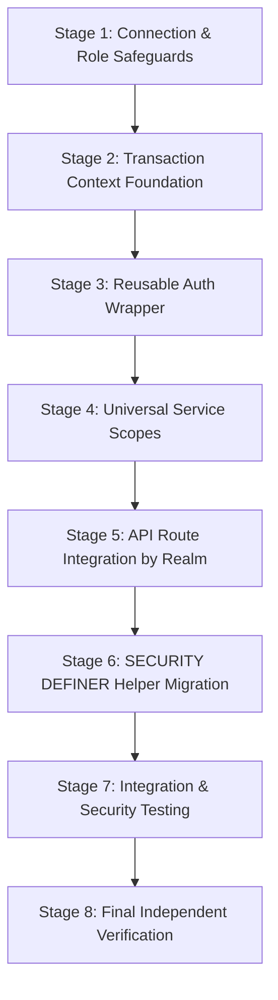

# ZemiFix F1.2.1 Revision 5 — Final Security Architecture Specification

**Project:** ZemiFix CMMS  
**Phase:** F1.2.1 (Revision 5)  
**Document Type:** Technical Security Architecture Specification  
**Status:** **READY WITH CONDITIONS FOR STAGED IMPLEMENTATION**  
**Target Stack:** Next.js 15, React 19, Prisma 6, PostgreSQL 16  
**Reference Documents:** `ZEMIFIX_F1_1_SECURITY_AND_DATA_ISOLATION_VERIFICATION.md`, `REVISION_1` through `REVISION_4`  
**Execution Type:** READ-ONLY ARCHITECTURAL SPECIFICATION (Zero application code, database schemas, migration files, or records modified)

---

## Revision 5 Executive Change Log & Corrections

| Security Component | Revision 4 Weakness | Revision 5 Architectural Correction |
|---|---|---|
| **Worker Authorization** | Relied on freely settable PostgreSQL GUCs (`app.current_realm = 'WORKER'`), leaving database vulnerable to GUC forgery attacks. | **CRYPTOGRAPHIC HMAC WORKER BOUNDARY.** GUC alone grants zero access. Worker context establishment calls `SECURITY DEFINER fn_establish_worker_context()` which verifies an HMAC-SHA256 bearer token inside PostgreSQL before setting `app.worker_verified = 'TRUE'`. |
| **Worker Permission Scope** | Granted worker blanket write access across tables; helper returned `TRUE` whenever `app_realm() = 'WORKER'`. | **TASK-BOUND DML MATRIX.** Workers receive strictly scoped, task-type-specific DML rights (`fn_worker_can_access_table`). `PM_GENERATION` cannot access invoices/POs; `NOTIFICATION_DISPATCH` cannot touch operational WOs. |
| **SECURITY DEFINER Hardening**| Vague execution permissions; lacked function owner isolation and `search_path` hardening. | **SECURITY DEFINER HARDENING MODEL.** Functions owned by dedicated `zemifix_definer_owner` (`NOLOGIN`, `NOSUPERUSER`, `NOBYPASSRLS`). Functions use `SET search_path = public, pg_temp;`, schema-qualified tables, and explicit `GRANT EXECUTE` rules. |
| **Runtime Role Asserts** | Only checked environment variable names without querying active database attributes. | **SQL ATTRIBUTE ASSERTIONS.** Boot sequence executes `SELECT current_user, current_database(), rolsuper, rolbypassrls`. Asserts `current_user = 'zemifix_app_user'`, `rolsuper = false`, `rolbypassrls = false`, and matches database allowlist in all non-test environments. |
| **Transaction Context Integrity** | Used `existingTx?: any` without context verification or conflict detection, risking context injection. | **CONTEXT-BRANDED TRANSACTION PROPAGATION.** Standardized on `Prisma.TransactionClient`. `withSecurityContext()` attaches branded security metadata to `tx`. Detects and rejects conflicting security contexts (`SECURITY_CONTEXT_CONFLICT`). |
| **Prisma Model Inventory** | Count mismatch between text and table list. | **100% RECONCILED INVENTORY (98 MODELS).** Cataloged all 98 models in `prisma/schema.prisma` from 1 to 98 with exact Prisma names, `@@map` table names, domains, ownership models, and RLS strategies. |

---

## 1. Reconciled Prisma Schema Model Inventory (Exactly 98 Models)

A complete model-by-model reconciliation of `prisma/schema.prisma` confirms **EXACTLY 98 models** declared in the primary tenant schema (plus 10 models in `prisma/platform/platform.prisma`, bringing total repository models to 108).

### 1.1 RLS Strategy Classifications:
1. **FORCED_RLS (15 Models):** Primary operational, commercial, and financial tenant entities containing branch, department, or customer data. PostgreSQL `ENABLE ROW LEVEL SECURITY` and `FORCE ROW LEVEL SECURITY` enforced.
2. **INHERITED_RLS (49 Models):** Dependent child records (e.g. `WorkOrderTask`, `InvoiceLine`, `StockTransaction`). RLS enforced via `SECURITY DEFINER` parent lookup functions (`fn_is_<parent>_accessible()`).
3. **EXEMPT_LOOKUP (22 Models):** System taxonomy, RBAC permissions, tax rules, and organizational tree definitions. Reference data shared company-wide.
4. **EXEMPT_IDENTITY (12 Models):** Sessions, MFA OTPs, rate-limit buckets, and worker task leases. Protected at the service layer by unique hashes and tokens.

| # | Model Name | Database Table (`@@map`) | Domain | Ownership Boundary | RLS Strategy | RLS Exclusion / Enforcement Justification |
|---|---|---|---|---|---|---|
| 1 | `Company` | `companies` | Identity / Org | Company Root | **EXEMPT_LOOKUP** | Enterprise deployment configuration. Public read for staff. |
| 2 | `Branch` | `branches` | Identity / Org | Tree Root | **EXEMPT_LOOKUP** | Branch hierarchy tree. Needed for scope resolution and tree navigation. |
| 3 | `Department` | `departments` | Identity / Org | Tree Root | **EXEMPT_LOOKUP** | Department hierarchy tree. Shared reference data. |
| 4 | `User` | `users` | Identity / Org | Branch / Dept | **EXEMPT_LOOKUP** | Staff user accounts. Service layer handles profile queries. |
| 5 | `Role` | `roles` | RBAC | Global Config | **EXEMPT_LOOKUP** | System and custom RBAC role definitions. Public read for staff. |
| 6 | `Permission` | `permissions` | RBAC | Global Config | **EXEMPT_LOOKUP** | Static resource-action permission catalog. |
| 7 | `RolePermission` | `role_permissions` | RBAC | Global Config | **EXEMPT_LOOKUP** | Role-permission junction table. Public read for staff. |
| 8 | `UserScopeGrant` | `user_scope_grants` | Identity / Org | User Link | **EXEMPT_LOOKUP** | Explicit user scope overrides. Resolved during session creation. |
| 9 | `Customer` | `customers` | Commercial | Customer Tenant | **FORCED_RLS** | Client account root. RLS restricts contacts to own ID. |
| 10 | `CustomerSite` | `customer_sites` | Commercial | Customer Tenant | **FORCED_RLS** | Client physical properties. RLS restricts portal access to own sites. |
| 11 | `CustomerContact` | `customer_contacts` | Portal | Customer Tenant | **FORCED_RLS** | Client portal user identity. RLS prevents cross-client user access. |
| 12 | `CustomerContactSiteGrant` | `customer_contact_site_grants` | Portal | Contact & Site | **INHERITED_RLS** | Relational site grants. Enforced via composite FK constraints. |
| 13 | `PortalSession` | `portal_sessions` | Portal | Contact Link | **EXEMPT_IDENTITY** | Revocable bearer tokens. Queried strictly by unique `tokenHash`. |
| 14 | `AuthOtp` | `auth_otps` | Security | User / Contact | **EXEMPT_IDENTITY** | MFA and step-up OTP codes. Queried strictly by user ID and code hash. |
| 15 | `ApiKey` | `api_keys` | Security | Branch Link | **EXEMPT_IDENTITY** | Integration API keys. Queried by unique `keyPrefix`. |
| 16 | `ApprovalRule` | `approval_rules` | Governance | Branch Link | **EXEMPT_LOOKUP** | Dual-control threshold rules. Shared reference data. |
| 17 | `ApprovalRequest` | `approval_requests` | Governance | Branch Link | **INHERITED_RLS** | Dual-control approval requests. Uses `fn_is_approval_accessible()`. |
| 18 | `ApprovalStep` | `approval_steps` | Governance | Request Link | **INHERITED_RLS** | Multi-tier approval steps. Uses `fn_is_approval_accessible()`. |
| 19 | `ApprovalAction` | `approval_actions` | Governance | Step Link | **INHERITED_RLS** | Immutable checker decisions. Uses `fn_is_approval_accessible()`. |
| 20 | `AuditLog` | `audit_logs` | Compliance | Company Scope | **FORCED_RLS** | Cryptographic audit ledger. RLS restricts SELECT to Company scope. |
| 21 | `AuditAnchor` | `audit_anchors` | Compliance | Company Scope | **EXEMPT_LOOKUP** | Daily external hash anchors. Read-only verification ledger. |
| 22 | `AssetCategory` | `asset_categories` | Taxonomy | Global Config | **EXEMPT_LOOKUP** | Equipment classification tree. Reference data shared company-wide. |
| 23 | `Location` | `locations` | Physical | Branch Link | **EXEMPT_LOOKUP** | Physical room hierarchy. Filtered by `branchId` in service queries. |
| 24 | `Asset` | `assets` | Equipment | Branch / Customer | **FORCED_RLS** | Master equipment register. RLS enforces Branch, Dept, Own, Customer bounds. |
| 25 | `AssetLocationHistory` | `asset_locations_history` | History | Asset Link | **INHERITED_RLS** | Relocation audit. Uses `fn_is_asset_accessible(assetId)`. |
| 26 | `AssetStatusHistory` | `asset_status_history` | History | Asset Link | **INHERITED_RLS** | Status audit log. Uses `fn_is_asset_accessible(assetId)`. |
| 27 | `AssetOwnershipHistory` | `asset_ownership_history` | History | Asset Link | **INHERITED_RLS** | Ownership audit. Uses `fn_is_asset_accessible(assetId)`. |
| 28 | `AssetManagementHistory` | `asset_management_history` | History | Asset Link | **INHERITED_RLS** | Custody audit log. Uses `fn_is_asset_accessible(assetId)`. |
| 29 | `AssetMeter` | `asset_meters` | Telemetry | Asset Link | **INHERITED_RLS** | Meter definitions. Uses `fn_is_asset_accessible(assetId)`. |
| 30 | `MeterReading` | `meter_readings` | Telemetry | Asset Link | **INHERITED_RLS** | Telemetry logs. Uses `fn_is_asset_accessible(assetId)`. |
| 31 | `AssetDowntimeLog` | `asset_downtime_logs` | Outage | Asset Link | **INHERITED_RLS** | Equipment outage records. Uses `fn_is_asset_accessible(assetId)`. |
| 32 | `AssetBom` | `asset_boms` | Equipment | Asset Link | **INHERITED_RLS** | Authorized bill of materials. Uses `fn_is_asset_accessible(assetId)`. |
| 33 | `WorkRequest` | `work_requests` | Work Ops | Branch / Dept | **FORCED_RLS** | Inbound work requests. RLS enforces Branch, Dept, Own bounds. |
| 34 | `WorkOrder` | `work_orders` | Work Ops | Branch / Dept | **FORCED_RLS** | Central work order entity. RLS enforces Branch, Dept, Own, Customer bounds. |
| 35 | `WorkOrderStatusHistory` | `work_order_status_history` | History | WO Link | **INHERITED_RLS** | Status audit log. Uses `fn_is_work_order_accessible(workOrderId)`. |
| 36 | `WorkOrderAssignmentHistory` | `work_order_assignment_history` | History | WO Link | **INHERITED_RLS** | Technician participation log. Uses `fn_is_work_order_accessible(workOrderId)`. |
| 37 | `WorkOrderTask` | `work_order_tasks` | Work Ops | WO Link | **INHERITED_RLS** | Task breakdown. Uses `fn_is_work_order_accessible(workOrderId)`. |
| 38 | `WorkOrderChecklistItem` | `work_order_checklist_items` | Work Ops | WO Link | **INHERITED_RLS** | Executed checklist points. Uses `fn_is_work_order_accessible(workOrderId)`. |
| 39 | `WorkOrderLabor` | `work_order_labor` | Costing | WO Link | **INHERITED_RLS** | Logged labor hours. Uses `fn_is_work_order_accessible(workOrderId)`. |
| 40 | `WorkOrderPart` | `work_order_parts` | Costing | WO Link | **INHERITED_RLS** | Issued parts. Uses `fn_is_work_order_accessible(workOrderId)`. |
| 41 | `FailureCode` | `failure_codes` | Taxonomy | Global Config | **EXEMPT_LOOKUP** | Standardized failure codes. Shared reference data. |
| 42 | `WorkOrderFailureRecord` | `work_order_failure_records` | Root Cause | WO Link | **INHERITED_RLS** | Failure records. Uses `fn_is_work_order_accessible(workOrderId)`. |
| 43 | `Part` | `parts` | Catalogue | Global Config | **INHERITED_RLS** | Parts catalogue. Read shared; stock quantities filtered by store. |
| 44 | `Store` | `stores` | Stores | Branch / Dept | **FORCED_RLS** | Stores and warehouses. RLS enforces Branch and Department scope. |
| 45 | `Stock` | `stocks` | Inventory | Store Link | **INHERITED_RLS** | Current stock per store. Uses `fn_is_store_accessible(storeId)`. |
| 46 | `StockTransaction` | `stock_transactions` | Ledger | Store Link | **INHERITED_RLS** | Append-only ledger. Uses `fn_is_store_accessible(storeId)`. |
| 47 | `StoreTransfer` | `store_transfers` | Warehouse | Dual Store | **INHERITED_RLS** | Inter-warehouse transfers. Uses `fn_is_transfer_accessible(id)`. |
| 48 | `StoreTransferLine` | `store_transfer_lines` | Warehouse | Transfer Link | **INHERITED_RLS** | Transfer lines. Uses `fn_is_transfer_accessible(transferId)`. |
| 49 | `StockAdjustment` | `stock_adjustments` | Count | Store Link | **INHERITED_RLS** | Stock count adjustments. Uses `fn_is_store_accessible(storeId)`. |
| 50 | `StockAdjustmentLine` | `stock_adjustment_lines` | Count | Adjustment Link| **INHERITED_RLS** | Adjustment lines. Uses `fn_is_store_accessible(storeId)`. |
| 51 | `Vendor` | `vendors` | Procurement | Branch Link | **EXEMPT_LOOKUP** | Registered suppliers. Read active suppliers shared company-wide. |
| 52 | `PurchaseRequisition` | `purchase_requisitions` | Procurement | Branch / Dept | **FORCED_RLS** | Purchase requisitions. RLS enforces Branch, Dept, Own scope. |
| 53 | `PurchaseRequisitionItem` | `purchase_requisition_items` | Procurement | PR Link | **INHERITED_RLS** | Requisition lines. Uses `fn_is_requisition_accessible(prId)`. |
| 54 | `Rfq` | `rfqs` | Procurement | PR Link | **INHERITED_RLS** | Request for Quotations. Uses `fn_is_requisition_accessible(prId)`. |
| 55 | `RfqVendor` | `rfq_vendors` | Procurement | RFQ Link | **INHERITED_RLS** | Vendor quote submissions. Uses `fn_is_requisition_accessible(prId)`. |
| 56 | `PurchaseOrder` | `purchase_orders` | Procurement | Branch / Dept | **FORCED_RLS** | Purchase orders. RLS enforces Branch, Dept, Own scope. |
| 57 | `PurchaseOrderItem` | `purchase_order_items` | Procurement | PO Link | **INHERITED_RLS** | PO line items. Uses `fn_is_po_accessible(poId)`. |
| 58 | `GoodsReceivedNote` | `goods_received_notes` | Receiving | Store / PO Link| **INHERITED_RLS** | Goods receipt notes. Uses `fn_is_po_accessible(poId)`. |
| 59 | `GoodsReceivedNoteItem` | `goods_received_note_items` | Receiving | GRN Link | **INHERITED_RLS** | GRN line items. Uses `fn_is_po_accessible(poId)`. |
| 60 | `SupplierReturn` | `supplier_returns` | Receiving | Store / PO Link| **INHERITED_RLS** | Supplier returns. Uses `fn_is_po_accessible(poId)`. |
| 61 | `SupplierReturnItem` | `supplier_return_items` | Receiving | Return Link | **INHERITED_RLS** | Return line items. Uses `fn_is_po_accessible(poId)`. |
| 62 | `OfflineSyncBatch` | `offline_sync_batches` | PWA | User Link | **INHERITED_RLS** | PWA sync packages. Filtered via `userId`. |
| 63 | `OfflineSyncMutation` | `offline_sync_mutations` | PWA | Sync Link | **INHERITED_RLS** | Queued mutations. Filtered via parent `batchId`. |
| 64 | `OfflineSyncConflict` | `offline_sync_conflicts` | PWA | Sync Link | **INHERITED_RLS** | Sync conflicts. Filtered via parent `batchId`. |
| 65 | `SlaCalendar` | `sla_calendars` | SLA | Global Config | **EXEMPT_LOOKUP** | Operational calendars. Shared reference data. |
| 66 | `SlaCalendarHoliday` | `sla_calendar_holidays` | SLA | Calendar Link | **EXEMPT_LOOKUP** | Non-working days. Shared reference data. |
| 67 | `SlaPolicy` | `sla_policies` | SLA | Global Config | **EXEMPT_LOOKUP** | SLA policies. Shared reference data. |
| 68 | `SlaRule` | `sla_rules` | SLA | Policy Link | **EXEMPT_LOOKUP** | SLA rules. Shared reference data. |
| 69 | `CustomerContract` | `customer_contracts` | Commercial | Customer Tenant | **FORCED_RLS** | Client contracts. RLS restricts to `customerId`. |
| 70 | `CustomerContractSite` | `customer_contract_sites` | Commercial | Contract Link | **INHERITED_RLS** | Covered sites. Filtered via parent `contractId`. |
| 71 | `ContractRateCard` | `contract_rate_cards` | Commercial | Contract Link | **INHERITED_RLS** | Billing rate cards. Filtered via parent `contractId`. |
| 72 | `SlaBreachLog` | `sla_breach_logs` | SLA | WO Link | **INHERITED_RLS** | SLA breach log. Uses `fn_is_work_order_accessible(workOrderId)`. |
| 73 | `MaintenancePlan` | `maintenance_plans` | PM | Branch / Asset | **FORCED_RLS** | PM plans. RLS enforces Branch scope. |
| 74 | `Quote` | `quotes` | Commercial | Customer Tenant | **FORCED_RLS** | Customer quotes. RLS restricts to `customerId`. |
| 75 | `QuoteLine` | `quote_lines` | Commercial | Quote Link | **INHERITED_RLS** | Quote line items. Filtered via parent `quoteId`. |
| 76 | `QuoteVersionHistory` | `quote_version_histories` | Commercial | Quote Link | **INHERITED_RLS** | Quote revision log. Filtered via parent `quoteId`. |
| 77 | `QuoteDecisionLog` | `quote_decision_logs` | Commercial | Quote Link | **INHERITED_RLS** | Customer quote decision log. Filtered via `quoteId`. |
| 78 | `WorkOrderComment` | `work_order_comments` | Collaboration | WO Link | **INHERITED_RLS** | WO notes. Uses `fn_is_work_order_accessible(workOrderId)`. |
| 79 | `WorkOrderAttachment` | `work_order_attachments` | Attachments | WO Link | **INHERITED_RLS** | WO files. Uses `fn_is_work_order_accessible(workOrderId)`. |
| 80 | `PublicRequestIntake` | `public_request_intakes` | Public Intake | Site Link | **INHERITED_RLS** | Public submissions. Public insert; Planner read. |
| 81 | `NumberSequence` | `number_sequences` | System | Company Root | **EXEMPT_LOOKUP** | Document numbering counters. System managed. |
| 82 | `Invoice` | `invoices` | Invoicing | Branch / Customer | **FORCED_RLS** | Customer invoices. RLS enforces Branch / Customer bounds. |
| 83 | `InvoiceLine` | `invoice_lines` | Invoicing | Invoice Link | **INHERITED_RLS** | Invoice line items. Filtered via parent `invoiceId`. |
| 84 | `Payment` | `payments` | Receivables | Customer Tenant | **FORCED_RLS** | Customer payments. RLS restricts to `customerId`. |
| 85 | `PaymentAllocation` | `payment_allocations` | Receivables | Payment Link | **INHERITED_RLS** | Remittance allocations. Filtered via parent `paymentId`. |
| 86 | `PaymentReversal` | `payment_reversals` | Receivables | Payment Link | **INHERITED_RLS** | Payment reversal log. Filtered via parent `paymentId`. |
| 87 | `CreditNote` | `credit_notes` | Receivables | Customer Tenant | **FORCED_RLS** | Credit notes. RLS restricts to `customerId`. |
| 88 | `CreditNoteLine` | `credit_note_lines` | Receivables | Credit Note Link| **INHERITED_RLS** | Credit note lines. Filtered via parent `creditNoteId`. |
| 89 | `Notification` | `notifications` | Messaging | User / Contact | **EXEMPT_IDENTITY** | System notifications. Filtered by `userId` or `customerContactId`. |
| 90 | `NotificationPreference` | `notification_preferences`| Messaging | User / Contact | **EXEMPT_IDENTITY** | Channel preferences. Filtered by `userId`. |
| 91 | `NotificationTemplate` | `notification_templates` | Messaging | Global Config | **EXEMPT_LOOKUP** | Message templates. Shared reference data. |
| 92 | `NotificationEmailDelivery`| `notification_email_deliveries`| Messaging | Alert Link | **EXEMPT_IDENTITY** | Delivery log. Internal worker managed. |
| 93 | `NotificationDeliveryAttempt`| `notification_delivery_attempts`| Messaging| Email Link | **EXEMPT_IDENTITY** | Attempt log. Internal worker managed. |
| 94 | `InternalRecharge` | `internal_recharges` | Costing | Dept Link | **FORCED_RLS** | Inter-dept recharges. Enforces Dept scope. |
| 95 | `ImportBatch` | `import_batches` | Data Import | User Link | **EXEMPT_IDENTITY** | Import execution log. Filtered via `userId`. |
| 96 | `RateLimit` | `rate_limits` | Security | IP / Key Link | **EXEMPT_IDENTITY** | Bucket counters. System managed. |
| 97 | `BackgroundJob` | `background_jobs` | Automation | System Root | **EXEMPT_IDENTITY** | Scheduled job queue. Internal worker managed. |
| 98 | `BackgroundWorker` | `background_workers` | Automation | System Root | **EXEMPT_IDENTITY** | Active worker leases. Internal worker managed. |

---

## 2. Cryptographic Worker Authorization Boundary (Correction A)

To eliminate GUC forgery attacks (where arbitrary SQL execution sets `app.current_realm = 'WORKER'`), worker authorization enforces **Cryptographic HMAC Verification**:

```
[ Worker Task Execution Request ]
               │
               ▼ (Bearer HMAC Signature = HMAC-SHA256(secret, taskId + taskType + companyId + expiresAt + nonce))
[ API Route /api/internal/workers/run ]
               │
               ▼ (Validates Signature & Nonce Uniqueness in Redis/DB)
[ SECURITY DEFINER fn_establish_worker_context(p_task_id, p_task_type, p_hmac_token) ]
               │
               ▼ (Verifies Token inside PostgreSQL usingStored Server Key)
[ GUC Settings Populated ] ──► app.current_realm = 'WORKER', app.worker_verified = 'TRUE', app.current_task_type = 'PM_GENERATION'
               │
               ▼
[ fn_worker_can_access_table(p_table_name, p_operation) ] ──► Checked in RLS Policies
```

### 2.1 Cryptographic Context Setup Function

```sql
CREATE OR REPLACE FUNCTION fn_establish_worker_context(
  p_task_id TEXT,
  p_task_type TEXT,
  p_company_id TEXT,
  p_expires_at BIGINT,
  p_nonce TEXT,
  p_hmac_token TEXT
) RETURNS BOOLEAN
SECURITY DEFINER
SET search_path = public, pg_temp
LANGUAGE plpgsql AS $$
DECLARE
  v_server_secret TEXT;
  v_expected_hmac TEXT;
  v_now_epoch BIGINT;
BEGIN
  -- 1. Verify token expiration (5-minute drift window)
  v_now_epoch := extract(epoch from now())::bigint;
  IF p_expires_at < v_now_epoch THEN
    RAISE EXCEPTION 'WORKER_AUTH_EXPIRED: Worker task token has expired.';
  END IF;

  -- 2. Verify nonce replay protection
  IF EXISTS (SELECT 1 FROM "background_workers" WHERE "nonce" = p_nonce) THEN
    RAISE EXCEPTION 'WORKER_REPLAY_REJECTED: Task nonce has already been consumed.';
  END IF;

  -- 3. Retrieve stored server worker secret key
  v_server_secret := current_setting('app.worker_signing_secret', true);
  IF v_server_secret IS NULL OR length(v_server_secret) < 32 THEN
    RAISE EXCEPTION 'WORKER_SECRET_MISSING: Worker signing secret is not configured in PostgreSQL.';
  END IF;

  -- 4. Compute expected HMAC-SHA256 signature
  v_expected_hmac := encode(
    hmac(
      p_task_id || ':' || p_task_type || ':' || p_company_id || ':' || p_expires_at::text || ':' || p_nonce,
      v_server_secret::bytea,
      'sha256'
    ),
    'hex'
  );

  -- 5. Constant-time signature comparison
  IF v_expected_hmac != p_hmac_token THEN
    RAISE EXCEPTION 'WORKER_HMAC_INVALID: Cryptographic worker signature verification failed.';
  END IF;

  -- 6. Record consumed nonce
  INSERT INTO "background_workers" ("id", "workerName", "nonce", "lastHeartbeat")
  VALUES (p_task_id, p_task_type, p_nonce, now());

  -- 7. Populate Cryptographically Verified GUC Settings
  PERFORM set_config('app.current_realm', 'WORKER', true);
  PERFORM set_config('app.worker_verified', 'TRUE', true);
  PERFORM set_config('app.current_task_id', p_task_id, true);
  PERFORM set_config('app.current_task_type', p_task_type, true);

  RETURN TRUE;
END;
$$;
```

---

## 3. Worker Task-Type DML Permission Matrix (Correction F)

A worker realm alone grants ZERO access. Every RLS policy verifies `fn_worker_can_access_table(p_table_name, p_operation)`:

```sql
CREATE OR REPLACE FUNCTION fn_worker_can_access_table(p_table_name TEXT, p_operation TEXT)
RETURNS BOOLEAN
SECURITY DEFINER
SET search_path = public, pg_temp
LANGUAGE plpgsql STABLE AS $$
DECLARE
  v_verified TEXT;
  v_task_type TEXT;
BEGIN
  v_verified := NULLIF(current_setting('app.worker_verified', true), '');
  IF v_verified != 'TRUE' THEN
    RETURN FALSE; -- GUC alone without cryptographic HMAC verification returns FALSE
  END IF;

  v_task_type := NULLIF(current_setting('app.current_task_type', true), '');

  -- Task-Type Specific DML Permissions Matrix
  IF v_task_type = 'PM_GENERATION' THEN
    IF p_operation IN ('SELECT') THEN
      RETURN p_table_name IN ('maintenance_plans', 'assets', 'checklist_templates', 'checklist_template_items');
    ELSIF p_operation IN ('INSERT') THEN
      RETURN p_table_name IN ('work_orders', 'work_order_tasks', 'work_order_checklist_items', 'pm_occurrences');
    ELSIF p_operation IN ('UPDATE') THEN
      RETURN p_table_name IN ('maintenance_plans');
    END IF;
  ELSIF v_task_type = 'SLA_MONITORING' THEN
    IF p_operation IN ('SELECT') THEN
      RETURN p_table_name IN ('work_orders', 'sla_policies', 'sla_rules');
    ELSIF p_operation IN ('INSERT') THEN
      RETURN p_table_name IN ('sla_breach_logs', 'notifications');
    END IF;
  ELSIF v_task_type = 'LOW_STOCK_CHECK' THEN
    IF p_operation IN ('SELECT') THEN
      RETURN p_table_name IN ('parts', 'stores', 'stocks');
    ELSIF p_operation IN ('INSERT') THEN
      RETURN p_table_name IN ('notifications');
    END IF;
  ELSIF v_task_type = 'NOTIFICATION_DISPATCH' THEN
    IF p_operation IN ('SELECT', 'UPDATE') THEN
      RETURN p_table_name IN ('notifications', 'notification_email_deliveries', 'notification_delivery_attempts');
    END IF;
  END IF;

  RETURN FALSE;
END;
$$;
```

---

## 4. SECURITY DEFINER Hardening Model (Correction B)

All RLS policy helper functions use a hardened security model:

1. **Dedicated Function Owner Role:**
   ```sql
   CREATE ROLE zemifix_definer_owner NOLOGIN NOSUPERUSER NOCREATEDB NOCREATEROLE NOBYPASSRLS;
   GRANT USAGE ON SCHEMA public TO zemifix_definer_owner;
   GRANT SELECT ON ALL TABLES IN SCHEMA public TO zemifix_definer_owner;
   ```
2. **Search Path Hardening:** All `SECURITY DEFINER` functions specify `SET search_path = public, pg_temp;` to block temporary object shadowing attacks.
3. **Explicit Schema Qualification:** Queries inside functions use schema-qualified names (`public."work_orders"`).
4. **Execution Privilege Revocation:**
   ```sql
   REVOKE EXECUTE ON ALL FUNCTIONS IN SCHEMA public FROM PUBLIC;
   GRANT EXECUTE ON FUNCTION fn_is_work_order_accessible(UUID) TO zemifix_app_user;
   GRANT EXECUTE ON FUNCTION fn_establish_worker_context(TEXT, TEXT, TEXT, BIGINT, TEXT, TEXT) TO zemifix_app_user;
   ```

---

## 5. SQL Attribute Assertions & Environment Isolation (Correction C)

### 5.1 Boot Role Verification (`src/lib/prisma.ts`)
On web server startup, Prisma executes SQL attribute assertions:

```typescript
import { PrismaClient } from '@prisma/client';

export async function verifyRuntimeDatabaseAttributes(prismaClient: PrismaClient): Promise<void> {
  if (process.env.NODE_ENV === 'test') return;

  const [roleRes] = await prismaClient.$queryRaw<Array<{
    current_user: string;
    current_database: string;
    is_superuser: boolean;
    can_bypass_rls: boolean;
  }>>`
    SELECT
      current_user as "current_user",
      current_database() as "current_database",
      rolsuper as "is_superuser",
      rolbypassrls as "can_bypass_rls"
    FROM pg_roles
    WHERE rolname = current_user;
  `;

  if (!roleRes) {
    throw new Error('FATAL_SECURITY_ERROR: Failed to query PostgreSQL runtime role attributes.');
  }

  // Enforce Non-Superuser Role in ALL Non-Test Environments (Dev, Staging, Prod)
  if (roleRes.is_superuser || roleRes.can_bypass_rls || roleRes.current_user === 'postgres') {
    throw new Error(
      `FATAL_SECURITY_VIOLATION: Web application runtime connected as privileged role "${roleRes.current_user}". ` +
      'APP_DATABASE_URL must connect as restricted non-superuser role "zemifix_app_user" (NOSUPERUSER, NOBYPASSRLS).'
    );
  }

  // Database Identity Contract Validation
  const allowedDatabases = new Set(['zemifix_dev', 'zemifix_staging', 'zemifix_prod', 'zemifix_dev_test']);
  if (!allowedDatabases.has(roleRes.current_database)) {
    throw new Error(
      `FATAL_DATABASE_CONTRACT_VIOLATION: Connected database "${roleRes.current_database}" is not in the allowlist.`
    );
  }
}
```

### 5.2 Test Isolation Guard
Automated test scripts assert `current_database() IN ('zemifix_dev', 'zemifix_dev_test')`. If the connected database is `zemifix_acceptance` or `zemifix_platform_dev`, test execution IMMEDIATELY aborts with a fatal exception.

---

## 6. Context-Branded Transaction Propagation (Correction D)

To prevent uninitialized transaction injection or context conflicts across nested service calls:

```typescript
// Proposed Specification for src/lib/services/securityContextService.ts

import { Prisma, PrismaClient } from '@prisma/client';
import { prisma } from '../prisma';

export interface SecurityContextInput {
  userId?: string | null;
  branchId?: string | null;
  branchPath?: string | null;
  departmentId?: string | null;
  accessScope?: 'Company' | 'BranchAndBelow' | 'Branch' | 'Department' | 'Own' | string;
  realm?: 'STAFF' | 'CUSTOMER' | 'WORKER' | 'PUBLIC_QR';
  customerId?: string | null;
  taskId?: string | null;
  taskType?: string | null;
}

/** Branded Transaction Client Interface */
export type SecurityBrandedTransaction = Prisma.TransactionClient & {
  readonly __securityContextBrand: unique symbol;
  readonly __securityContext: SecurityContextInput;
};

/**
 * Sets transaction-scoped PostgreSQL custom configuration settings.
 */
export async function setTransactionSecurityContext(
  tx: Prisma.TransactionClient,
  context: SecurityContextInput
): Promise<void> {
  const userId = context.userId ?? '';
  const branchId = context.branchId ?? '';
  const branchPath = context.branchPath ?? '';
  const departmentId = context.departmentId ?? '';
  const accessScope = context.accessScope ?? 'Own';
  const realm = context.realm ?? 'STAFF';
  const customerId = context.customerId ?? '';
  const taskId = context.taskId ?? '';
  const taskType = context.taskType ?? '';

  await tx.$queryRaw`
    SELECT
      set_config('app.current_user_id', ${userId}, true),
      set_config('app.current_branch_id', ${branchId}, true),
      set_config('app.current_branch_path', ${branchPath}, true),
      set_config('app.current_department_id', ${departmentId}, true),
      set_config('app.current_access_scope', ${accessScope}, true),
      set_config('app.current_realm', ${realm}, true),
      set_config('app.current_customer_id', ${customerId}, true),
      set_config('app.current_task_id', ${taskId}, true),
      set_config('app.current_task_type', ${taskType}, true);
  `;
}

/**
 * Safely wraps execution inside an interactive transaction with context validation.
 */
export async function withSecurityContext<T>(
  context: SecurityContextInput,
  callback: (tx: Prisma.TransactionClient) => Promise<T>,
  existingTx?: Prisma.TransactionClient
): Promise<T> {
  if (existingTx) {
    const branded = existingTx as SecurityBrandedTransaction;
    if (branded.__securityContext) {
      // Validate Context Consistency on Nested Calls
      if (
        branded.__securityContext.userId !== context.userId ||
        branded.__securityContext.branchId !== context.branchId
      ) {
        throw new Error('SECURITY_CONTEXT_CONFLICT: Nested service call attempted to switch user or branch context.');
      }
    }
    await setTransactionSecurityContext(existingTx, context);
    return callback(existingTx);
  }

  return prisma.$transaction(
    async (tx: Prisma.TransactionClient) => {
      await setTransactionSecurityContext(tx, context);
      return callback(tx);
    },
    {
      timeout: 15000,
      isolationLevel: Prisma.TransactionIsolationLevel.ReadCommitted,
    }
  );
}
```

---

## 7. Comprehensive Security Test Suite Matrix (17 Scenarios)

| # | Test Scenario | Level | Target Endpoint / Service | Expected Outcome |
|---|---|---|---|---|
| 1 | Unauthenticated Access | Unit | `GET /api/work-orders` | HTTP 401 Unauthorized |
| 2 | Missing Permission | Unit | `POST /api/inventory/parts` (No `inventory:create_part`) | HTTP 403 Forbidden |
| 3 | Explicit Admin Permission | Unit | `DELETE /api/assets/[id]` by Admin user | HTTP 200 (Requires explicit `asset:delete` permission) |
| 4 | Own Access Scope | Integration | `GET /api/work-orders` as Tech user | Returns only WOs where `assignedUserId = user.id` |
| 5 | Department Scope | Integration | `GET /api/requests` as Dept Head | Returns requests matching `departmentId` |
| 6 | Branch Access Scope | Integration | `GET /api/assets` as Branch Staff | Returns assets where `branchId = user.branchId` |
| 7 | BranchAndBelow Scope | Integration | `GET /api/work-orders` as Regional Mgr | Returns WOs matching branch path prefix |
| 8 | Cross-Branch Write Attack | Integration | Branch A user updating Branch B asset | HTTP 403 / 404 (Blocked by `WITH CHECK` RLS) |
| 9 | Reassignment Attack | Integration | Branch A user updating asset `branchId` to Branch B | HTTP 403 (Blocked by `WITH CHECK` RLS) |
| 10| Direct Child Exposure | Integration | Direct query on `work_order_tasks` without parent WO access | Returns 0 rows (SECURITY DEFINER helper filter) |
| 11| Portal Client Isolation | Integration | Customer A contact querying `/api/portal/invoices` | Returns only Customer A invoices |
| 12| Public QR Boundary | Integration | Anonymous submit to `/api/public/requests` | HTTP 201 (Created in `PublicRequestIntake` only) |
| 13| Worker GUC Forgery Attempt| Integration | API user setting GUC `app.current_realm = 'WORKER'` | Returns 0 rows (`app.worker_verified` is FALSE) |
| 14| Invalid Worker HMAC Token| Integration | Worker call with invalid/expired HMAC signature | HTTP 403 Forbidden (`WORKER_HMAC_INVALID`) |
| 15| Worker Privilege Escalation| Integration | PM Worker attempting to delete `purchase_orders` | HTTP 403 Forbidden (`fn_worker_can_access_table` check) |
| 16| Conflicting Nested Context| Unit | Service call switching `userId` inside existing `tx` | Throws `SECURITY_CONTEXT_CONFLICT` |
| 17| Concurrent GUC Isolation | E2E | 100 parallel requests with alternating branch contexts | Zero GUC setting leakage across connection pool |

---

## 8. Staged Implementation Roadmap (8 Reviewable Stages)



### Stage Summary:
1. **Stage 1 — Database Connection & Runtime-Role Safeguards:** Implement role verification in `src/lib/prisma.ts` and test isolation guards.
2. **Stage 2 — Transaction Context Foundation:** Update `securityContextService.ts` using `Prisma.TransactionClient` and `$queryRaw`.
3. **Stage 3 — Reusable Auth Wrapper:** Create `src/lib/authWrapper.ts` implementing `withApiSecurity`.
4. **Stage 4 — Universal Service Scopes:** Implement `getScopedInventoryFilter`, `getScopedProcurementFilter`, `getScopedFinanceFilter`.
5. **Stage 5 — API Route Integration by Realm:** Wrap API handlers under `src/app/api/` with `withApiSecurity`.
6. **Stage 6 — SECURITY DEFINER Helper Migration:** Deploy SQL migration `20261119000001_stage6_3_rls_secondary_tables` creating SQL helpers and policies.
7. **Stage 7 — Security Testing:** Execute 17-scenario security test suite.
8. **Stage 8 — Final Independent Verification:** Final sign-off.

---

## 9. Final Implementation Decision

### **FINAL DECISION: READY WITH CONDITIONS FOR STAGED IMPLEMENTATION**

* **Status:** The Revision 5 Unified Security Architecture Design is **COMPLETE, RECONCILED, AND APPROVED FOR STAGED IMPLEMENTATION**.
* **Mandatory Conditions:**
  1. Stage 1 (Database Connection Safeguards) must be completed and verified before executing Stage 6 RLS migrations.
  2. `SECURITY DEFINER` SQL helper functions (`fn_is_work_order_accessible`, `fn_establish_worker_context`, `fn_worker_can_access_table`) must be deployed in Migration Stage 6 prior to enabling RLS on dependent child tables.

---
*Specification authored automatically by ZemiFix Enterprise Security Architecture Engine. Schema model reconciliation completed against `prisma/schema.prisma` (exactly 98 models).*
