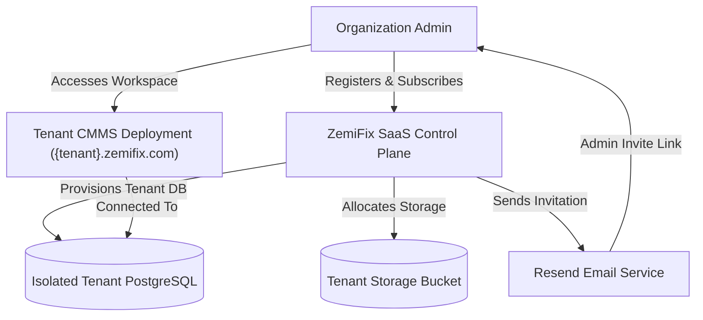
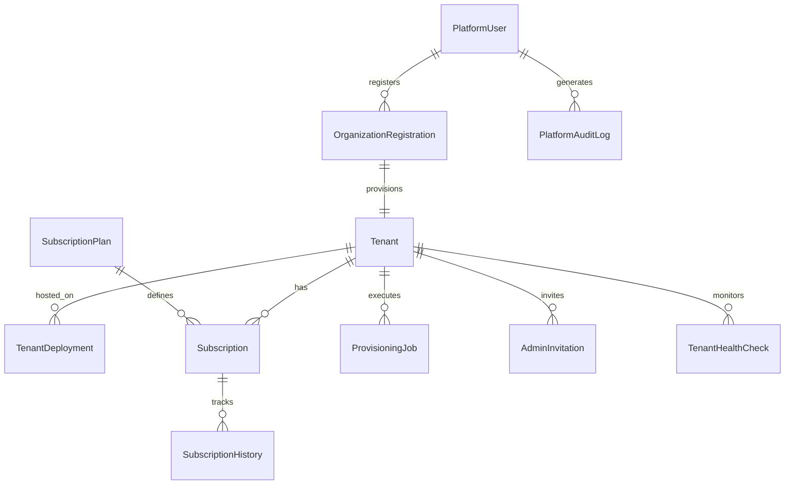
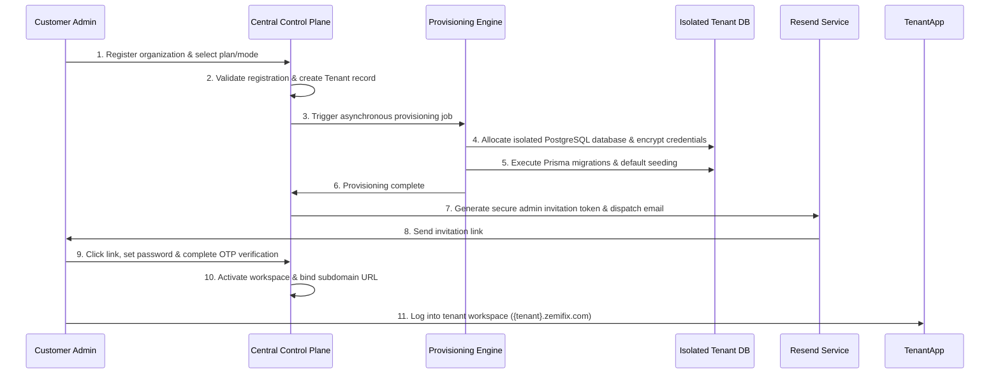
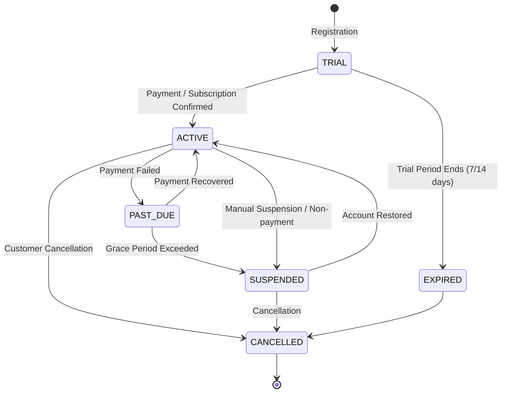

# ZemiFix Commercial SaaS Target Architecture & Implementation Blueprint

**Date:** November 18, 2026  
**Project Directory:** `E:\HP\Downloads\remix-zemifix-cmms`  
**Reference Document:** *ZemiFix Architecture Specification v1* & *ZemiFix SaaS Architecture Compatibility Audit* (`ZEMIFIX_SAAS_ARCHITECTURE_COMPATIBILITY_AUDIT.md`)  
**Scope:** Comprehensive technical architecture and implementation blueprint for transforming ZemiFix CMMS into a multi-organization commercial SaaS platform.

---

## 1. Core Architectural Decision

We strictly preserve the original architectural principle: **ONE LEGAL COMPANY PER DEPLOYMENT**.

Every subscribing organization receives an isolated ZemiFix workspace comprising:
- Its own independent Company record.
- Its own isolated PostgreSQL database.
- Its own encrypted database credentials.
- Its own company administrator.
- Its own employees, branches, departments, roles, and permissions.
- Its own operational records (work orders, assets, inventory, procurement, finance).
- Its own isolated file storage allocation.
- Its own dedicated workspace URL / subdomain (`{tenant}.zemifix.com`).

No shared multi-company tenant tables or shared database pools are introduced inside the core CMMS application.

---

## 2. Central ZemiFix Platform Control Plane

A separate central SaaS control plane (running independently from tenant CMMS instances) manages the commercial lifecycle of tenants:

### Control Plane Responsibilities
- Company self-service registration and organization profile management.
- Subscription plan management (Trial, Professional, Enterprise).
- Tenant workspace registry and endpoint directory.
- Automated tenant provisioning (database allocation, migration execution, default seeding).
- Initial company administrator secure invitation generation.
- Workspace activation, suspension (on billing expiry/default), and cancellation.
- Tenant health monitoring and telemetry logging.
- Platform-level audit logging.

### Tenant Deployment Responsibilities
- Local tenant authentication (passwords, mandatory OTP, session cookies).
- Local operational management (branches, assets, work orders, inventory, finance, PWA).
- Local Contractor Customer Portal (`/portal`).
- Local Technician PWA (`/pwa`).

---

## 3. Central Platform Database (Control Plane Schema)

The central control plane uses a dedicated platform database (separate from tenant databases) with the following entities:

### Proposed Entities & Security Requirements
1. **`PlatformUser`**: Super-administrators managing the ZemiFix platform. Stores hashed passwords, MFA secrets, and role permissions.
2. **`OrganizationRegistration`**: Prospective company signups capturing legal name, contact email, selected operating mode (`Facility`, `Contractor`, or `Both`), and chosen subscription plan.
3. **`Tenant`**: Core workspace record tracking tenant slug/subdomain, organization display name, status (`TRIAL`, `ACTIVE`, `SUSPENDED`, `CANCELLED`), and created timestamps.
4. **`TenantDeployment`**: Mapping of tenant to infrastructure endpoints, including database connection parameters (encrypted at rest), storage bucket names, and primary domain URL.
5. **`SubscriptionPlan`**: Definition of tiers (Trial, Pro, Enterprise), user caps, feature entitlements, and pricing intervals.
6. **`Subscription`**: Active subscription binding a tenant to a plan, tracking start date, renewal date, and billing state (`ACTIVE`, `PAST_DUE`, `EXPIRED`).
7. **`SubscriptionHistory`**: Audit trail of plan upgrades, downgrades, and renewals.
8. **`ProvisioningJob`**: Asynchronous job queue tracking automated workspace creation steps (DB creation, migration execution, seeding, storage allocation) with retry counters and failure logs.
9. **`AdminInvitation`**: Cryptographic time-limited invitation tokens for the first company administrator.
10. **`PlatformAuditLog`**: Tamper-evident log of all control plane actions (tenant provisioning, suspension, admin logins).
11. **`TenantHealthCheck`**: Periodic liveness pings and metrics monitoring database connectivity and disk usage per tenant.

---

## 4. Company Onboarding Workflow

### Failure Handling & Retries
- **Provisioning Failures:** If database allocation or migration fails, the `ProvisioningJob` enters a `FAILED` state with detailed error logs. The provisioning engine supports idempotent retries.
- **Duplicate Registrations:** Subdomain/slug collisions are prevented via database unique constraints and reservation checks during registration.

---

## 5. Tenant Provisioning Engine

The provisioning engine automates workspace creation:
1. **Database Creation:** Executes programmatic commands against PostgreSQL cluster to create an isolated database (`zemifix_tenant_{slug}`).
2. **Credential Generation:** Generates a unique, high-entropy password for the tenant database user.
3. **Secrets Management:** Encrypts tenant database credentials using AES-256-GCM before storing in `TenantDeployment`. Never stores plaintext passwords.
4. **Migration Execution:** Programmatically runs `prisma migrate deploy` targeting the new tenant database URL.
5. **Seeding & Configuration:** Executes baseline seeding (`prisma/seed.ts`), updating the tenant's `Company` record with the registered name, operating modes (`facility`, `contractor`), and base currency.
6. **Storage Allocation:** Provisions an isolated file storage directory / S3 bucket path (`storage/tenants/{slug}/`).
7. **Health Verification:** Performs a test connection and liveness ping against the new tenant database before marking the deployment `ACTIVE`.

---

## 6. Identity and Authentication Boundaries

| Identity | Storage Location | Authentication Mechanism | Accessible Applications / Workspaces |
| :--- | :--- | :--- | :--- |
| **A. ZemiFix Platform Admin** | Central Platform DB (`PlatformUser`) | Password + MFA / TOTP + Signed JWT (`zemifix:platform_admin`) | Central Control Plane Dashboard (`admin.zemifix.com`) |
| **B. Customer Org Admin** | Tenant DB (`User` with Admin Role) | Password + Mandatory OTP + Signed JWT (`zemifix_session`) | Company Workspace (`{tenant}.zemifix.com`) |
| **C. Internal Company Staff** | Tenant DB (`User` with Role/Scope) | Password + Mandatory OTP + Signed JWT (`zemifix_session`) | Company Workspace (`{tenant}.zemifix.com`), PWA (`/pwa`) |
| **D. Contractor Customer Portal Contact** | Tenant DB (`CustomerContact`) | Password + Portal Session JWT (`zemifix_portal_session`) | Contractor Customer Portal (`{tenant}.zemifix.com/portal`) |

*Note:* Platform Administrators do not have automatic access to tenant databases or workspaces unless explicit support-access delegation or invitation is granted.

---

## 7. Subscription and Licensing Lifecycle

- **Enforcement:** The control plane middleware intercepts requests to suspended or expired tenants, redirecting users to a billing renewal notice page.

---

## 8. Workspace Routing

- **Domain Structure:** `{tenant}.zemifix.com` (e.g., `hospital.zemifix.com`, `hotel.zemifix.com`).
- **Reverse Proxy / Gateway:** An Nginx / Traefik or Cloudflare reverse proxy inspects the incoming `Host` header, extracts the tenant subdomain, looks up the active deployment endpoint in the central control plane cache/registry, and routes traffic to the corresponding container/server instance.
- **TLS:** Wildcard SSL certificate (`*.zemifix.com`) managed automatically via Let's Encrypt / Cloudflare.

---

## 9. Deployment and Infrastructure Recommendation

- **Recommended Approach for First Commercial Release:**
  - **Shared App Infrastructure, Isolated Tenant Databases:** Deploy a single containerized instance of the ZemiFix Next.js application, but dynamically configure `DATABASE_URL` per request or per worker based on the tenant subdomain lookup. Each tenant maintains its own completely independent PostgreSQL database and file storage path.
  - **Benefits:** Minimizes hosting costs and container management complexity while strictly preserving the "zero-shared-data" tenant isolation principle.

---

## 10. Existing ZemiFix Compatibility

- Existing core models (`Company`, `Branch`, `Department`, `User`, `Role`, `Permission`, `Asset`, `WorkOrder`, etc.), authentication, OTP, access scopes, operational modes, Customer Portal (`/portal`), and Technician PWA (`/pwa`) remain **100% unchanged** within each tenant deployment.
- The control plane wraps around the existing application without altering internal CMMS business logic.

---

## 11. Phased Implementation Roadmap

| Phase | Milestone | Deliverables | Acceptance Criteria |
| :--- | :--- | :--- | :--- |
| **S0** | Architecture & Infrastructure Setup | Architecture sign-off, wildcard DNS, wildcard SSL configuration. | DNS and gateway routing verified. |
| **S1** | Central Control Plane & Registry | Platform database schema (`PlatformUser`, `Tenant`, `TenantDeployment`), admin login. | Super-admins can manage tenant records. |
| **S2** | Automated Provisioning Engine | Scripted DB allocator, dynamic Prisma migration runner, seeding service. | New tenant DB successfully provisioned and migrated via API. |
| **S3** | Registration & Admin Invitation | Self-service signup form, invitation email dispatcher via Resend, password/OTP setup. | User registers organization, receives invite, logs into new workspace. |
| **S4** | Tenant Health & Management | Health-check background worker, platform dashboard, suspension controls. | Control plane displays live tenant status and metrics. |
| **S5** | Subscription & Commercial Readiness | Subscription tiers, trial expiration handling, billing enforcement middleware. | Expired trials automatically restricted. |

---

## 12. Conclusion & Approval Request

This architecture successfully scales ZemiFix into a commercial multi-organization SaaS platform while strictly honoring the core architectural requirement of **one legal company per deployment with isolated database storage**.

*Approval Requested:* Proceed to Phase S1 (Central Control Plane & Registry setup) upon user sign-off.
