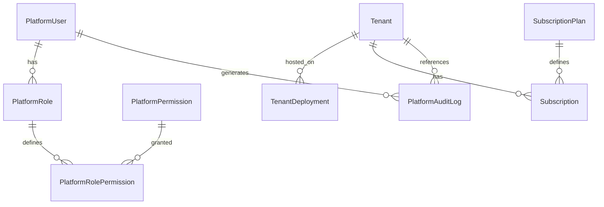

# ZemiFix SaaS Phase S1 Technical Design: Central Control Plane

**Date:** November 18, 2026  
**Project Directory:** `E:\HP\Downloads\remix-zemifix-cmms`  
**Reference Specification:** *ZemiFix SaaS Target Architecture Blueprint Final*  
**Scope:** Phase S1.1 detailed technical design and implementation preparation for the Central ZemiFix SaaS Platform Control Plane. (Read-only architectural planning; no code or schema changes implemented in this task).

---

## 1. Objective

Design the isolated central ZemiFix Platform Control Plane responsible for overseeing fleet-wide operations, subscription management, organization registrations, tenant workspace registry, deployment metadata, provisioning workflows, super-administrator authentication, platform audit logging, and tenant health monitoring.

The control plane is strictly separated from tenant CMMS database instances and application runtimes.

---

## 2. Existing Project Preservation

To ensure the existing CMMS application remains completely pristine:
- Existing tenant Prisma schema (`prisma/schema.prisma`) is untouched.
- Existing tenant `Company`, `User`, and `Role` models remain isolated inside tenant databases.
- Existing staff authentication, mandatory OTP, Customer Portal (`/portal`), Technician PWA (`/pwa`), and CMMS modules are preserved without alteration.
- The control plane utilizes its own independent database (`zemifix_platform_dev`) and separate authentication mechanisms.

---

## 3. Platform Database Design (Minimum S1 Schema)

The control plane requires its own Prisma schema (e.g., `prisma/platform.schema.prisma`) pointing to `zemifix_platform_dev`.

### Minimum Required S1 Models
1. **`PlatformUser`**: Super-administrators with platform-level access.
2. **`PlatformRole` & `PlatformPermission`**: RBAC for platform administrators.
3. **`Tenant`**: Master registry of subscribing organizations.
4. **`TenantDeployment`**: Endpoint and database connection metadata per tenant.
5. **`SubscriptionPlan` & `Subscription`**: Commercial tiers and billing status.
6. **`PlatformAuditLog`**: Tamper-evident logging of platform-level administrative actions.

### Entity Relationship Diagram (Mermaid)

### Prisma Model Definitions (Proposed S1)
- **`PlatformUser`**: `id` (UUIDv7), `name` (String), `email` (Unique String), `passwordHash` (String), `isActive` (Boolean), `roleId` (UUIDv7), `createdAt`, `updatedAt`.
- **`Tenant`**: `id` (UUIDv7), `slug` (Unique String, subdomain), `name` (String), `status` (`TRIAL`, `ACTIVE`, `SUSPENDED`, `CANCELLED`), `createdAt`, `updatedAt`.
- **`TenantDeployment`**: `id` (UUIDv7), `tenantId` (UUIDv7, Unique), `dbName` (String), `dbUrlEncrypted` (Text, AES-256-GCM), `storageBucket` (String), `customDomain` (String? Ùnique), `createdAt`.
- **`SubscriptionPlan`**: `id` (UUIDv7), `name` (String), `code` (Unique String), `maxUsers` (Int), `priceMonthly` (Decimal).
- **`Subscription`**: `id` (UUIDv7), `tenantId` (UUIDv7, Unique), `planId` (UUIDv7), `status` (`TRIAL`, `ACTIVE`, `PAST_DUE`, `EXPIRED`, `CANCELLED`), `currentPeriodEnd` (DateTime).
- **`PlatformAuditLog`**: `id` (UUIDv7), `platformUserId` (UUIDv7?), `tenantId` (UUIDv7?), `action` (String), `resource` (String), `payload` (JSONB), `clientIp` (String), `createdAt`.

---

## 4. Platform Authentication Architecture

- **Isolation:** Stored exclusively in the platform database (`PlatformUser`). Never shares credentials or sessions with tenant CMMS users.
- **Session Tokens:** Signed HMAC-JWTs issued with audience `zemifix:platform_admin` and stored in an HTTP-only secure cookie `zemifix_platform_session`.
- **Authorization:** Enforced via `PlatformRole` and `PlatformPermission` checks on all control plane API routes (`/api/platform/*`).
- **Audit Logging:** Every sensitive platform action (tenant creation, suspension, deployment modification) is automatically recorded in `PlatformAuditLog`.

---

## 5. Repository Structure Recommendation

**Recommended Arrangement: Monorepo** (Unified Repository)
- **Rationale:** Maintaining the control plane within the existing repository (under a dedicated `src/control-plane/` or `platform/` directory with its own Prisma schema) keeps the codebase cohesive, simplifies CI/CD pipelines, and allows shared utility libraries (such as validation, crypto, and logging) to be reused safely without managing multiple micro-repositories.
- **Collaboration Safety:** Friends collaborating on the CMMS tenant application work within `src/app/`, `src/lib/`, and tenant modules, while platform control plane code resides in isolated directories, preventing accidental interference.

---

## 6. Local Development Configuration

- **Tenant CMMS Application:**
  - Port: `3000`
  - Database: `zemifix_dev` (via `DATABASE_URL`)
- **Central Control Plane:**
  - Port: `3001`
  - Database: `zemifix_platform_dev` (via `PLATFORM_DATABASE_URL`)
- **Isolation:** Both applications run independently; neither accesses the other's database.

---

## 7. S1 Implementation Scope

### What Belongs in S1 (Phase 1)
- Platform database setup (`zemifix_platform_dev`) and platform Prisma configuration (`prisma/platform.prisma`).
- Platform administrator model, password hashing, and authentication (`zemifix_platform_session`).
- Platform RBAC permissions and audit logging middleware.
- Initial Platform Control Plane admin dashboard (`/platform` or `/admin`).
- Tenant registry foundation (`Tenant` and `TenantDeployment` CRUD).

### What Must Wait for Later Phases
- Automated database provisioning engine (Phase S2).
- Organization self-service registration and Stripe/payment integration (Phase S3 & S5).
- First-admin email invitations via Resend (Phase S3).
- Production DNS wildcard routing (Phase S0 / Production).

---

## 8. Security and Acceptance Testing

- **Acceptance Test Suite:**
  1. Platform administrator can authenticate with valid credentials.
  2. Platform session cookies (`zemifix_platform_session`) are rejected by tenant CMMS endpoints (`/api/auth/me`), verifying session separation.
  3. Unauthenticated requests to platform APIs return HTTP 401.
  4. Platform RBAC restricts non-super-admin platform users from modifying tenant registries.
  5. Platform audit logs successfully record all administrative mutations.
  6. Control plane database queries have zero dependency or connection overlap with `zemifix_dev`.

---

## 9. Implementation Sequence & Next Step (S1.2)

1. **Step S1.2:** Initialize platform database configuration (`prisma/platform.prisma` targeting `zemifix_platform_dev`).
2. **Step S1.3:** Implement platform authentication library (`platformAuth.ts`) and platform session cookies.
3. **Step S1.4:** Build platform API routes for tenant registry and platform admin management.
4. **Step S1.5:** Build platform control plane dashboard UI.

**Recommended Exact First Implementation Task (S1.2):**  
Create the platform Prisma schema (`prisma/platform.prisma`) defining `PlatformUser`, `Tenant`, `TenantDeployment`, `SubscriptionPlan`, `Subscription`, and `PlatformAuditLog` for the `zemifix_platform_dev` database.
