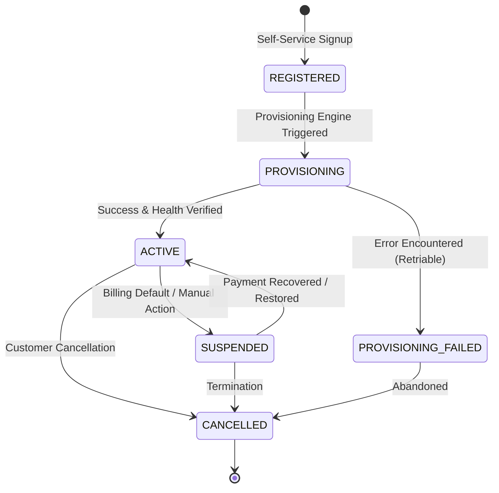

# ZemiFix SaaS Phase S1 Technical Design — Final (Approved)

**Date:** November 18, 2026  
**Project Directory:** `E:\HP\Downloads\remix-zemifix-cmms`  
**Reference Specification:** *ZemiFix SaaS Target Architecture Blueprint Final*  
**Scope:** Final read-only technical design and architectural review for Phase S1 (Central ZemiFix SaaS Platform Control Plane).

---

## 1. Prisma Client & Database Isolation

### A. Prisma Schema & Client Location
- **Platform Schema Location:** Standardized at `prisma/platform.prisma`.
- **Tenant Schema:** Existing tenant schema (`prisma/schema.prisma`) remains 100% untouched.
- **Separate Client Output Directory:** The platform Prisma schema explicitly defines a custom generator output directory:
  ```prisma
  generator client {
    provider = "prisma-client-js"
    output   = "../node_modules/@prisma/platform-client"
  }
  ```
  This guarantees that generating the platform client never overwrites or conflicts with the existing tenant Prisma Client (`@prisma/client`).

### B. Separate Generation & Migration Commands
- **Platform Client Generation:** `npx prisma generate --schema=prisma/platform.prisma`
- **Platform Database Migrations:** `npx prisma migrate dev --schema=prisma/platform.prisma --name <migration_name>`

### C. Database Isolation Guarantee
- **Tenant App:** `DATABASE_URL` $\rightarrow$ `zemifix_dev` (accessed exclusively via standard `@prisma/client`).
- **Platform App:** `PLATFORM_DATABASE_URL` $\rightarrow$ `zemifix_platform_dev` (accessed exclusively via `@prisma/platform-client`).
- **Zero Cross-Talk:** Dynamic runtime connection switching is strictly prohibited. Platform code never imports or calls the tenant Prisma Client, and tenant code never imports or calls the platform Prisma Client.

---

## 2. Platform Authentication Security

- **Password Hashing:** Uses bcrypt with cost factor 10, identical to the secure tenant password hashing implementation.
- **JWT Specification:**
  - **Issuer:** `zemifix-platform`
  - **Audience:** `zemifix:platform_admin`
  - **Expiration:** 4 hours (shorter than tenant sessions to mitigate idle admin session hijacking).
  - **Signing Key:** Isolated environment variable `PLATFORM_SESSION_SECRET` (minimum 32 random characters).
- **Session Cookie:** HTTP-only, `secure` in production, `SameSite=strict`, named `zemifix_platform_session`.
- **CSRF Protection:** Enforced on all state-changing platform API requests (`POST`, `PUT`, `PATCH`, `DELETE`) via strict Origin/CSRF header validation middleware.
- **Brute-Force & MFA:** Rate limiting on platform login attempts (max 5 attempts per 15 minutes per IP/email) and TOTP-based Multi-Factor Authentication (MFA) required for all platform administrators.
- **Isolation:** Platform session cookies are scoped strictly to control plane endpoints (`/platform/*` and `/api/platform/*`) and will never validate against tenant CMMS endpoints.

---

## 3. Platform RBAC (Role-Based Access Control)

- **Entities:** `PlatformUser`, `PlatformRole`, `PlatformPermission`, `PlatformRolePermission`.
- **Role Assignment Model:** Each `PlatformUser` is assigned a single `PlatformRole` (e.g., `SuperAdmin`, `SupportAdmin`, `BillingAdmin`). Roles map to many `PlatformPermissions` via `PlatformRolePermission`.
- **API Authorization:** Every sensitive platform API action enforces explicit permission checks using a `requirePlatformPermission(resource, action)` guard.

---

## 4. Tenant Lifecycle States

The control plane tracks tenant organizations through a definitive lifecycle state machine:



- **Triggering Operations:** Registration triggers `REGISTERED`; background provisioning triggers `PROVISIONING`; successful seeding and health pings transition to `ACTIVE`; payment failures or admin actions trigger `SUSPENDED`; explicit termination triggers `CANCELLED`.

---

## 5. Tenant Deployment Secrets Management

- **Storage Strategy:** Rather than storing raw decrypted database passwords in plaintext or basic symmetric encryption fields, tenant deployment records store **Secrets Manager References** (e.g., AWS Secrets Manager ARN or HashiCorp Vault path) in `TenantDeployment.secretArn`.
- **Fallback Encryption (AES-256-GCM):** If stored locally in `dbUrlEncrypted`, records are encrypted using AES-256-GCM with envelope encryption, keyed via `MASTER_ENCRYPTION_KEY`.
- **Log Redaction:** All logging pipelines automatically mask connection strings and secrets as `[REDACTED]`.
- **Zero API Exposure:** Tenant database credentials are never returned through platform API responses.

---

## 6. Platform Audit Logging & Tamper Evidence

- **Append-Only Behavior:** Platform audit logs are written exclusively via Prisma `.create()` statements within controlled service transactions; updates and deletes are blocked at the database engine level by revoking `UPDATE` and `DELETE` privileges on the `platform_audit_logs` table.
- **Logged Attributes:** `actorId`, `action`, `targetResource`, `targetId`, `timestamp`, `outcome` (`SUCCESS` / `FAILURE`), `clientIp`, and redacted JSON payload.
- **Tamper Evidence:** Each audit log entry includes an HMAC-SHA256 checksum chaining the previous log entry's checksum, creating a tamper-evident hash chain.

---

## 7. GitHub Repository Structure & Collaboration Trade-Offs

- **Monorepo Approach (Recommended):** Keeping the control plane inside the existing `New_Zemifix` repository (in a dedicated `src/platform/` directory with `prisma/platform.prisma`) is recommended for the first release.
- **Collaboration Trade-Offs:**
  - *Pros:* Shared TypeScript utility functions, unified CI/CD linting, easy local setup, single PR review workflow.
  - *Cons:* Folder-level permissions on GitHub do not prevent collaborators from editing files outside their assigned module.
- **Mitigation:** Strict branch protection rules, code owners, and automated pre-commit linting checks ensure CMMS developers do not modify platform control plane files.

---

## 8. S1 Implementation Scope & Conclusion

- **S1 Scope:** Platform database foundation (`prisma/platform.prisma`), platform authentication (`zemifix_platform_session`), platform RBAC, tamper-evident audit logging, and the initial control-plane administration dashboard.
- **Deferred:** Automated database provisioning, organization self-registration, first-admin invitations, Stripe integration, and production DNS.
- **Readiness Statement:** The architecture is **fully ready for S1.2 implementation** (Creating `prisma/platform.prisma` targeting `zemifix_platform_dev`).
- **Remaining Decisions Requiring Human Approval:** Approval to proceed with creating `prisma/platform.prisma` and the platform client output directory.
