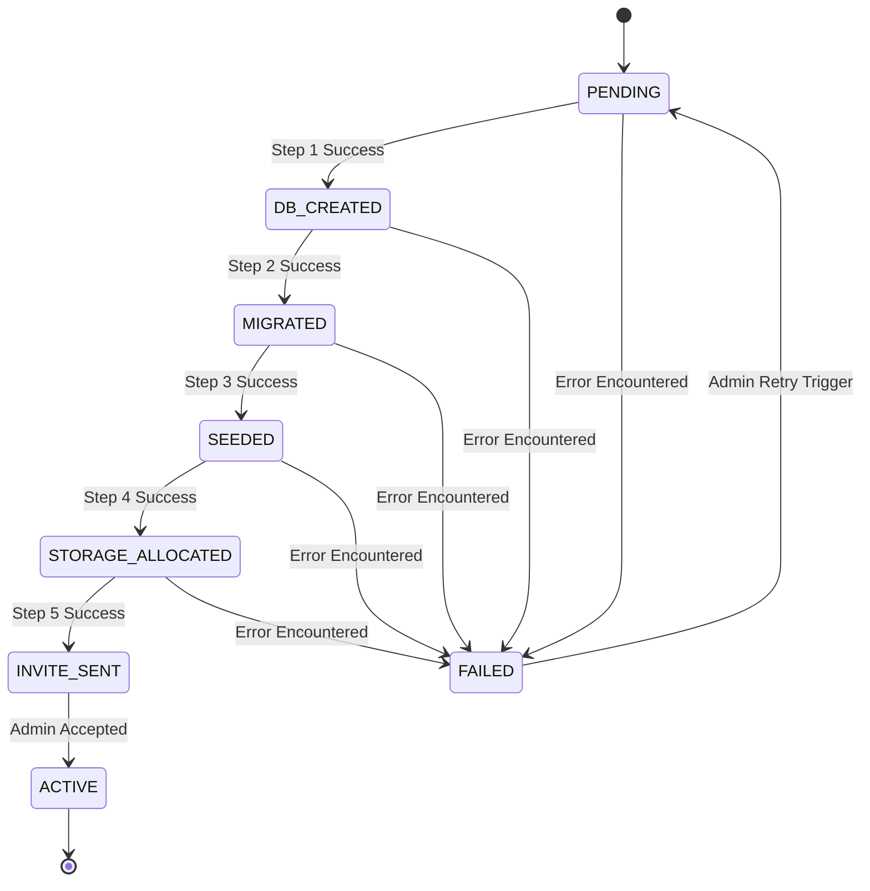

# ZemiFix Commercial SaaS Target Architecture Blueprint — Version 2 (Revised)

**Date:** November 18, 2026  
**Project Directory:** `E:\HP\Downloads\remix-zemifix-cmms`  
**Reference Specification:** *ZemiFix Architecture Specification v1* & *ZemiFix SaaS Architecture Compatibility Audit*  
**Scope:** Read-only architectural revision resolving deployment topology, database isolation, administrator invitations, secrets management, provisioning recovery, and identity boundaries.

---

## 1. Resolution of Deployment Architecture Contradiction

The original *ZemiFix Architecture Specification v1* dictates: **ONE LEGAL COMPANY PER DEPLOYMENT**.

In Version 1 of this blueprint, a shared Next.js application server with dynamic `DATABASE_URL` switching per request was evaluated. However, upon rigorous architectural review, dynamic runtime switching of `DATABASE_URL` introduces severe risks:
- **Prisma Client Caching & Connection Pool Exhaustion:** Prisma generates client instances bound to a specific connection string at startup. Dynamic per-request re-instantiation of Prisma clients bypasses connection pooling, leading to connection leaks and socket exhaustion under load.
- **Background Worker Ambiguity:** Background workers and scheduled tasks (e.g. SLA breach scanners, automated billing jobs) require a fixed context database connection. Dynamic runtime switching makes asynchronous background processing extremely fragile.
- **Cache & Memory Isolation:** Shared Node.js memory heaps across tenants increase the surface area for cross-tenant data leakage via global variables or request context pollution.

### Recommendation for First Commercial Release: Option A (Separate Application Deployment & Database per Company)
- **Topology:** Each subscribing organization receives an independent, containerized deployment of the ZemiFix application coupled with its own dedicated PostgreSQL database and private file storage bucket.
- **Isolation Guarantee:** Absolute hardware-level / container-level isolation. A compromise or resource spike in Tenant A cannot impact Tenant B.
- **Control Plane Role:** The central ZemiFix Platform Control Plane orchestrates provisioning via Infrastructure-as-Code (IaC) or container orchestration APIs (Docker/ECS/Kubernetes namespaces), managing deployments without runtime coupling.

---

## 2. Database Infrastructure Strategy

To balance operational cost and absolute isolation without weakening security:

- **Cluster-Level Sharing vs. Database-Level Isolation:** 
  - For the first commercial release, multiple isolated tenant PostgreSQL **databases** (e.g. `zemifix_tenant_hospital_a`, `zemifix_tenant_hotel_b`) will reside within a **single managed PostgreSQL database cluster** (or cloud RDS instance).
- **Security Boundaries:** 
  - Each tenant database has a unique, high-entropy database role/username and password.
  - PostgreSQL role permissions strictly restrict each tenant database user to their own database (`GRANT ALL PRIVILEGES ON DATABASE zemifix_tenant_x TO tenant_user_x`). Cross-database queries are disallowed at the database engine level.
- **Scaling Path:** As tenants grow to Enterprise tiers, their database can be migrated to a dedicated PostgreSQL server or cluster seamlessly by updating the tenant's connection string in the control plane registry.

---

## 3. Administrator Invitation Ownership & Lifecycle

While the central platform initiates the onboarding and invitation process, the actual Customer Organization Administrator account belongs **entirely to the tenant organization's local `User` table**, preserving complete tenant sovereignty.

```mermaid
sequenceDiagram
    participant CP as Central Control Plane
    participant DB as Tenant PostgreSQL DB
    participant Email as Resend Email Service
    participant Admin as Customer Org Admin

    CP->>DB: 1. Provision default roles & seed admin placeholder user (isActive: false)
    CP->>CP: 2. Generate cryptographically secure token (SHA-256 hashed storage)
    CP->>Email: 3. Dispatch invitation email with secure one-time link
    Email->>Admin: 4. Deliver invite link ({tenant}.zemifix.com/setup?token=...)
    Admin->>DB: 5. Access setup URL & submit new password
    DB->>DB: 6. Verify token hash, activate user account (isActive: true), hash password
    Admin->>DB: 7. Complete mandatory OTP verification
    DB->>CP: 8. Invalidate invitation token (single-use enforcement)
    CP->>Admin: 9. Workspace fully activated; redirect to login
```

### Invitation Security & Enforcement
- **Token Generation:** 256-bit cryptographic random tokens, stored as SHA-256 hashes in the central control plane and tenant DB.
- **Expiration & Single-Use:** Invalidation upon successful password creation or after 48 hours.
- **Tenant Binding:** Cryptographically bound to the specific tenant ID and user email.
- **Separation:** Platform administrators have no administrative rights inside the tenant DB.

---

## 4. Secrets Management Architecture

To securely manage tenant database credentials and sensitive configuration:
- **Storage Location:** Tenant database connection strings and secrets are stored in the central platform database (`TenantDeployment`) encrypted at rest using **AES-256-GCM**.
- **Key Protection:** Master encryption keys are loaded exclusively via environment variables (`MASTER_ENCRYPTION_KEY`) from a secure secrets manager (AWS Secrets Manager, HashiCorp Vault, or environment vault).
- **Key Rotation:** Supports envelope encryption where tenant secrets are encrypted with a tenant-specific Data Encryption Key (DEK), which is wrapped by the Master Key. Key rotation re-wraps DEKs without downtime.
- **Retrieval:** Provisioning workers fetch credentials securely via memory-scoped internal service calls. Credentials are scrubbed from all logging pipelines (`[REDACTED]`).
- **Rotation:** Supports rolling rotation by generating new database passwords, updating PostgreSQL roles, re-encrypting records in the control plane, and restarting the tenant deployment gracefully.

---

## 5. Provisioning Failure Recovery & Idempotency

Provisioning an isolated workspace involves multiple distributed steps (DB creation, user creation, migration, seeding, storage, DNS).



### Idempotency & Recovery
- **State Machine:** Every `ProvisioningJob` tracks granular step states. If a job fails at migration or seeding, a retry inspects the current state, skips already-completed steps (e.g. database creation if DB already exists), and resumes from the failure point.
- **Rollback / Cleanup:** If a provisioning failure is unrecoverable, automated cleanup drops the partially created database and storage directory to prevent orphaned infrastructure.

---

## 6. Responsibility Matrix

| Role | Responsibilities | Access Boundary |
| :--- | :--- | :--- |
| **A. ZemiFix Platform Admin** | Manages platform subscriptions, tenant registry, deployment health, billing tiers, and system monitoring. | Central Control Plane (`admin.zemifix.com`) |
| **B. Platform Provisioning Engine** | Executes automated tenant database allocation, migration runner, container deployment, and invite delivery. | Internal Control Plane Worker Service |
| **C. Customer Org Admin** | Manages company configuration, branches, departments, employees, roles, and administrative settings. | Tenant Workspace (`{tenant}.zemifix.com`) |
| **D. Internal Company Staff** | Executes work orders, manages inventory, logs labor, and operates the Technician PWA (`/pwa`). | Tenant Workspace (`{tenant}.zemifix.com`) |
| **E. Contractor Customer Portal Contact** | External client viewing work orders, requests, contracts, quotes, and downloading PDF invoices. | Tenant Customer Portal (`{tenant}.zemifix.com/portal`) |

---

## 7. Updated Implementation Roadmap (S0 to S5)

| Phase | Milestone | Deliverables | Approval Prerequisite |
| :--- | :--- | :--- | :--- |
| **S0** | Architecture Sign-off & Infrastructure Setup | Infrastructure topology approval, wildcard DNS (`*.zemifix.com`), wildcard SSL setup. | **Infrastructure Decision Sign-off** |
| **S1** | Central Control Plane & Registry | Control plane database schema, super-admin authentication, tenant registry API. | Platform Database Design Approval |
| **S2** | Automated Provisioning Engine | Isolated PostgreSQL database allocator, Prisma migration runner, seeding service, idempotency checks. | Provisioning Security & Secrets Sign-off |
| **S3** | Organization Registration & Admin Invitation | Self-service signup portal, secure token hashing, Resend email invitation dispatcher, first-admin password/OTP setup. | Onboarding Flow Approval |
| **S4** | Tenant Health Monitoring & Management | Health-check background worker, platform admin metrics dashboard, manual/automatic suspension controls. | Monitoring Architecture Approval |
| **S5** | Subscription & Billing Enforcement | Tier limits, trial expiration logic, billing grace periods, suspension middleware. | Commercial Pricing Tier Sign-off |

---

## 8. Outstanding Decisions Requiring Approval

1. **Hosting Provider Selection:** Approval for initial container orchestration platform (e.g., AWS ECS, Render, or Docker Swarm) for isolated tenant deployments.
2. **Database Cluster Architecture:** Approval for using a managed PostgreSQL cluster with isolated tenant database roles for the first release.
3. **Subdomain Provisioning Strategy:** Approval for automated DNS record creation via Cloudflare API during tenant provisioning.

---

## Summary of Changes from Version 1
- **Deployment Topology:** Revised from shared application servers with dynamic connection strings to fully isolated, containerized application deployments per tenant organization.
- **Database Infrastructure:** Clarified shared cluster with isolated database roles and passwords.
- **Administrator Ownership:** Clarified that the admin account belongs entirely to the tenant's local `User` table, secured via cryptographically hashed invitation tokens.
- **Provisioning Recovery:** Added idempotent state machine for resilient error recovery and resumption.
